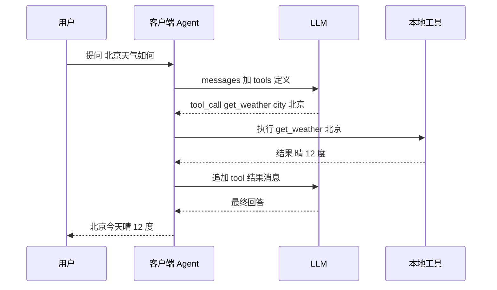

### Q237 · Function calling 的完整流程

> 难度:★★★★ | 标签:Agent, Function calling

**问**:描述一次 Function calling 从发起到完成的完整流程,模型真的执行了函数吗?

**答**:完整五步:1) 客户端把工具定义(名称、描述、JSON Schema 参数)随消息发给模型;2) 模型判断需要调用,返回结构化的 tool_call(函数名+参数 JSON),并不执行任何代码;3) 客户端解析参数、本地执行函数得到结果;4) 把结果以 tool 角色消息追加回对话再请求模型;5) 模型基于结果生成最终回答,或继续发起下一次调用。模型只负责"决定调什么、传什么参",执行永远在客户端。



```python
# file: code/06_Agent与LLM及系统设计/q237_function_calling.py
"""完整演示 Function calling 循环:模型只返回调用意图,客户端执行并回填。"""
import json


class FakeLLM:
    """第一轮返回 tool_call,第二轮基于工具结果生成回答。"""

    def __init__(self):
        self.turn = 0

    def chat(self, messages, tools=None):
        self.turn += 1
        if self.turn == 1:
            return {"tool_calls": [{"name": "get_weather",
                                    "arguments": {"city": "北京"}}]}
        tool_msg = next(m for m in messages if m["role"] == "tool")
        return f"根据查询结果回答:{tool_msg['content']}"


def get_weather(city: str) -> str:
    return json.dumps({"city": city, "weather": "晴", "temp_c": 12}, ensure_ascii=False)


TOOLS = {"get_weather": get_weather}


def agent_loop(llm, user_input: str, max_turns: int = 3) -> str:
    messages = [{"role": "user", "content": user_input}]
    for _ in range(max_turns):
        resp = llm.chat(messages, tools=list(TOOLS))
        if isinstance(resp, dict) and "tool_calls" in resp:
            for call in resp["tool_calls"]:
                result = TOOLS[call["name"]](**call["arguments"])
                messages.append({"role": "tool", "content": result})
            continue
        return resp
    return "达到最大轮数,终止"


if __name__ == "__main__":
    print(agent_loop(FakeLLM(), "北京天气如何?"))
```

**追问**:
- 模型返回的参数不合法怎么办?先做 JSON 解析与 Schema 校验,失败则把错误信息以 tool 消息回传,让模型自行修正参数重试。
- 为什么模型不执行代码?——安全边界:执行环境在客户端,模型只产意图;这让你能校验、限权、审计每次调用。
- 一轮能并发多个工具调用吗?——现代 API 支持返回多个 tool_call,相互独立的可并发执行后统一回填;有依赖的必须串行。
- 工具结果太大怎么办?——回填摘要+artifact 引用;全量塞回去既烧 token 又稀释注意力。
