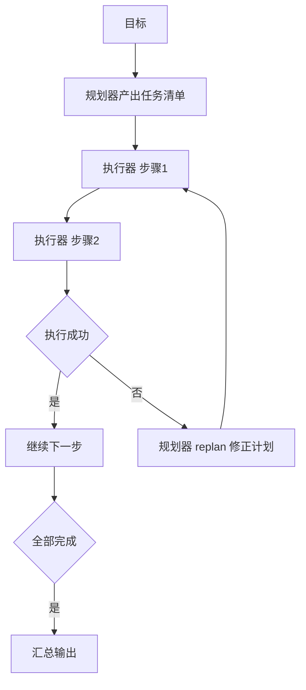

### Q242 · Plan-and-Execute 与 ReAct 的区别

> 难度:★★★ | 标签:Agent, 规划

**问**:Plan-and-Execute 模式是什么?什么场景选它而不是 ReAct?



**答**:Plan-and-Execute 先由规划器一次性产出完整任务清单(计划),再由执行器逐步执行,每步结果可反馈给规划器做 replan。与 ReAct 的差别:ReAct 是"边想边做",步间耦合紧、上下文膨胀快;Plan-and-Execute 是"先想清楚再做",计划全局可见、便于并行与人工审批,适合长任务、多子任务、可预估步骤的场景。ReAct 适合探索性强、步骤无法预知的任务。实践中常混合:规划器出计划,每个子任务内部用 ReAct 执行。

```python
# file: code/06_Agent与LLM及系统设计/q242_plan_execute.py
"""演示 Plan-and-Execute:规划器产出计划,执行器逐步执行并支持 replan。"""


class FakePlanner:
    def plan(self, goal: str) -> list[str]:
        return [f"1. 检索与「{goal}」相关的资料", "2. 提取关键数据", "3. 撰写摘要"]

    def replan(self, goal: str, done: list[str], failed: str) -> list[str]:
        return [f"重试: {failed}", "4. 汇总输出"]


class Executor:
    def execute(self, step: str) -> str:
        if step.startswith("2"):
            return "失败:资料为空"  # 模拟某一步失败
        return f"完成[{step[:8]}...]"


def plan_and_execute(planner, executor, goal: str) -> str:
    plan = planner.plan(goal)
    done, failed = [], None
    for step in plan:
        print(f"执行:{step}")
        result = executor.execute(step)
        if result.startswith("失败"):
            failed = step
            break
        done.append(step)
    if failed:
        print("触发 replan")
        for step in planner.replan(goal, done, failed):
            print(f"重新执行:{step} -> {executor.execute(step)}")
    return "任务结束"


if __name__ == "__main__":
    plan_and_execute(FakePlanner(), Executor(), "行业报告")
```

**追问**:
- replan 的触发时机?——子任务失败、计划与现实冲突(工具不存在、前置结果不符)、或关键中间结果改变假设;无脑每步 replan 等于退化成 ReAct。
- 计划怎么持久化?——任务清单(状态、依赖)存状态存储,支持断点恢复与人工审批插入;计划是 artifact 不是内存临时变量。
- 怎么评估规划质量?——轨迹评估:计划步数 vs 实际最优、子任务完成率、replan 次数;绕远路的计划结果对了也是成本问题。
