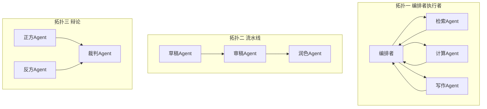

### Q246 · 多 Agent 协作有哪些常见拓扑

> 难度:★★★★ | 标签:Agent, 多Agent

**问**:多 Agent 系统有哪些常见协作模式?各自适用什么场景?

**答**:四种主流拓扑:1) 编排者-执行者:一个主 Agent 拆解任务分派给专职子 Agent,结果汇总,最常用、可控性最好;2) 流水线:Agent 按固定顺序接力(如写稿→审稿→改稿),适合流程明确的场景;3) 辩论/评审:多个 Agent 独立作答后互相批驳,取收敛结论,提升复杂推理质量但成本成倍;4) 群聊/自由协作:Agent 在共享消息板上自主交流,灵活但难控。选型原则:能用单 Agent 解决就不上多 Agent,协作结构越简单越可控。



```python
# file: code/06_Agent与LLM及系统设计/q246_multi_agent_tops.py
"""三种拓扑的最小可运行对比:编排者、流水线、辩论,全部 stub。"""


class StubAgent:
    def __init__(self, name, reply_fmt):
        self.name, self.fmt = name, reply_fmt

    def act(self, msg: str) -> str:
        return self.fmt.format(msg=msg)


# 拓扑一:编排者-执行者
def orchestrator(task: str) -> str:
    workers = {"检索": StubAgent("检索", "找到与{msg}相关的3篇资料"),
               "写作": StubAgent("写作", "基于[{msg}]写出草稿")}
    parts = [workers[k].act(task) for k in workers]
    return f"编排者汇总: {' | '.join(parts)}"


# 拓扑二:流水线
def pipeline(task: str) -> str:
    for agent in [StubAgent("草稿", "初稿:{msg}"),
                  StubAgent("审稿", "审后:{msg} 已修正"),
                  StubAgent("润色", "终稿:{msg}")]:
        task = agent.act(task)
    return task


# 拓扑三:辩论
def debate(topic: str, rounds: int = 2) -> str:
    pro, con = StubAgent("正方", "支持:{msg} 因为收益大"), StubAgent("反方", "反对:{msg} 因为风险高")
    msg = topic
    for _ in range(rounds):
        msg = f"{pro.act(msg)} VS {con.act(msg)}"
    return f"裁判裁决:{msg}"


if __name__ == "__main__":
    print(orchestrator("市场调研"))
    print(pipeline("新品介绍"))
    print(debate("是否上微服务"))
```

**追问**:
- 为什么「能单 Agent 就单 Agent」?——每加一个 Agent 就多一层上下文传递与失败点;多 Agent 的收益(分工、隔离)必须大于协调成本。
- 编排者会不会成为瓶颈?——会:所有消息过编排者,token 与延迟集中;所以子 Agent 上下文要裁剪、子任务粒度要够大。
- 辩论模式怎么控制成本?——限制轮数、判据收敛即停、裁判用小模型;高风险决策才值得花这个钱。
