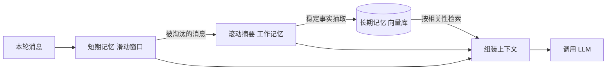

### Q251 · Agent 记忆系统分几层

> 难度:★★★ | 标签:Agent, 记忆

**问**:Agent 的记忆系统一般怎么分层?各自存什么、存多久?



**答**:经典三层:1) 短期记忆=当前对话 messages,存于内存,随上下文窗口淘汰;2) 工作记忆/会话摘要=历史对话的压缩版,跨轮保留,可持久化到 Redis;3) 长期记忆=用户画像、偏好、事实性知识,经向量化入库,按相关性检索注入。关键设计是"写入筛选"(不是所有话都值得长期记住)与"读取时机"(每轮注入相关记忆而非全量)。记忆还应支持 TTL、遗忘与用户可见可控(隐私要求)。

```python
# file: code/06_Agent与LLM及系统设计/q251_memory_layers.py
"""三层记忆的内存实现:短期窗口、滚动摘要、长期向量检索(假 embedding)。"""


class MemorySystem:
    def __init__(self, window_size: int = 3):
        self.window_size = window_size
        self.short_term: list[dict] = []
        self.summary: str = ""
        self.long_term: list[tuple[str, list[int]]] = []

    # ---- 短期:滑动窗口 ----
    def add_short(self, role: str, content: str):
        self.short_term.append({"role": role, "content": content})
        if len(self.short_term) > self.window_size * 2:
            dropped = self.short_term.pop(0)
            self._fold_to_summary(dropped)

    def _fold_to_summary(self, msg: dict):
        self.summary = (self.summary + " " + msg["content"])[:80]

    # ---- 长期:假向量检索 ----
    @staticmethod
    def fake_embed(text: str) -> list[int]:
        return [ord(c) % 10 for c in text[:8]]

    def add_long(self, fact: str):
        self.long_term.append((fact, self.fake_embed(fact)))

    def recall(self, query: str, k: int = 2) -> list[str]:
        qv = self.fake_embed(query)
        scored = sorted(self.long_term,
                        key=lambda x: -sum(a * b for a, b in zip(x[1], qv)))
        return [fact for fact, _ in scored[:k]]

    def build_context(self) -> list[dict]:
        msgs = []
        if self.summary:
            msgs.append({"role": "system", "content": f"历史摘要: {self.summary}"})
        if self.long_term:
            facts = self.recall("用户的偏好")
            msgs.append({"role": "system", "content": f"相关长期记忆: {facts}"})
        return msgs + self.short_term


if __name__ == "__main__":
    mem = MemorySystem(window_size=2)
    mem.add_long("用户偏好简洁回答")
    for i in range(4):
        mem.add_short("user", f"第{i}个问题,比较长的一句话")
    for m in mem.build_context():
        print(m["role"], ":", m["content"][:40])
```

**追问**:
- 记忆写入为什么需要筛选?——全量入库会让检索噪声淹没真正重要的记忆;用 LLM 判断「值得记吗」+ 用户显式让记的优先。
- 记忆的隐私怎么做?——用户可见、可删、可导出(合规硬要求);敏感字段入库前脱敏,TTL 自动遗忘。
- 记忆检索的排序因子?——相关性 × 重要度 × 时间衰减;纯相似度会把半年前的临时偏好排到当前需求前面。
