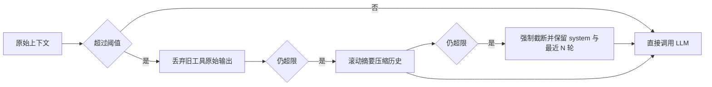

### Q255 · 上下文窗口管理与压缩策略

> 难度:★★★★ | 标签:Agent, 上下文

**问**:长 Agent 任务中,上下文管理有哪些具体策略?优先级怎么排?

**答**:策略按优先级:1) 能不塞就不塞——工具返回只保留关键字段,大结果存 artifact 传引用;2) 滑动窗口——丢最旧的低价值消息;3) 滚动摘要——压缩历史;4) 结构化槽位——把关键事实抽成固定字段常驻;5) 分段重开——子任务开新会话,只带摘要。编排原则:system 和当前任务指令永不丢弃,工具原始输出最先丢弃,越旧的历史越先牺牲。



```python
# file: code/06_Agent与LLM及系统设计/q255_context_compress.py
"""多级压缩管线:裁剪工具输出 -> 滚动摘要 -> 硬截断,保护 system 消息。"""


def token_est(messages) -> int:
    return sum(len(m["content"]) for m in messages) // 2


def compress(messages, budget: int) -> list[dict]:
    msgs = [dict(m) for m in messages]
    # 第一级:压缩旧的 tool 消息
    for m in msgs:
        if m["role"] == "tool" and len(m["content"]) > 20:
            m["content"] = m["content"][:20] + "...[已裁剪]"
    if token_est(msgs) <= budget:
        return msgs
    # 第二级:滚动摘要(此处用假摘要函数)
    system = msgs[0]
    rest = msgs[1:]
    keep = rest[-2:]
    summary = " ".join(m["content"][:8] for m in rest[:-2])
    msgs = [system, {"role": "system", "content": f"[历史摘要] {summary}"}] + keep
    # 第三级:硬截断
    while token_est(msgs) > budget and len(msgs) > 2:
        msgs.pop(2)
    return msgs


if __name__ == "__main__":
    raw = [{"role": "system", "content": "你是助手"}]
    for i in range(5):
        raw += [{"role": "user", "content": f"问题{i}" * 5},
                {"role": "tool", "content": "工具返回了一大段很长的结果数据" * 3}]
    print("压缩前 token≈", token_est(raw))
    out = compress(raw, budget=40)
    print("压缩后 token≈", token_est(out), "消息数", len(out))
    for m in out:
        print(" ", m["role"], m["content"][:24])
```

**追问**:
- 工具结果怎么瘦身?——只回填业务需要的关键字段,全文存 artifact;LLM 要的是「能决策的最小信息」。
- 为什么静态内容放前、动态放后?——前缀缓存要求前缀稳定,system/工具定义在前吃缓存折扣,变化的历史在后。
- 分段重开的时机?——子任务边界(进入新独立任务)时开新会话只带摘要;拖着旧上下文跨任务既烧钱又串扰。
