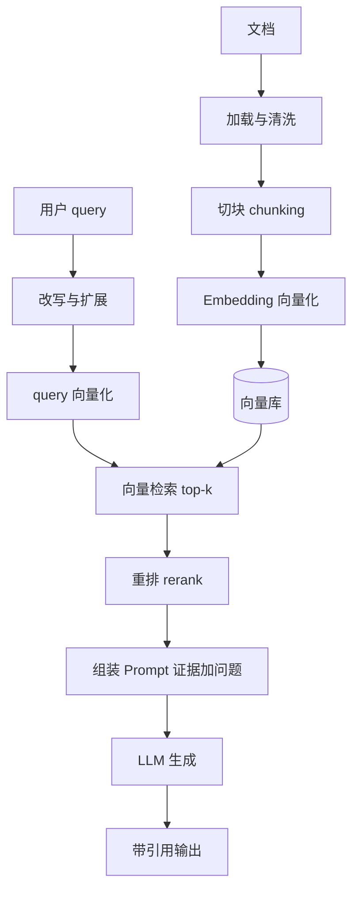

### Q256 · RAG 的完整链路是什么

> 难度:★★★★ | 标签:RAG, 架构

**问**:请描述 RAG 从文档到答案的完整链路,每一步的失败会表现成什么样?

**答**:离线链路:文档加载 → 清洗 → 切块 → Embedding → 入向量库。在线链路:用户 query(可选改写)→ 向量化 → 检索 top-k → 重排 → 组装 Prompt → 生成 → 引用标注。典型故障映射:切块破坏语义 → 检索到碎片、答案牛头不对马嘴;embedding 领域不匹配 → 检索命中率低、模型靠参数瞎答(幻觉);重排缺失 → top-k 噪声挤占上下文;Prompt 未要求引用 → 无法溯源。RAG 的本质是"把开放生成约束在检索证据之内"。



```python
# file: code/06_Agent与LLM及系统设计/q256_rag_pipeline.py
"""最小 RAG 全链路:假 embedding + 假检索 + FakeLLM 生成,验证数据流转。"""


def fake_embed(text: str) -> list[int]:
    return [ord(c) % 7 for c in text[:8].ljust(8, "x")]


def dot(a, b):
    return sum(x * y for x, y in zip(a, b))


class VectorStore:
    def __init__(self):
        self.vectors: list[tuple[str, list[int]]] = []

    def add(self, chunks: list[str]):
        self.vectors += [(c, fake_embed(c)) for c in chunks]

    def search(self, query: str, k: int = 2) -> list[str]:
        qv = fake_embed(query)
        ranked = sorted(self.vectors, key=lambda x: -dot(x[1], qv))
        return [c for c, _ in ranked[:k]]


class FakeGenLLM:
    def chat(self, messages):
        ctx = next(m["content"] for m in messages if m["role"] == "system")
        return f"根据检索证据回答:{ctx[:30]}..."


def rag_answer(store, llm, query: str) -> str:
    topk = store.search(query, k=2)
    context = "\n".join(f"[片段{i}] {c}" for i, c in enumerate(topk))
    messages = [{"role": "system", "content": context},
                {"role": "user", "content": query}]
    return llm.chat(messages)


if __name__ == "__main__":
    store = VectorStore()
    store.add(["RAG 通过检索外部知识增强大模型回答",
               "向量数据库支持近似最近邻搜索 ANN",
               "今天的天气是晴天,气温 12 度"])
    print(rag_answer(store, FakeGenLLM(), "什么是 RAG?"))
```

**追问**:
- RAG 一定优于长上下文直塞吗?知识库大、更新频繁、要求溯源时 RAG 优;单文档小场景直接塞全文更简单且无检索损耗。
- 「切块破坏语义」长什么样?——答案引用半个表格/半句话,答非所问;切块策略要按文档结构优先而非固定长度。
- 检索失败时模型会怎样?——靠参数记忆自由发挥,即幻觉;所以要有检索置信度门槛,低置信明确说「未找到」。
- 引用标注怎么做?——生成时要求标注片段 id,前端映射到原文高亮;无引用的断言在展示层降权或标记。
