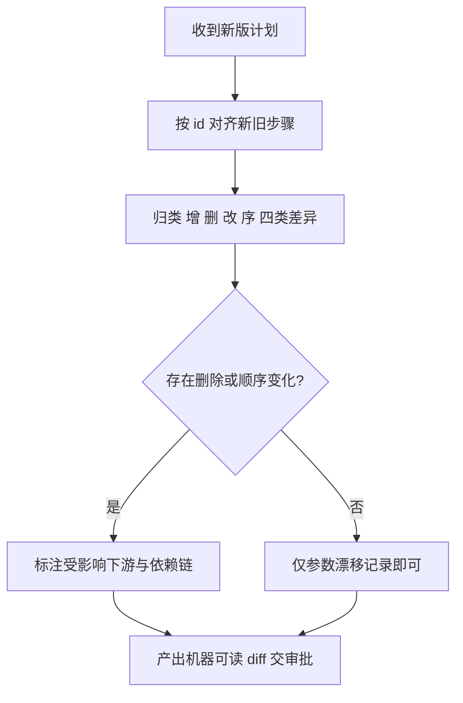

### Q2563 · Agent 计划的版本对比:步骤增删改与顺序四类归并

> 难度:★★★☆ | 标签:Agent, 计划管理, diff

**问**:LLM 重写了一版执行计划,你怎么快速判断这版计划改了什么、能不能放心执行?

**答**:先把计划表示成带稳定 id 的步骤列表,这是 diff 的前提;没有 id 就只能整段文本比对,产出的是噪音。对齐方式是按 id 求集合差:新增、删除一目了然,共有的步骤逐字段比对找出参数变更,再用保留步骤在两版里的出现顺序判断是否调序。产出物是机器可读的四类归并 diff,而不是一段"改动说明",审批和回归消费同一份数据。工程上要特别注意删除项:被删步骤的 id 是否还被别的步骤引用,是下一步风险分级的输入。这套 diff 也常用于审计:证明线上跑的计划和评审过的计划逐字段一致。



```python
# file: code/06_Agent与LLM及系统设计/q2563_plan_diff.py
"""Q2563 Agent 计划的版本对比:步骤增删改与顺序变化四类归并。

计划被重写后,先用 id 对齐新旧两版,再按 增/删/改/序 四类归并差异,
产出机器可读的 diff,供审批、审计与回归使用。
"""


def index_plan(plan):
    return {step["id"]: step for step in plan}


def diff_plans(old, new):
    oi, ni = index_plan(old), index_plan(new)
    added = sorted(set(ni) - set(oi))
    removed = sorted(set(oi) - set(ni))
    changed = sorted(sid for sid in set(oi) & set(ni) if oi[sid] != ni[sid])
    seq_old = [s["id"] for s in old if s["id"] in ni]
    seq_new = [s["id"] for s in new if s["id"] in oi]
    return {"added": added, "removed": removed, "changed": changed,
            "reordered": seq_old != seq_new}


def main():
    old = [
        {"id": "s1", "tool": "search", "kw": "财报"},
        {"id": "s2", "tool": "extract", "src": "s1"},
        {"id": "s3", "tool": "summary", "src": "s2"},
    ]
    new = [
        {"id": "s2b", "tool": "crawl", "url": "x"},    # 新增
        {"id": "s3", "tool": "summary", "src": "s2"},  # 保留但挪到 s1 前
        {"id": "s1", "tool": "search", "kw": "年报"},  # 参数漂移
    ]
    d = diff_plans(old, new)
    assert d["added"] == ["s2b"], d
    assert d["removed"] == ["s2"], d
    assert d["changed"] == ["s1"], d
    assert d["reordered"] is True, d
    print("新增:", d["added"])
    print("删除:", d["removed"])
    print("参数变更:", d["changed"])
    print("顺序有变化:", d["reordered"])


if __name__ == "__main__":
    main()
```

**追问**:
- 追问一:步骤没有稳定 id 怎么办?答:用工具名加参数指纹做模糊对齐,但要在 diff 里标出匹配置信度,低置信度按新增加删除处理。
- 追问二:和文本 diff 有什么区别?答:文本 diff 面向渲染,结构 diff 面向执行语义,后者才能回答哪条依赖链被断了。
