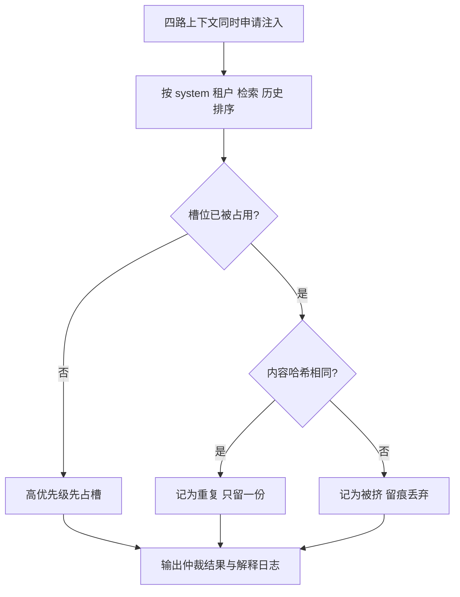

### Q2565 · 上下文注入的优先级仲裁:多来源抢同一槽位

> 难度:★★★☆ | 标签:Agent, 上下文, 优先级

**问**:系统策略、租户画像、检索结果、历史摘要都想往上下文里写,冲突了听谁的?

**答**:先固定一个全局优先级序,比如 system 高于 tenant 高于 retrieved 高于 history,来源序就是裁决序,不再一事一议。同一槽位被多个来源申请时,高优先级先占,后来者若内容哈希相同记为重复只留一份,不同则记为被挤并丢弃,两种情况都留痕。仲裁的价值在于可解释:事后能回答"上下文里为什么没有这段检索结果",是重复还是被策略挤掉,一句话说清。实现上按优先级排序后线性扫一遍即可,槽位用首占制,避免低优先级内容先行造成覆盖混乱。要点是同一来源内部也要去重,检索多路召回撞车是重复注入的常见来源。



```python
# file: code/06_Agent与LLM及系统设计/q2565_injection_arbitration.py
"""Q2565 上下文注入的优先级仲裁:多来源抢同一槽位。

系统策略、租户画像、检索结果、历史摘要都想往上下文里塞内容,
按固定优先级仲裁:同槽位高优先级先占,同内容去重只留一份,
被挤掉的要留痕,方便事后解释上下文里为什么没有它。
"""
import json

PRIORITY = {"system": 0, "tenant": 1, "retrieved": 2, "history": 3}


def arbitrate(items):
    ordered = sorted(items, key=lambda x: PRIORITY[x["source"]])
    slots = {}
    for it in ordered:
        h = json.dumps(it["content"], ensure_ascii=False, sort_keys=True)
        rec = slots.setdefault(it["slot"],
                               {"kept": it, "hashes": {h}, "dup": [], "dropped": []})
        if rec["kept"] is not it:
            if h in rec["hashes"]:
                rec["dup"].append(it["source"])
            else:
                rec["hashes"].add(h)
                rec["dropped"].append(it["source"])
    return slots


def main():
    items = [
        {"source": "history", "slot": "facts", "content": "用户在杭州"},
        {"source": "retrieved", "slot": "facts", "content": "用户在杭州"},
        {"source": "tenant", "slot": "style", "content": "正式语气"},
        {"source": "system", "slot": "style", "content": "正式语气"},
        {"source": "history", "slot": "style", "content": "口语化"},
    ]
    slots = arbitrate(items)
    assert slots["style"]["kept"]["source"] == "system", slots["style"]
    assert slots["style"]["dup"] == ["tenant"], slots["style"]
    assert slots["style"]["dropped"] == ["history"], slots["style"]
    assert slots["facts"]["kept"]["source"] == "retrieved"
    assert slots["facts"]["dup"] == ["history"]
    print("style 胜者:", slots["style"]["kept"]["source"],
          "重复:", slots["style"]["dup"], "被挤:", slots["style"]["dropped"])
    print("facts 胜者:", slots["facts"]["kept"]["source"], "重复:", slots["facts"]["dup"])


if __name__ == "__main__":
    main()
```

**追问**:
- 追问一:为什么用内容哈希而不是原文比对?答:哈希规整了键序和空白,序列化方式不同但语义相同的内容也能去重。
- 追问二:被挤掉的内容就永远丢了吗?答:留痕后可进溢出区,下轮窗口有空位时按优先级回补。
