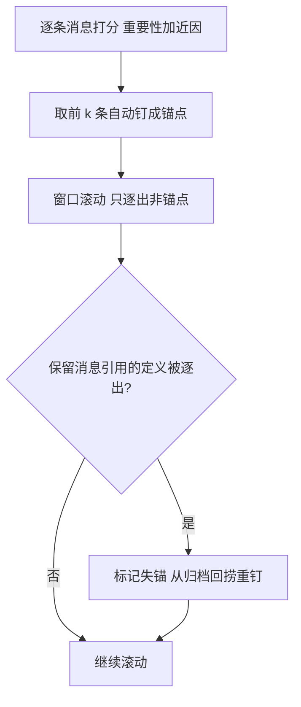

### Q2568 · 锚点的自动选取与失锚检测:定义被逐出要报警回捞

> 难度:★★★★ | 标签:Agent, 会话, 记忆

**问**:锚点不能全靠人工钉,自动选锚怎么打分?怎么发现"该锚的没锚上"?

**答**:自动选锚用重要性加近因性打分:消息类型有先验权重,任务目标、约束条件天然高于闲聊,再叠加近几轮的活跃度加成,取 top-k 钉住。失锚检测是配套的报警器:被保留的消息引用了某个术语,而这个术语的定义消息已被逐出,就是失锚,典型表现是 Agent 后面开始用错概念。检测实现可以从简,定义消息带"定义:X"模式,保留消息做词面匹配即可覆盖大半场景。处置不是重跑而是回捞:从归档把定义消息取回重新钉住,成本远低于让 Agent 带病运行。这套机制的价值在于把上下文完整性变成可检测的状态,而不是靠人盯着翻记录。



```python
# file: code/06_Agent与LLM及系统设计/q2568_anchor_select.py
"""Q2568 锚点的自动选取与失锚检测:定义被逐出要能报警并回捞。

重要性加近因性给消息打分,分高的自动钉成锚点;被保留消息引用了
某个术语,而该术语的定义消息已被逐出,就是失锚,要从归档回捞重钉。
"""
import re

WEIGHT = {"goal": 5.0, "constraint": 4.0, "fact": 2.0, "chat": 1.0}


def score(msg, turn):
    return WEIGHT.get(msg["kind"], 1.0) + max(0.0, 3.0 - (turn - msg["turn"]))


def pick_anchors(history, turn, k):
    ranked = sorted(history, key=lambda m: -score(m, turn))
    return {m["id"] for m in ranked[:k]}


def detect_lost_anchor(kept, evicted):
    defined = {}
    for m in evicted:
        found = re.search(r"定义[:：](\w+)", m["text"])
        if found:
            defined[found.group(1)] = m["id"]
    lost = []
    for m in kept:
        for term, src in defined.items():
            if term in m["text"] and m["id"] != src:
                lost.append((m["id"], term, src))
    return lost


def main():
    history = [
        {"id": "m1", "kind": "goal", "turn": 1, "text": "目标:输出季度复盘"},
        {"id": "m2", "kind": "constraint", "turn": 2, "text": "定义:ACV 为年度合同额"},
        {"id": "m3", "kind": "chat", "turn": 3, "text": "再聊聊 ACV 口径"},
        {"id": "m4", "kind": "chat", "turn": 4, "text": "ACV 记不算服务费"},
    ]
    anchors = pick_anchors(history, turn=4, k=1)
    assert anchors == {"m1"}, anchors
    kept = [m for m in history if m["id"] in anchors] + [history[3]]
    kept_ids = {m["id"] for m in kept}
    evicted = [m for m in history if m["id"] not in kept_ids]
    assert {m["id"] for m in evicted} == {"m2", "m3"}, evicted
    lost = detect_lost_anchor(kept, evicted)
    assert lost == [("m4", "ACV", "m2")], lost
    print("自动锚点:", sorted(anchors), "→ 定义消息 m2 被逐出")
    print("失锚检测:", lost, "→ 从归档回捞 m2 重新钉住")


if __name__ == "__main__":
    main()
```

**追问**:
- 追问一:词面匹配抓不住代词指代怎么办?答:指代回填在逐出前做,把"它"还原成实体词再进窗口,别指望逐出后还能补。
- 追问二:k 怎么定?答:锚点总量设窗口的固定比例配额,超了按分数排队,分数同分时近因优先。
