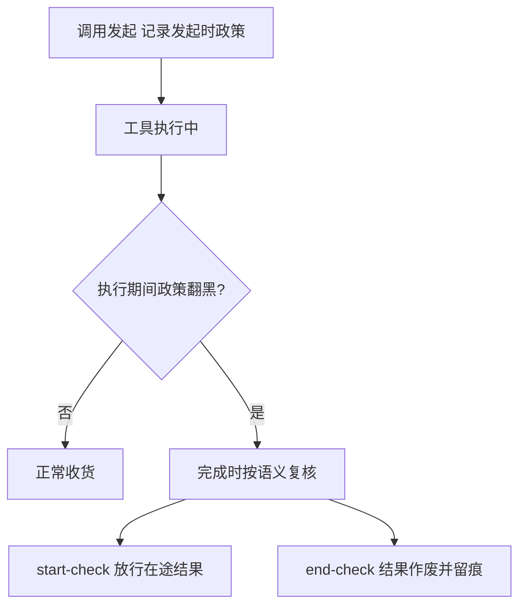

### Q2572 · 切换的生效边界:在途调用按发起时还是结束时算

> 难度:★★★★ | 标签:Agent, 工具治理, 一致性

**问**:调用发起时合法,执行到一半政策翻黑,这个结果算数吗?

**答**:这是热切换最容易被忽略的语义洞:调用是长时操作,政策是瞬时快照,两者之间有时间差。start-check 按发起时的政策放行,延迟低、实现简单,但敏感工具上等于给了政策切换前的最后一班车;end-check 在完成时再复核一次,期间翻黑则结果作废并留痕。选择按工具敏感度分:读缓存类工具 start-check 无妨,写操作、外发、支付类一律 end-check。实现上发起时记下政策版本,完成时比对版本与策略,版本不一致就走作废路径。工程要点是作废也有成本:工具的副作用可能已经发生,所以高危工具应该设计成可撤销副作用或干脆两阶段提交。



```python
# file: code/06_Agent与LLM及系统设计/q2572_switch_boundary.py
"""Q2572 切换的生效边界:在途调用按发起时还是结束时政策算。

调用发起时合法、完成时政策已翻黑,结果算不算数?start-check
按发起时政策放行,延迟低但对危险工具不安全;end-check 在完成时
复核,期间翻黑立即作废结果,敏感工具一律推荐 end-check。
"""


class Executor:
    def __init__(self):
        self.policy = {"search": "allow"}
        self.version = 1
        self.events = []

    def flip(self, tool, mode, reason):
        self.policy[tool] = mode
        self.version += 1
        self.events.append("v" + str(self.version) + ":" + tool + "=" + mode + "(" + reason + ")")

    def run(self, tool, semantics, mid_hook=None):
        start_ok = self.policy.get(tool) == "allow"
        if mid_hook:
            mid_hook()  # 模拟工具在途期间政策切换
        end_ok = self.policy.get(tool) == "allow"
        if semantics == "start-check":
            return start_ok
        return start_ok and end_ok


def main():
    ex1 = Executor()
    ex2 = Executor()

    def flip1():
        ex1.flip("search", "deny", "审计叫停")

    def flip2():
        ex2.flip("search", "deny", "审计叫停")

    r1 = ex1.run("search", "start-check", flip1)
    r2 = ex2.run("search", "end-check", flip2)
    assert r1 is True and r2 is False
    assert ex1.version == 2 and ex2.version == 2
    print("start-check 在途放行:", r1, "← 危险工具不安全")
    print("end-check 完成时复核:", r2, "← 结果作废,敏感工具推荐")
    print("切换事件:", ex2.events)


if __name__ == "__main__":
    main()
```

**追问**:
- 追问一:作废的结果下游已经拿到怎么办?答:作废决定要广播,下游按撤回通知清理,这就要求结果带可追踪的调用 id。
- 追问二:end-check 会不会误伤正常调用?答:会,所以只有高危工具走 end-check,且翻黑事件本身少见,误伤率可控。
