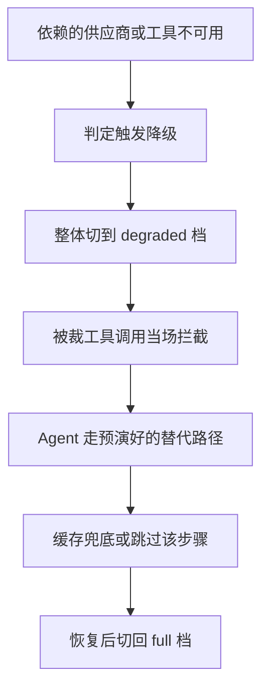

### Q2576 · 降级模式的最小工具集:能力降配核心链路不断

> 难度:★★☆☆ | 标签:Agent, 降级, 工具治理

**问**:上游依赖挂了一半,Agent 是整体罢工还是带伤干活?

**答**:提前把工具集按运行模式配成档位:full 全量,degraded 只留核心链路必需的工具,切档是整体生效而不是散装关闭。被裁工具的调用当场拦截,错误信息带上当前模式名,Agent 按预演过的替代路径走:检索不可用就走缓存兜底,通知不可用就降级为落库待发。最小工具集是灾备预案的一部分,要定期演练,验证降级档下核心任务能走通,而不是挂在墙上的一张清单。恢复后切回 full 档,降级期间的替代路径选择全部留痕,复盘时能算出降级的业务代价。关键认知是:降级不是功能开关列表,是一套提前验证过的完整行为模式。



```python
# file: code/06_Agent与LLM及系统设计/q2576_min_toolset.py
"""Q2576 降级模式的最小工具集:能力降配但核心链路不断。

把工具集按运行模式配成档位:full 全量,degraded 只留核心;
降级触发时整体切档,被裁工具的调用当场拦截,Agent 按预演好的
替代路径走缓存兜底,而不是临场报错找不到路。
"""

PROFILES = {
    "full": {"search": "allow", "calc": "allow", "mail": "allow"},
    "degraded": {"search": "deny", "calc": "allow", "mail": "deny"},
}


class Agent:
    def __init__(self, profile):
        self.profile = profile

    def use(self, tool):
        if PROFILES[self.profile].get(tool) != "allow":
            raise PermissionError(tool + " 在 " + self.profile + " 模式不可用")
        return tool + "-ok"


def plan_route(agent, need_search):
    if need_search:
        try:
            agent.use("search")
            return "live-search"
        except PermissionError:
            return "cache-fallback"
    agent.use("calc")
    return "calc-path"


def main():
    full = Agent("full")
    assert plan_route(full, True) == "live-search"
    assert plan_route(full, False) == "calc-path"
    degraded = Agent("degraded")
    assert plan_route(degraded, True) == "cache-fallback"
    assert plan_route(degraded, False) == "calc-path"
    blocked = False
    try:
        degraded.use("mail")
        raise SystemExit(1)
    except PermissionError as exc:
        blocked = True
        print("最小工具集拦截:", exc)
    assert blocked, "mail 应被降级档拦截"
    print("full 模式:", plan_route(full, True))
    print("degraded 模式:", plan_route(degraded, True), "核心链路 calc 仍可用")


if __name__ == "__main__":
    main()
```

**追问**:
- 追问一:最小工具集怎么圈定?答:按核心任务的依赖闭包圈,任务关键路径上不可替代的才入选,可替代的留在 full 档。
- 追问二:降级档下质量下降谁来兜底?答:输出加降级标记透传给用户,免责声明和预期管理也是降级设计的一部分。
