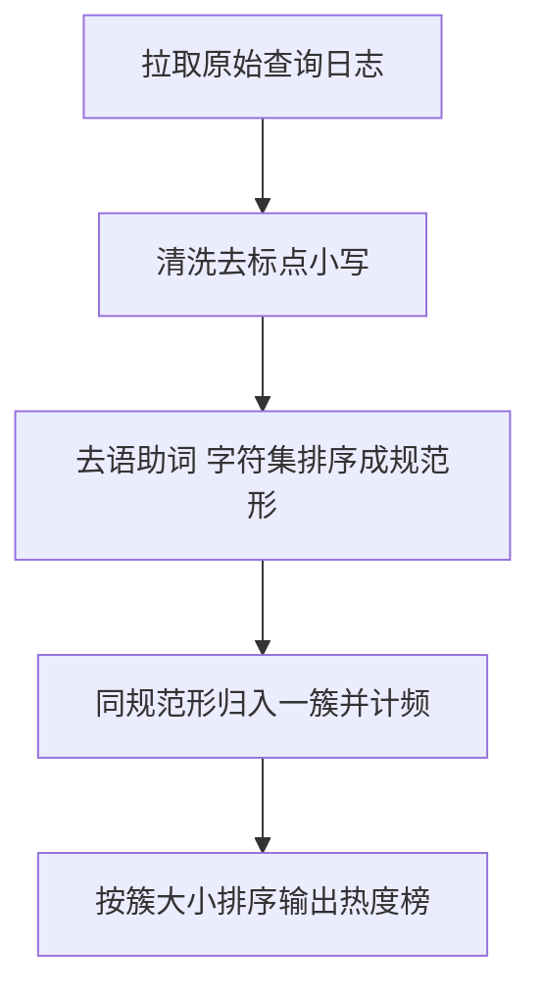

### Q2580 · 查询日志的频次聚类:归一化后按同型合并

> 难度:★★★☆ | 标签:RAG, 日志挖掘, 聚类

**问**:日志里"Python GIL 是什么""什么是 Python GIL"各占一条,热度统计全失真,怎么办?

**答**:先归一化再聚类:去标点、转小写、去掉"是什么""的吗"这类语助成分,再把剩余字符集排序成规范形,同规范形即同一意图,簇大小就是真实热度。字符集排序是中文查询的实用近似,词序变化完全免疫,代价是同字不同义会误合,对热度统计这个误差可接受。聚类的下游价值链是:热度榜指导缓存预热、语料补齐、FAQ 建设,头部簇和长尾要区别对待。注意归一化规则要版本化,规则一改热度榜就不可比,历史报表要标注用的哪版规则。更精细的语义聚类用嵌入加近邻,但频次统计场景归一化法便宜十倍且可解释。



```python
# file: code/06_Agent与LLM及系统设计/q2580_query_cluster.py
"""Q2580 查询日志的频次聚类:归一化后按同型合并计数。

日志里的查询十种写法一个意思:大小写 标点 词序 语助词都在抖。
先归一化成规范形(去标点 小写 字符集排序),同规范形即同一簇,
簇内计频,簇大小就是该意图的真实热度。
"""
import re
from collections import Counter

FILLER = set("的吗请一下什么哪些如何")


def normalize(q):
    q = re.sub(r"[^\w\u4e00-\u9fff]+", "", q.lower())
    return "".join(sorted(ch for ch in q if ch not in FILLER))


def cluster(queries):
    groups = {}
    for q in queries:
        groups.setdefault(normalize(q), []).append(q)
    return groups


def main():
    logs = ["Python GIL 是什么", "什么是 Python GIL", "python gil 是什么?",
            "GIL 的作用", "GIL 有什么用", "redis 持久化", "Redis 持久化!",
            "持久化 redis", "怎么买咖啡"]
    groups = cluster(logs)
    sizes = sorted((len(v) for v in groups.values()), reverse=True)
    assert sizes == [3, 3, 1, 1, 1], sizes
    top = max(groups.values(), key=len)
    assert top[0] == "Python GIL 是什么"
    rep = Counter(top).most_common(1)[0][0]
    print("簇数量:", len(groups), "簇大小分布:", sizes)
    print("最大簇成员:", top)
    print("代表查询:", rep)


if __name__ == "__main__":
    main()
```

**追问**:
- 追问一:为什么不用编辑距离聚类?答:编辑距离是两两比较,日志千万级开销不可接受,规范形是线性哈希式聚类。
- 追问二:多语言混合日志怎么处理?答:按语言路由分桶,各桶用自己的归一化规则,统计时再合并。
