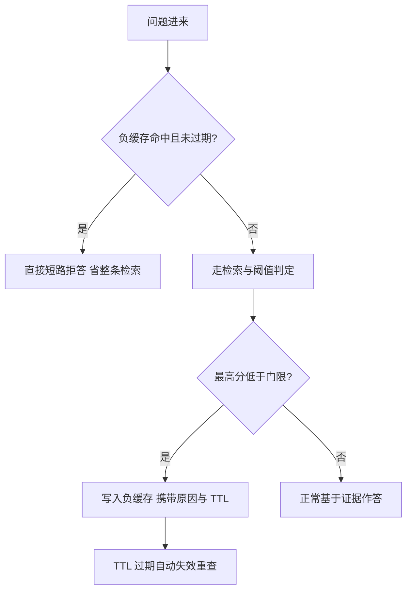

### Q2587 · 负缓存:已知无答案的问题不再重复检索

> 难度:★★★☆ | 标签:RAG, 缓存, 成本

**问**:同一个无答案的问题每天被问几百次,每次都全链路检索一遍,怎么止血?

**答**:负缓存把"确认无答案"也当成可缓存的结果:第一次检索判定最高分低于门限,把问题哈希连同拒答原因、TTL 写进缓存;TTL 内同问题直接短路,跳过整条召回重排链路,只剩一次哈希查找的成本。TTL 是安全的来源:语料持续更新,今天的无答案不等于永远无答案,过期自动重查,拒答永不陈旧。写入要挑场景:阈值边缘的判定别写,避免把"差一点就有答案"固化成拒答;明确的零分命中等强信号才写。指标要分开记:负缓存命中率、省下的检索次数、误缓存率——把可答问题错缓存的概率必须单独监控。负缓存和正缓存同构,只是缓存的值是"没有",工程上常被遗忘,成本收益却很实在。



```python
# file: code/06_Agent与LLM及系统设计/q2587_negative_cache.py
"""Q2587 负缓存:已知无答案的问题不再重复检索。

低分拒答的问题往往会被反复问:第一次检索确认无证据后,把问题
哈希连同原因写进负缓存,TTL 内直接短路拒答,省掉整条检索链路;
TTL 过期自动失效重查,语料更新后不会永远拒答。
"""
import hashlib


class NegativeCache:
    def __init__(self, ttl):
        self.ttl = ttl
        self.store = {}   # qhash -> (expire_at, reason)
        self.saved = 0

    @staticmethod
    def key(q):
        return hashlib.md5(q.encode("utf-8")).hexdigest()[:12]

    def put(self, q, now, reason):
        self.store[self.key(q)] = (now + self.ttl, reason)

    def get(self, q, now):
        rec = self.store.get(self.key(q))
        if rec is None:
            return None
        expire, reason = rec
        if now >= expire:
            del self.store[self.key(q)]
            return None
        self.saved += 1
        return reason


def fake_best_sim(q):
    """stub:确定性假相似度,只区分无证据与有证据两类问题。"""
    return 0.31 if "外星人" in q else 0.92


def pipeline(q, cache, now, stats):
    hit = cache.get(q, now)
    if hit is not None:
        stats["negative-hit"] += 1
        return "拒答:" + hit
    stats["retrieval"] += 1
    if fake_best_sim(q) < 0.8:
        cache.put(q, now, "语料中无相关证据")
        return "拒答:语料中无相关证据"
    stats["answered"] += 1
    return "基于证据作答"


def main():
    cache = NegativeCache(ttl=100)
    stats = {"retrieval": 0, "negative-hit": 0, "answered": 0}
    q = "地球上有外星人基地吗"
    r1 = pipeline(q, cache, 0, stats)
    r2 = pipeline(q, cache, 10, stats)
    assert r1 == r2 and stats["retrieval"] == 1 and stats["negative-hit"] == 1
    r3 = pipeline(q, cache, 200, stats)          # TTL 过期,重新检索
    assert stats["retrieval"] == 2 and stats["negative-hit"] == 1
    r4 = pipeline("什么是 RAG", cache, 0, stats)
    assert stats["answered"] == 1 and r4 == "基于证据作答"
    assert cache.saved == 1
    print("首次检索:", r1)
    print("负缓存命中:", r2, "← 省一次检索,TTL 内直接短路")
    print("TTL 过期后重查:", r3)
    print("可答问题不受影响:", r4)


if __name__ == "__main__":
    main()
```

**追问**:
- 追问一:语料更新怎么主动清负缓存?答:更新事件触发按语料版本段的批量失效,不做全清,避免命中率瞬间归零。
- 追问二:改写重试和负缓存冲突吗?答:不冲突,负缓存记的是改写归一后的意图哈希,改写前的变体都命中同一条。
