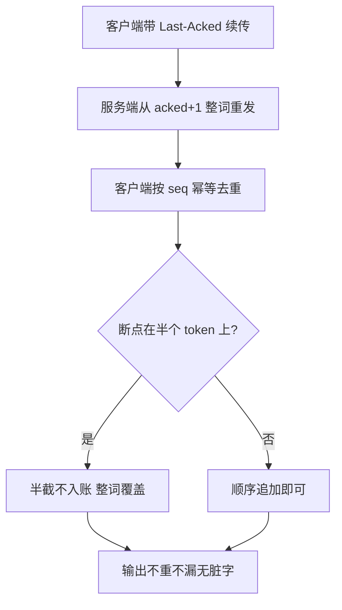

### Q2592 · 流式断点续传的语义:幂等去重与半截词分叉

> 难度:★★★★ | 标签:LLM 运维, 流式, 可靠性

**问**:流式中断重连,续传真正难定义的是什么?

**答**:难的不是重发,是两件事的语义:重复事件怎么幂等,断在半个 token 上怎么续。重复靠 seq 去重:服务端 at-least-once 从最后确认位起重放,可能多发,客户端只认没见过的序号,重复事件零成本丢弃,不重不漏由客户端保证。半截词是分叉点:断点落在 token 中间,半截内容绝不能入账拼接,否则恢复后出现"再见见"这种脏字;正确语义是从词边界整词重发,客户端用整词覆盖半截。这两条合起来定义了续传的契约:客户端状态只有已确认 seq 集合,服务端状态只有事件流本身,双方无共享状态也能对齐。实现时重放窗口要有上限,超出窗口的会话走整段重生成,别让无限重放拖垮服务端。



```python
# file: code/06_Agent与LLM及系统设计/q2592_stream_resume.py
"""Q2592 流式断点续传的语义:幂等去重与半截词的分叉处理。

续传必须定义两件事:重复事件怎么去重(客户端按 seq 幂等,
at-least-once 多发无害),断在半个 token 上怎么续(半截不入账,
服务端从词边界整词重发,客户端覆盖而不是拼接,不出脏字)。
"""

def server_stream(tokens, last_acked):
    """服务端从 last_acked+1 起重放,at-least-once,可能多给。"""
    return [(i, t) for i, t in enumerate(tokens) if i > last_acked]


def client_assemble(events, known):
    """客户端按 seq 幂等去重,只认没见过的序号。"""
    parts = []
    for seq, tok in sorted(events):
        if seq in known:
            continue
        known.add(seq)
        parts.append(tok)
    return "".join(parts)


def main():
    tokens = ["你好", ",", "世界", "!", "再见"]
    known = set()
    acked = 1                       # 客户端已确认 0、1 两个事件
    dup = server_stream(tokens, acked) * 2   # 网络层重发一份
    text = client_assemble(dup, known)
    assert text == "世界!再见", text  # 去重后不重不漏
    # 断在 再见 的半个词上:半截 不 入账,整词重发覆盖
    half = "再"
    replay = server_stream(tokens, acked)   # 服务端从边界整词重发
    text2 = client_assemble(replay, set())
    assert text2 == "世界!再见"
    assert half + "见" == "再见" and half not in text2.replace("再见", "")
    print("重复事件去重重组:", text)
    print("词边界续传:", text2, "| 半截", repr(half), "被整词覆盖,不拼接出脏字")


if __name__ == "__main__":
    main()
```

**追问**:
- 追问一:半截内容服务端要保存吗?答:不要,服务端按整词边界重放即可,半截是客户端本地显示态,保存它只会引入一致性问题。
- 追问二:seq 从哪里保证单调?答:服务端生成事件时分配,重启后从持久化位点续号,跨重启单调是契约的一部分。
