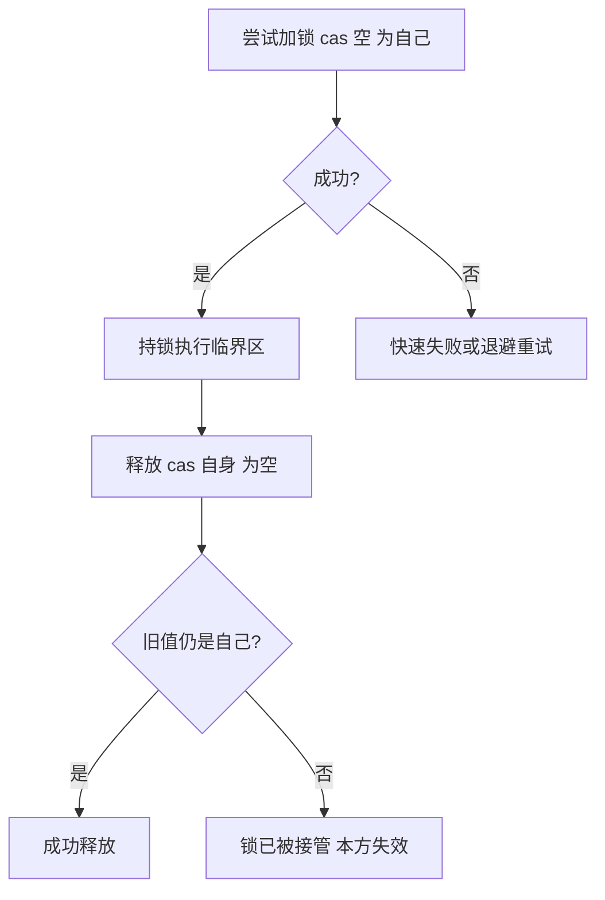

### Q2597 · 基于 CAS 的分布式互斥:谁能改锁由 CAS 说了算

> 难度:★★★★ | 标签:分布式, 锁, 一致性

**问**:不用现成的锁服务,一条原子的比较交换能撑起分布式互斥吗?

**答**:能,而且这条语义就是一切锁服务的内核:加锁是 cas 空为自身,释放是 cas 自身为空。它自动解决三个经典问题:互斥——同一时刻只有一个 cas 能成功;防误删——释放带旧值比对,B 冒名释放时旧值对不上必然失败;防接管后误释放——旧主迟到释放时锁值已是新主的,比对失败,新主无感。模拟里必须把 cas 写成单点原子操作,真实系统里对应 Redis 的 Lua、etcd 的事务、ZooKeeper 的版本号。CAS 互斥的短板在持有者崩溃:没人释放锁就死锁,这要靠下一题的 TTL 加 fencing 补齐。面试时能徒手写出这三个失败场景的推演,比背十种锁的实现更能证明理解。



```python
# file: code/06_Agent与LLM及系统设计/q2597_cas_mutex.py
"""Q2597 基于比较交换的分布式互斥:谁能改锁由 CAS 说了算。

分布式锁的本质是一条原子 CAS 语义:加锁 cas(空, 自己),释放
cas(自己, 空);释放带着自己的旧值比对,冒名者对不上旧值必然
失败——过期锁被别人接管后,旧主的迟到释放也伤不到新主。
"""


class Store:
    def __init__(self):
        self.kv = {}

    def cas(self, key, expect, new):
        """模拟原子的 compare-and-swap:当前值等于 expect 才写入。"""
        if self.kv.get(key) == expect:
            self.kv[key] = new
            return True
        return False


def acquire(store, owner, key="lock"):
    return owner + "#1" if store.cas(key, None, owner + "#1") else None


def release(store, owner, key="lock"):
    return store.cas(key, owner + "#1", None)


def main():
    s = Store()
    t1 = acquire(s, "A")
    assert t1 == "A#1" and s.kv["lock"] == "A#1"
    assert acquire(s, "B") is None        # B 抢不到
    assert release(s, "B") is False       # B 冒名释放被 CAS 拒绝
    assert s.kv["lock"] == "A#1", s.kv
    assert release(s, "A") is True
    assert s.kv["lock"] is None
    t2 = acquire(s, "B")
    assert t2 == "B#1" and release(s, "B") is True
    print("A 持锁,B 抢锁与冒名释放均失败")
    print("A 释放后 B 正常获取并释放:", t2)


if __name__ == "__main__":
    main()
```

**追问**:
- 追问一:锁值里放什么?答:持有者身份加过期时刻加 fencing 号,裸字符串锁在故障场景全是坑。
- 追问二:自旋重试还是快速失败?答:按调用语义,用户在线请求快速失败转降级,后台任务退避重试。
