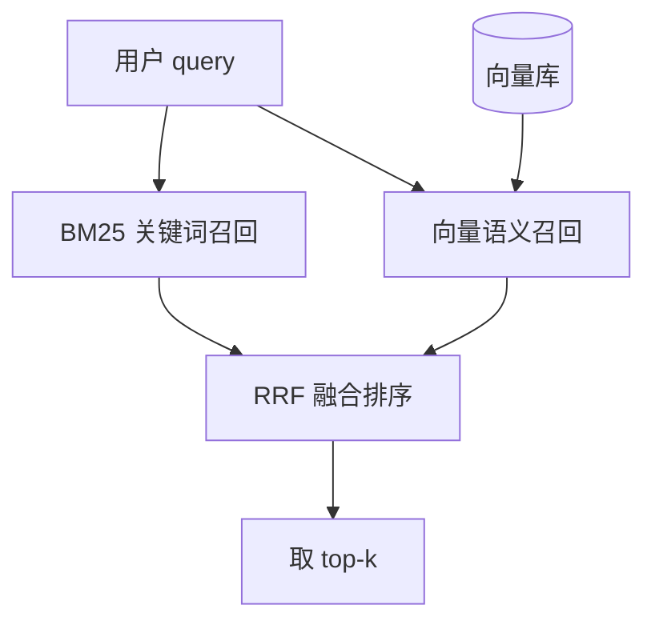

### Q260 · 混合检索怎么做

> 难度:★★★★ | 标签:RAG, 检索

**问**:为什么需要混合检索?BM25 和向量检索怎么融合?



**答**:纯向量检索对精确关键词(产品型号、错误码、人名)不敏感——embedding 会把细粒度差异抹平;纯 BM25 又不理解同义改写。混合检索 = BM25(关键词精确命中)+ 向量(语义泛化)并行召回,再融合排序。融合最常用 RRF(Reciprocal Rank Fusion):每路结果的排名倒数加权求和,`score = Σ 1/(k + rank_i)`,k 常取 60,优点是无需统一两路的分数量纲。也可用加权归一化分数融合,但需要调权。

```python
# file: code/06_Agent与LLM及系统设计/q260_hybrid_search.py
"""混合检索:BM25 模拟 + 向量检索并行召回,RRF 融合排序。"""


def bm25_scores(query: str, docs: list[str]) -> dict[int, float]:
    """极简词频打分,模拟 BM25 的关键词倾向。"""
    terms = query.split()
    return {i: sum(d.count(t) for t in terms) for i, d in enumerate(docs)}


def vector_scores(query: str, docs: list[str]) -> dict[int, float]:
    def emb(t):
        return [ord(c) % 7 for c in t[:6].ljust(6, "x")]
    qv = emb(query)
    return {i: sum(a * b for a, b in zip(qv, emb(d))) for i, d in enumerate(docs)}


def rrf_fuse(rankings: list[list[int]], k: int = 60) -> list[int]:
    scores: dict[int, float] = {}
    for ranking in rankings:
        for rank, doc_id in enumerate(ranking, start=1):
            scores[doc_id] = scores.get(doc_id, 0) + 1.0 / (k + rank)
    return sorted(scores, key=lambda d: -scores[d])


def hybrid_search(query: str, docs: list[str], top_k: int = 3) -> list[int]:
    bm25_rank = [i for i, _ in sorted(bm25_scores(query, docs).items(), key=lambda x: -x[1])]
    vec_rank = [i for i, _ in sorted(vector_scores(query, docs).items(), key=lambda x: -x[1])]
    return rrf_fuse([bm25_rank, vec_rank])[:top_k]


if __name__ == "__main__":
    docs = ["错误码 ERR_5002 表示网关超时",
            "网关服务出现超时问题如何排查",
            "团队介绍与招聘信息"]
    print("BM25 路径:", sorted(bm25_scores("ERR_5002 超时", docs).items(), key=lambda x: -x[1]))
    print("RRF 融合结果:", hybrid_search("ERR_5002 超时", docs))
```

**追问**:
- RRF 的 k 参数影响什么?——k 越大排名差距越平滑,头部与尾部分数接近;k=60 是经验值,极端头部权威场景可调小。
- 两路召回的 top-k 怎么定?——BM25 与向量各召回 50-100,融合后 rerank 取 3-5;两路过小会漏,过大烧 rerank 算力。
- 中文场景 BM25 要注意什么?——分词器(ik/jieba)质量直接决定 BM25 效果;未分词的 BM25 在中文上基本不可用。
