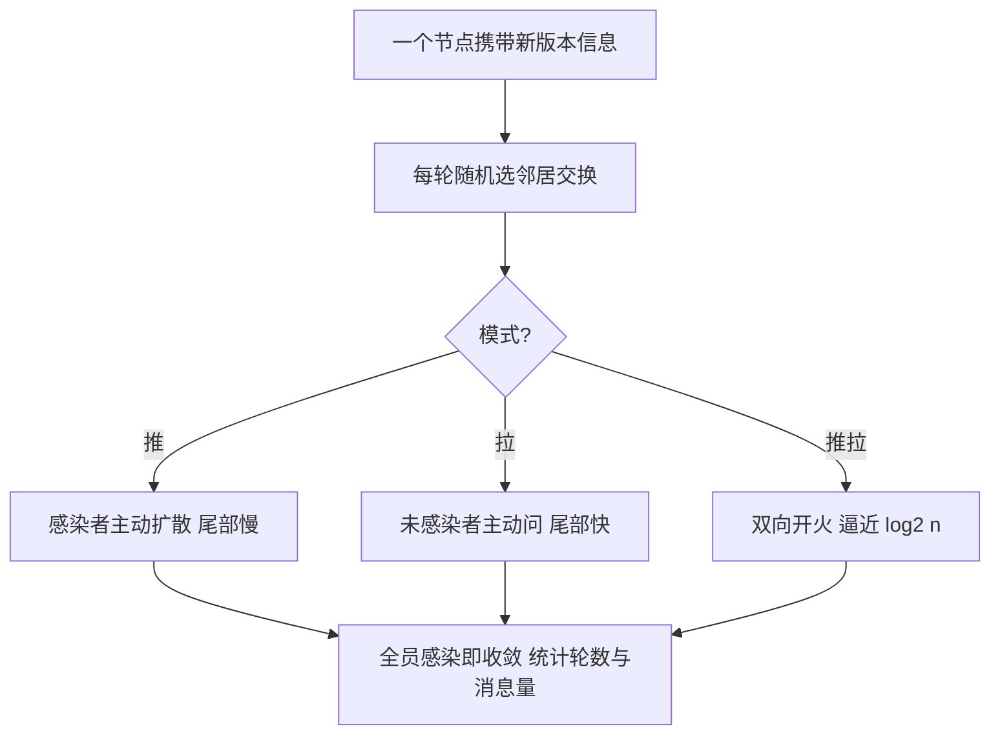

### Q2601 · Gossip 推与拉的收敛实测:轮数逼近 log2 n

> 难度:★★★☆ | 标签:分布式, Gossip, 协议

**问**:Gossip 协议说几轮就收敛,推和拉有区别吗?实测说话。

**答**:固定种子跑三模式对比:推是感染者主动扩散,前期翻倍极快,但最后几个未感染者要靠运气被撞中,尾部收敛慢;拉是未感染者主动问,尾部反而快,因为它每轮都在出击;推拉结合双向开火,轮数最贴近理论下限 log2 n。本例 32 节点,理论下限 5 轮,推拉模式固定种子下优于单推单拉。Gossip 的工程价值在无中心成员管理、故障传播、配置分发,代价是消息冗余:全员感染前的消息数远大于节点数,推模式尤甚。参数就一个——每轮选几个邻居,扇出加一轮收敛快但总消息涨,按集群规模和容忍时延定。实测必须固定随机种子,否则每次数字不同,演示变成玄学。



```python
# file: code/06_Agent与LLM及系统设计/q2601_gossip_sim.py
"""Q2601 Gossip 推与拉的收敛实测:固定种子下比较轮数与消息量。

推模式传播快但尾部慢:最后几个未感染节点要靠运气撞上;
拉模式让未感染者主动出击,尾部收敛更快;推拉结合双向开火,
轮数逼近理论下限 log2 n。固定种子可复现。
"""
import math
import random


def simulate(n, mode, seed, rounds_cap=60):
    rng = random.Random(seed)
    informed = [False] * n
    informed[0] = True
    msgs = 0
    for r in range(rounds_cap):
        new = list(informed)
        for i in range(n):
            peer = rng.randrange(n)
            if peer == i:
                continue
            if mode == "push" and informed[i] and not informed[peer]:
                msgs += 1
                new[peer] = True
            elif mode == "pull" and informed[peer] and not informed[i]:
                msgs += 1
                new[i] = True
            elif mode == "push-pull" and informed[i] != informed[peer]:
                msgs += 1
                new[i] = new[peer] = True
        informed = new
        if all(informed):
            return r + 1, msgs
    return None, msgs


def main():
    n = 32
    results = {}
    for mode in ("push", "pull", "push-pull"):
        rounds, msgs = simulate(n, mode, seed=42)
        assert rounds is not None, mode + " 未收敛"
        results[mode] = (rounds, msgs)
    assert results["push-pull"][0] <= results["push"][0], results
    assert results["push-pull"][0] <= results["pull"][0], results
    print("n =", n, "理论下限 log2 n =", math.ceil(math.log2(n)))
    for mode, (r, m) in sorted(results.items(), key=lambda kv: kv[1][0]):
        print(mode, "收敛轮数:", r, "成功传播消息数:", m)


if __name__ == "__main__":
    main()
```

**追问**:
- 追问一:信息会永远传下去吗?答:会,所以要带版本或 TTL,收到已知版本的传播直接丢弃,否则消息量不收敛。
- 追问二:节点中途加入怎么办?答:新节点先拉一轮全量,再进入 gossip 循环,纯推协议对新成员不友好。
