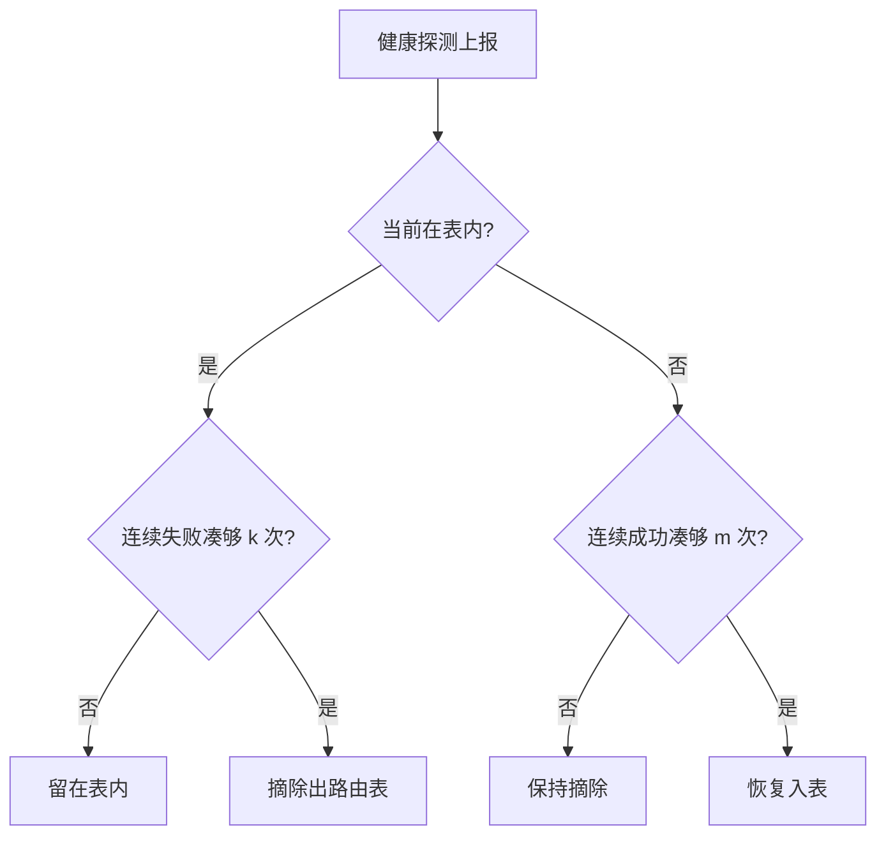

### Q2604 · 路由表更新的滞回:抖动副本不许反复进出

> 难度:★★★☆ | 标签:分布式, 路由, 稳定性

**问**:副本健康检查一好一坏地抖,路由表每秒进出一次,怎么稳住?

**答**:滞回门给摘除与恢复设不对称的门槛:连续 k 次失败才摘,连续 m 次成功才恢复,m 大于 k,坏得快、回得慢,偏向保守。对照实验最有说服力:每拍翻转的抖动副本,朴素门翻转 47 次,连接池和调用方跟着抽风;滞回门下抖动凑不够连击数,翻转 0 次,稳在表内。真坏的副本也不会被滞回包庇:连续失败凑够门槛照样摘除,恢复仍需连续成功,摘除与恢复各走各的计数器。参数 k 与 m 按探测频率折算时间窗,摘除窗口要短于用户可感知的故障时延。状态切换全留痕,进出各多少次是路由稳定性的核心指标,趋势恶化要查探测灵敏度。



```python
# file: code/06_Agent与LLM及系统设计/q2604_hysteresis.py
"""Q2604 路由表更新的滞回:抖动副本不许反复进出。

健康抖动的副本若一 fail 就摘、一 ok 就回,路由表反复震荡,
连接池跟着抽风;滞回要求连续 k 次失败才摘除、连续 m 次成功
才恢复,抖动信号凑不够连击数,副本稳在表内。
"""


class HealthGate:
    def __init__(self, fail_to_remove, ok_to_restore):
        self.f2r = fail_to_remove
        self.o2s = ok_to_restore
        self.in_table = True
        self.fails = 0
        self.oks = 0
        self.flips = 0

    def report(self, healthy):
        if healthy:
            self.fails = 0
            self.oks += 1
            if not self.in_table and self.oks >= self.o2s:
                self.in_table = True
                self.flips += 1
        else:
            self.oks = 0
            self.fails += 1
            if self.in_table and self.fails >= self.f2r:
                self.in_table = False
                self.flips += 1


def main():
    flappy = [True, False] * 24              # 每拍翻转的抖动副本
    naive = HealthGate(1, 1)
    hyst = HealthGate(2, 3)
    for h in flappy:
        naive.report(h)
        hyst.report(h)
    assert naive.flips == 47, naive.flips    # 首拍免翻转,此后每拍一翻
    assert hyst.flips == 0 and hyst.in_table, (hyst.flips, hyst.in_table)
    bad = HealthGate(2, 3)
    bad.report(False)
    assert bad.in_table is True                # 单次失败不动
    bad.report(False)
    assert bad.in_table is False and bad.flips == 1   # 连续 2 失败才摘
    bad.report(True)
    assert bad.in_table is False               # 单次成功不回
    for _ in range(2):
        bad.report(True)
    assert bad.in_table is True and bad.flips == 2    # 连续 3 成功才恢复
    print("抖动副本:朴素门翻转", naive.flips, "次 vs 滞回门", hyst.flips, "次")
    print("真坏副本:摘除后恢复也需连击,状态切换共", bad.flips, "次")


if __name__ == "__main__":
    main()
```

**追问**:
- 追问一:滞回会不会让真坏副本多活一会儿?答:会,这是用秒级延迟换掉分钟级震荡,止损窗口内还有重试与超时兜底。
- 追问二:探测本身抖怎么办?答:多探测源投票再加滞回,两层平滑,单源抖动到不了路由表。
