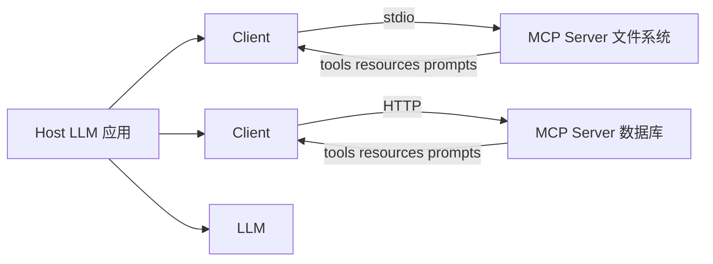

### Q267 · MCP 协议是什么

> 难度:★★★ | 标签:Agent, MCP

**问**:介绍 MCP 协议,它解决了什么问题?

**答**:MCP(Model Context Protocol)是 Anthropic 提出的开放协议,标准化 LLM 应用与外部数据源、工具之间的连接。核心角色:Host(LLM 应用,如 IDE/客户端)、Client(Host 内的连接器)、Server(提供能力的一端,暴露 tools/resources/prompts 三类原语)。它解决的痛点是 M×N 集成爆炸——以前每个应用要为每个工具各写一遍适配,现在工具方实现一次 MCP Server,任何支持 MCP 的 Host 都能接入,类似"AI 应用的 USB-C"。传输支持 stdio(本地)与 Streamable HTTP(远程)。



```python
# file: code/06_Agent与LLM及系统设计/q267_mcp_server.py
"""用字典模拟一个 MCP Server 的 tools 与 resources 原语,并演示 Host 侧发现与调用。"""


class FakeMCPServer:
    """模拟 MCP Server 暴露的能力清单。"""

    def __init__(self, name: str):
        self.name = name
        self.tools = {}
        self.resources = {}

    def register_tool(self, name: str, description: str, fn):
        self.tools[name] = {"description": description, "fn": fn}

    def register_resource(self, uri: str, fn):
        self.resources[uri] = fn

    def list_tools(self):          # 对应 MCP tools/list
        return [{"name": n, "description": t["description"]} for n, t in self.tools.items()]

    def call_tool(self, name, args):   # 对应 MCP tools/call
        if name not in self.tools:
            return {"isError": True, "content": f"未知工具 {name}"}
        return {"isError": False, "content": str(self.tools[name]["fn"](**args))}

    def read_resource(self, uri):  # 对应 MCP resources/read
        return self.resources[uri]()


# Host 侧:发现并调用,不关心 Server 是本地还是远程
server = FakeMCPServer("fs-server")
server.register_tool("read_file", "读取文件内容",
                     lambda path: f"{path} 的内容(共100行)")
server.register_resource("file:///config.json", lambda: '{"env": "prod"}')

if __name__ == "__main__":
    print("发现工具:", server.list_tools())
    print("调用工具:", server.call_tool("read_file", {"path": "/etc/app.yaml"}))
    print("调用未知:", server.call_tool("write_file", {}))
    print("读取资源:", server.read_resource("file:///config.json"))
```

**追问**:
- MCP 的三类原语是什么?——tools(模型可调用)、resources(上下文数据)、prompts(模板);Host 决定暴露给模型哪些。
- MCP Server 的传输方式?——stdio(本地进程)与 Streamable HTTP(远程,支持 SSE 流与无状态部署);远程场景必须考虑鉴权与会话。
- 它和 Function calling 的关系?——互补不冲突:MCP 标准化「工具如何被发现与连接」,function calling 仍是模型决定调用的机制。
