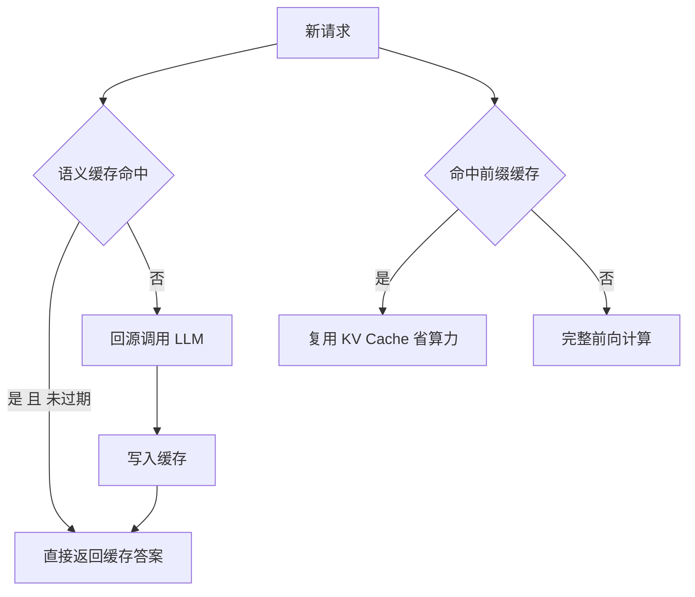

### Q270 · 前缀缓存与语义缓存的原理

> 难度:★★★★ | 标签:Agent, 缓存

**问**:解释前缀缓存和语义缓存的区别,各自适合什么场景?



**答**:前缀缓存(Prompt Caching)由推理服务端实现:相同前缀(如长 system prompt、few-shot)的 KV Cache 被复用,省的是计算和延迟,通常计费也打折;要求前缀完全一致,所以静态内容要放前面、动态内容放后面。语义缓存是应用层自建:把历史 query 的 embedding 和答案存起来,新 query 相似度超过阈值就直接返回缓存答案,省的是整次 LLM 调用;风险是相似不等于相同,阈值要保守,且答案有时效性(如价格)时必须设置失效策略。

```python
# file: code/06_Agent与LLM及系统设计/q270_caching.py
"""语义缓存实现:embedding 相似度命中则直接返回,否则回源 LLM 并写入缓存。"""
from __future__ import annotations


def embed(text: str, dim: int = 12) -> list[int]:
    """Toy 嵌入:字符 2-gram 词袋。只反映字面相似;真实语义缓存用 embedding 模型。"""
    v = [0] * dim
    for a, b in zip(text, text[1:]):
        v[(ord(a) * 7 + ord(b)) % dim] += 1
    return v


def sim(a, b) -> float:
    na = sum(x * x for x in a) ** 0.5
    nb = sum(y * y for y in b) ** 0.5
    if not na or not nb:
        return 0.0
    return sum(x * y for x, y in zip(a, b)) / (na * nb)  # 余弦相似度


class SemanticCache:
    def __init__(self, threshold: float = 0.85):
        self.threshold = threshold
        self.store: list[tuple[str, str]] = []   # (query, answer)

    def lookup(self, query: str) -> str | None:
        qv = embed(query)
        for q, ans in self.store:
            if sim(qv, embed(q)) >= self.threshold:
                return f"[缓存命中] {ans}"
        return None

    def put(self, query: str, answer: str):
        self.store.append((query, answer))


class OriginLLM:
    def chat(self, q: str) -> str:
        return f"[回源生成] 关于「{q}」的详细回答"


def answer_with_cache(cache, llm, query: str) -> str:
    hit = cache.lookup(query)
    if hit:
        return hit
    ans = llm.chat(query)
    cache.put(query, ans)
    return ans


if __name__ == "__main__":
    cache, llm = SemanticCache(), OriginLLM()
    print(answer_with_cache(cache, llm, "退货政策是什么"))
    print(answer_with_cache(cache, llm, "退货政策是什么呢"))  # 2-gram 高度重叠,应命中
    print(answer_with_cache(cache, llm, "怎么开发票"))        # 与缓存条目无共同 2-gram,回源
```

**追问**:
- 语义缓存什么时候不能用?答案含时效性数据(库存、汇率)或强个性化(依赖用户身份)时,命中会返回错误结果。
- 前缀缓存的计费折扣怎么拿?——静态 system/工具定义/few-shot 放最前且逐字节一致(含空白);任何模板注入的动态值放后缀。
- 语义缓存的阈值怎么定?——保守起步(如 0.95+ 相似度)并保留改写判断;低阈值命中近似问题,答案驴唇不对马嘴。
- 缓存键要含什么?——归一化 query + 模型版本 + 关键上下文(用户组/语言);模型升级后旧答案要能整体失效。
