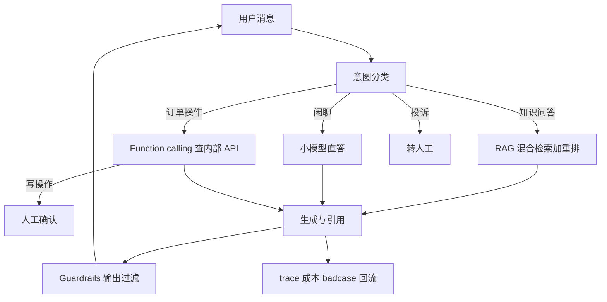

### Q275 · 综合设计题:端到端智能客服 Agent

> 难度:★★★★★ | 标签:Agent, 系统设计

**问**:设计一个企业知识库智能客服:要求能回答产品问题、查订单、必要时转人工,如何设计整体架构?

**答**:架构分五层:1) 入口层——意图分类(规则+小模型)区分闲聊/知识问答/订单操作/投诉转人工;2) 知识层——RAG(混合检索+重排+引用输出);3) 动作层——订单查询走 Function calling 调内部 API,退款等写操作强制人工确认;4) 记忆层——会话内滑动窗口+摘要,用户长期偏好入库;5) 防护与运营层——Guardrails、全链路 trace、badcase 回流、成本看板。关键取舍:能分类短路的就不进 Agent 循环(省成本降延迟);所有有副作用的操作必须幂等+确认;模型层做好分级路由与降级。



```python
# file: code/06_Agent与LLM及系统设计/q275_customer_service.py
"""端到端智能客服骨架:意图路由 + RAG + 工具调用 + 转人工 + 防护,全 stub。"""


def fake_embed(t):
    return [ord(c) % 7 for c in t[:6].ljust(6, "x")]


KNOWLEDGE = ["我们的退货政策是 7 天无理由", "会员每月送 10GB 流量"]
ORDERS = {"1001": {"status": "已发货", "carrier": "顺丰"}}


def classify(text: str) -> str:
    if any(k in text for k in ["投诉", "人工"]):
        return "human"
    if any(k in text for k in ["退款", "订单", "物流", "发货"]):
        return "action"   # 退款是写操作,归入 action 后走人工确认,而不是直接转人工
    return "knowledge"


class KnowledgeRAG:
    def answer(self, q: str) -> str:
        hits = max(KNOWLEDGE, key=lambda d: sum(a == b for a, b in zip(fake_embed(d), fake_embed(q))))
        return f"根据知识库[{hits[:12]}...]回答您的问题"


def query_order(order_id: str) -> str:
    return str(ORDERS.get(order_id, "订单不存在"))


def serve(user_text: str) -> str:
    intent = classify(user_text)
    if intent == "human":
        return "已为您转接人工客服"
    if intent == "action":
        if "退款" in user_text:   # 写操作:强制确认
            return "退款操作需人工确认后执行(高危)"
        import re
        m = re.search(r"\d{3,}", user_text)
        return f"订单信息:{query_order(m.group())}" if m else "请提供订单号"
    return KnowledgeRAG().answer(user_text)


if __name__ == "__main__":
    for q in ["退货政策是什么?", "订单 1001 到哪了?", "我要退款!", "你好"]:
        print(f"Q: {q}\nA: {serve(q)}\n")
```

**追问**:
- 为什么意图分类要短路?——闲聊与简单 FAQ 直接规则/小模型回答,不进 Agent 循环;这是成本与延迟的最大杠杆。
- 退款这类写操作的完整防线?——幂等键 + 参数校验 + 人工确认 + 审计日志;四层缺一不可,少了哪层哪层出事故。
- 怎么衡量这套客服系统的成功?——解决率(无人工介入闭环)、转人工率、CSAT、单会话成本;四指标一起看,单看解决率会诱导瞎答。
