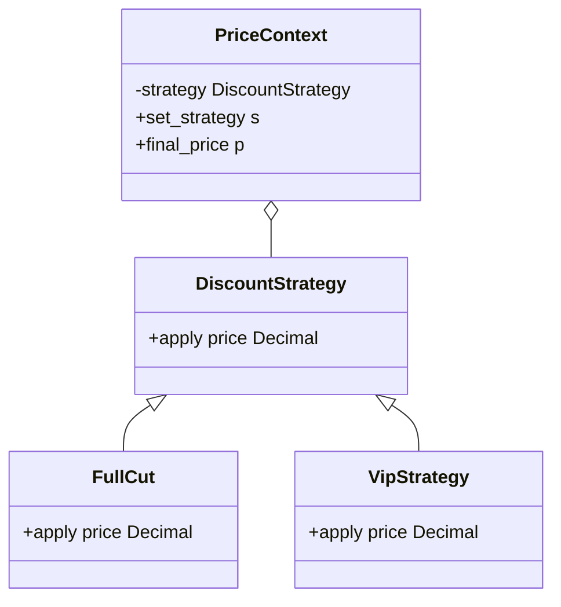

### Q278 · 策略模式替换长长的 if-else
> 难度:★★★ | 标签:设计模式, 重构

**问**:一个函数里有 20 个 if-elif 分支做不同的折扣计算,如何用策略模式重构?

**答**:把每个分支抽成独立策略类或函数,用字典(策略表)按类型分发,新增策略只加一行注册,不改主流程,符合开闭原则。这是面试中“重构 if-else”的标准答案,同时要点出:分支少(2-3 个)不必过度设计,策略表本身也是隐式耦合,注意保持 key 语义清晰。

```python
# file: code/06_Agent与LLM及系统设计/q278_strategy.py
from decimal import Decimal


def vip_price(price: Decimal) -> Decimal:
    return price * Decimal("0.8")


def new_user_price(price: Decimal) -> Decimal:
    return price * Decimal("0.9")


def default_price(price: Decimal) -> Decimal:
    return price


STRATEGIES = {
    "vip": vip_price,
    "new": new_user_price,
    "default": default_price,
}


def calc_price(user_type: str, price: Decimal) -> Decimal:
    return STRATEGIES.get(user_type, default_price)(price)


class DiscountStrategy:
    """面向对象的策略写法,适合策略本身有状态的场景。"""
    def apply(self, price: Decimal) -> Decimal:
        raise NotImplementedError


class FullCut(DiscountStrategy):
    def __init__(self, threshold: Decimal, cut: Decimal):
        self.threshold, self.cut = threshold, cut

    def apply(self, price: Decimal) -> Decimal:
        return price - self.cut if price >= self.threshold else price


if __name__ == "__main__":
    print(calc_price("vip", Decimal("100")))   # 80.0
    print(calc_price("xxx", Decimal("100")))   # 100
    print(FullCut(Decimal("100"), Decimal("20")).apply(Decimal("120")))
```

**追问**:
- 策略表和 match/case 怎么选?——分发键是开放集合(会持续增加)用策略表;封闭枚举分支 3.10+ 用 match 更直观。
- 策略需要共享上下文怎么办?——统一签名 `execute(ctx)`,上下文对象传递;签名不一致的策略用适配器包一层。
- 怎么防止策略表 key 语义漂移?——key 用 Enum/Literal 而不是裸字符串;未注册的 key 要显式抛错(默认分支告警)而不是静默。



---
