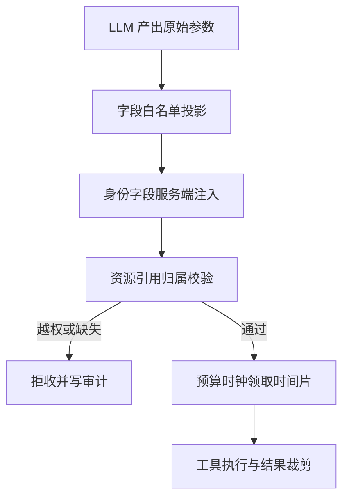

### Q2835 · 多轮对话的指针重置语义:软硬重置与悬空指代

> 难度:★★☆☆ | 标签:Agent, 会话, 状态管理

**问**:用户说「重新开个话题」,你的对话状态应该清成什么样?重置后第一句话里的「它」指什么?

**答**:一把梭全清是最省事也最错的:用户名、偏好这类跨话题事实跟着陪葬,下一轮还得重新问。正确语义是分级:软重置清历史与未钉住的槽位、保留钉住的事实,用于「换个话题」;硬重置全清,用于登出或换账号,两者必须在产品语义里写清楚。更隐蔽的坑是悬空指代:历史清空后,「它明天呢」里的它已经没有先行词,解析器必须显式返回失败让系统开口追问,而不是拿残留槽位瞎猜。重置语义最好作为会话状态机的一部分有单测覆盖,因为它恰好处在「用户感知最明显、测试最容易漏」的位置。



```python
# file: code/06_Agent与LLM及系统设计/q2835_pointer_reset.py
"""Q2835 多轮对话的指针重置语义:软重置 硬重置与悬空指代。

用户说「重新开个话题」时,很多系统直接清空全部状态,把用户名、
偏好等还需要的事实一起丢了;另一些系统什么也不清,新话题里还残留
旧槽位。正确语义是分级:软重置清历史与未钉槽位、保留钉住的事实,
硬重置全清;重置后指代解析必须显式失败,逼系统开口问而不是瞎猜。
"""


class DialogueState:
    def __init__(self):
        self.history = []
        self.slots = {}
        self.pinned = set()

    def turn(self, text):
        self.history.append(text)

    def pin(self, key):
        self.pinned.add(key)

    def soft_reset(self):
        """软重置:清历史,槽位只留钉住的。"""
        self.history = []
        self.slots = {k: v for k, v in self.slots.items() if k in self.pinned}

    def hard_reset(self):
        """硬重置:历史 槽位 钉住关系全清。"""
        self.history = []
        self.slots = {}
        self.pinned = set()

    def resolve_pronoun(self):
        """指代解析:没有历史可锚定时必须显式失败。"""
        if len(self.history) < 1:
            return None
        return self.history[-1]


def main():
    st = DialogueState()
    st.turn("帮我查北京的天气")
    st.slots["user_city"] = "北京"
    st.slots["user_name"] = "王工"
    st.pin("user_name")
    # 软重置:话题重开,身份保留,城市这种话题槽位清掉
    st.soft_reset()
    assert st.history == [], st.history
    assert st.slots == {"user_name": "王工"}, st.slots
    assert st.resolve_pronoun() is None  # 历史空了,「它」无从解析
    # 用户接着说「它明天呢」——系统必须追问而不是猜
    need_ask = st.resolve_pronoun() is None
    assert need_ask is True
    # 硬重置:连钉住的身份一起清(退出登录场景)
    st.hard_reset()
    assert st.slots == {} and st.pinned == set(), (st.slots, st.pinned)
    print("软重置后槽位:", {"user_name": "王工"}, "悬空指代需追问:", need_ask)
    print("硬重置后全部清空,适合登出或换账号场景")


if __name__ == "__main__":
    main()
```

**追问**:
- 追问一:钉住集合谁来维护? 答:身份类字段由系统自动钉,业务偏好让用户可见可改,自动钉住的要能被硬重置一并清掉,否则登出等于没登。
- 追问二:软重置和摘要压缩什么关系? 答:摘要压缩是保留语义的降损,软重置是用户授权的丢弃,前者动上下文不动槽位语义,后者直接换语境。
