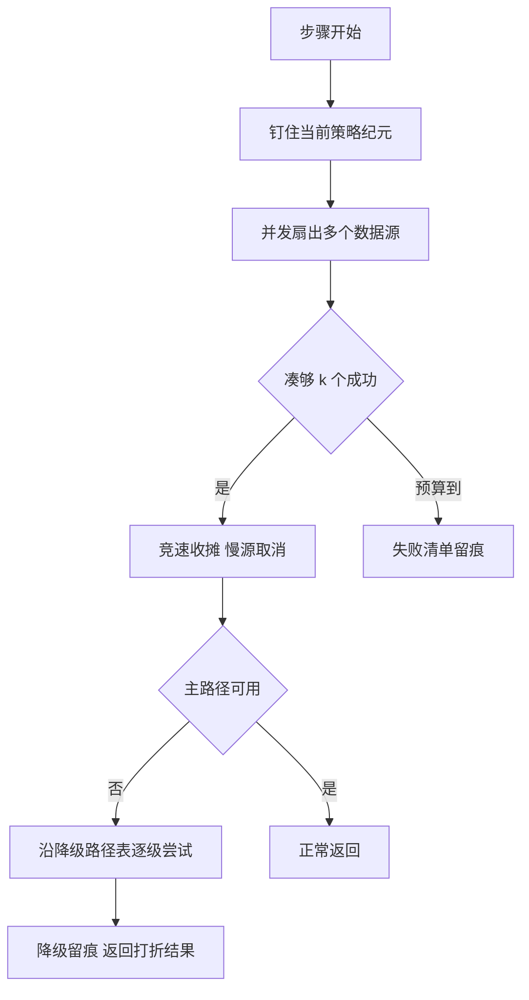

### Q2840 · 策略热切换的纪元绑定:步骤开始即钉住策略版本

> 难度:★★★★ | 标签:Agent, 策略, 热更新

**问**:运维在 Agent 运行中途改了重试上限或超时策略,正在跑的那一步用什么版本?怎么保证可追溯?

**答**:热切换最容易出的事故是「切换生效边界不清」:有的步骤用新策略有的用旧的,复现问题时说不清。规则要定死在步骤边界:每一步开始时对策略注册表做快照并钉住纪元号,本步内读的都是钉住的那份,策略被换也不回头,下一步自然用新版。纪元号随步骤留痕,事后审计能精确到「第 N 步用的是哪个版本」,回归测试也能按纪元复放。实现上快照要浅拷贝整个策略对象,避免注册表原地改值污染在途步骤;切换本身是原子操作,改完纪元加一。这套语义把「切换」从一个危险动作变成一个普通操作。



```python
# file: code/06_Agent与LLM及系统设计/q2840_policy_epoch.py
"""Q2840 策略热切换的纪元绑定:步骤开始即钉住策略版本。

运维改了重试上限 超时或工具策略,正在跑的 Agent 怎么办?规则是
步骤边界生效:每一步开始时对策略做快照并钉住纪元号,本步内策略被
热切换也不回头,下一步自然用新版。这样每一步用哪版策略都有据可查。
"""


class PolicyRegistry:
    def __init__(self, policy):
        self._policy = dict(policy)
        self.epoch = 1

    def snapshot(self):
        """步骤开始时调用:钉住当前策略与纪元。"""
        return dict(self._policy), self.epoch

    def hot_swap(self, patch):
        """热切换:只影响之后开始的步骤。"""
        self._policy.update(patch)
        self.epoch += 1


def run_step(registry, name, action):
    """一步的执行:开头钉策略,执行中读的都是钉住的那份。"""
    policy, epoch = registry.snapshot()
    used = action(policy)  # 模拟本步执行期间读到的策略值
    return {"name": name, "epoch": epoch, "retry_max_seen": used}


def main():
    reg = PolicyRegistry({"retry_max": 3})
    # 步骤一开始就钉住 epoch1 的 retry_max=3
    step1 = run_step(reg, "fetch", lambda p: p["retry_max"])
    # 执行中途运维热切换
    reg.hot_swap({"retry_max": 1})
    step2 = run_step(reg, "parse", lambda p: p["retry_max"])
    assert step1 == {"name": "fetch", "epoch": 1, "retry_max_seen": 3}, step1
    assert step2 == {"name": "parse", "epoch": 2, "retry_max_seen": 1}, step2
    assert reg.epoch == 2
    # 纪元可追溯:每个步骤能说清自己用的哪版策略
    trail = [step1["epoch"], step2["epoch"]]
    assert trail == [1, 2], trail
    print("步骤1:", step1, "(中途切换不影响)")
    print("步骤2:", step2, "(已用新策略)")
    print("策略纪元随步骤留痕:", trail)


if __name__ == "__main__":
    main()
```

**追问**:
- 追问一:为什么不在步骤中途即时生效? 答:中途生效会让单步行为取决于切换时机,不可复现;边界生效牺牲一点时效换来确定性,值得。
- 追问二:长步骤怎么办,等它跑完才生效吗? 答:长步骤可以在内部再设检查点做二级快照,但那要显式声明,不要隐式半路换策略。
