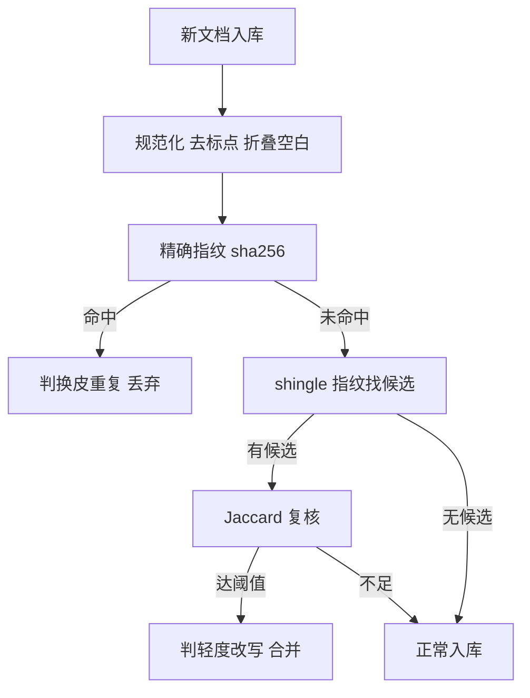

### Q2845 · 语料入库的规范化指纹闸:两级查重与相似复核

> 难度:★★★☆ | 标签:RAG, 语料, 去重

**问**:同一篇文档换个 URL、改改标点又进语料库,检索结果全是重复,怎么在入库前拦住?

**答**:语料重复是慢性病:爬虫重抓、多渠道转载、换皮洗稿,每一条都让索引膨胀、让同一段原文在上下文里出现三遍。入库前过指纹闸,两级防线:第一级规范化后精确哈希——统一小写、标点替换为空格、折叠空白,挡住换皮重复;第二级 shingle 指纹找相似候选,命中再用 Jaccard 复核,拦住轻度改写,复核这步不能省,否则标点差异会造成误杀。规范化里「标点替换为空格」比「删除」稳,避免原本分开的词被粘成一个新词。闸的判决要留档:exact_dup、near_dup、new 三种结论连同指向的原文档 id 一起入库,治理时才知道重复簇有多大。



```python
# file: code/06_Agent与LLM及系统设计/q2845_corpus_fingerprint.py
"""Q2845 语料入库的规范化指纹闸:两级查重与相似验证。

同一篇文档换个 URL 大小写 标点 空白就再次入库,是语料库膨胀和检索
结果重复的主因。入库前过指纹闸:第一级规范化后精确哈希,挡住换皮
重复;第二级 shingle 指纹找相似候选,再用 Jaccard 复核,拦住轻度改写。
"""

import hashlib
import re


def canonical(text):
    t = text.lower()
    t = re.sub(r"[^\w\s]", " ", t)   # 标点替换为空格,避免不同词被粘连
    return re.sub(r"\s+", " ", t).strip()


def exact_fp(text):
    return hashlib.sha256(canonical(text).encode("utf-8")).hexdigest()[:16]


def shingles(text, n=2):
    toks = canonical(text).split(" ")
    return {" ".join(toks[i:i + n]) for i in range(max(0, len(toks) - n + 1))}


def sh_fp(s):
    return hashlib.md5(s.encode("utf-8")).hexdigest()


def jaccard(a, b):
    return len(a & b) / float(len(a | b)) if a | b else 1.0


class Corpus:
    def __init__(self, near_threshold=0.6):
        self.exact = {}
        self.bands = {}
        self.items = []
        self.near_threshold = near_threshold

    def add(self, doc_id, text):
        fp = exact_fp(text)
        if fp in self.exact:
            return "exact_dup", self.exact[fp]
        sh = shingles(text)
        cands = set()
        for s in sh:
            cands |= self.bands.get(sh_fp(s), set())
        for cid in cands:
            if jaccard(sh, self.items[cid][1]) >= self.near_threshold:
                return "near_dup", self.items[cid][0]
        self.exact[fp] = doc_id
        self.items.append((doc_id, sh))
        idx = len(self.items) - 1
        for s in sh:
            self.bands.setdefault(sh_fp(s), set()).add(idx)
        return "new", doc_id


def main():
    corpus = Corpus()
    base = "退款申请提交后 系统会在 三个工作日内 完成审核 原路退回到 用户的 付款账户 如遇 节假日 自动顺延"
    r1 = corpus.add("d1", base)
    assert r1 == ("new", "d1"), r1
    # 换皮重复:改标点 空白与大小写,精确指纹即命中
    r2 = corpus.add("d2", "退款申请提交后, 系统会在  三个工作日内, 完成审核, 原路退回到 用户的 付款账户, 如遇 节假日 自动顺延!")
    assert r2 == ("exact_dup", "d1"), r2
    # 轻度改写:换一个词,相似指纹命中候选再 Jaccard 复核
    r3 = corpus.add("d3", "退款申请提交后 系统会在 三个工作日内 完成审核 原路退回到 用户的 本人储蓄卡 如遇 节假日 自动顺延")
    assert r3[0] == "near_dup" and r3[1] == "d1", r3
    # 完全不同的文档正常入库
    r4 = corpus.add("d4", "年度合同续签需要提前三十天提交审批流程")
    assert r4 == ("new", "d4"), r4
    print("d1 入库:", r1)
    print("d2 换皮重复:", r2)
    print("d3 轻度改写:", r3)
    print("d4 正常入库:", r4)


if __name__ == "__main__":
    main()
```

**追问**:
- 追问一:图片和表格怎么查重? 答:表格规范化表头后同样走指纹闸,图片用感知哈希,与文本指纹分库存储。
- 追问二:阈值定 0.6 会误杀续写文档吗? 答:长文档按段落分别建指纹,段落级相似不等于整篇重复,跨段聚合后再判。
