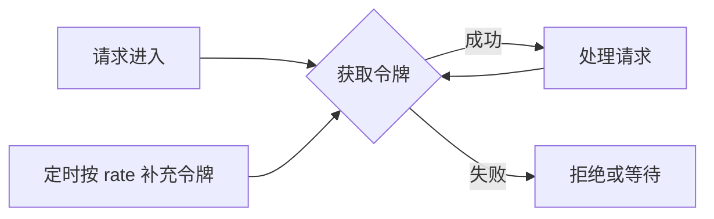

### Q285 · 令牌桶限流器
> 难度:★★★★ | 标签:限流, 并发

**问**:手写一个令牌桶限流器,和滑动窗口计数相比各有什么特点?

**答**:令牌桶以恒定速率往桶里放令牌,请求取不到令牌就被拒绝,允许短时突发(桶容量即突发上限);滑动窗口计数统计窗口内请求数,平滑限流但没有突发能力。实现时用 `threading.Lock` 保护 `tokens` 和 `last_refill`,按经过时间补充令牌即可。分布式场景用 Redis + Lua 保证原子性。

```python
# file: code/06_Agent与LLM及系统设计/q285_token_bucket.py
import threading
import time


class TokenBucket:
    def __init__(self, rate: float, capacity: int):
        self.rate = rate              # 每秒补充令牌数
        self.capacity = capacity      # 桶容量,决定突发上限
        self.tokens = float(capacity)
        self.last = time.monotonic()
        self.lock = threading.Lock()

    def allow(self, n: int = 1) -> bool:
        with self.lock:
            now = time.monotonic()
            self.tokens = min(self.capacity,
                              self.tokens + (now - self.last) * self.rate)
            self.last = now
            if self.tokens >= n:
                self.tokens -= n
                return True
            return False


if __name__ == "__main__":
    bucket = TokenBucket(rate=5, capacity=5)
    ok = [bucket.allow() for _ in range(10)]
    print(ok)               # 前 5 个 True,后 5 个 False
    time.sleep(0.5)
    print(bucket.allow())   # 又有令牌
```

**追问**:
- 令牌桶参数怎么定?——rate=平均 QPS 上限、capacity=允许突发量;按下游容量与 SLA 反推,压测验证。
- 分布式实现为什么用 Lua?——取令牌涉及「读余额-计算补充-扣减」多步,Redis 单线程执行脚本保证原子;应用层多步有竞态。
- 拒绝的请求怎么处理?——返回 429 + Retry-After,按业务降级(排队/丢弃/兜底);静默丢弃最不可取。



---
