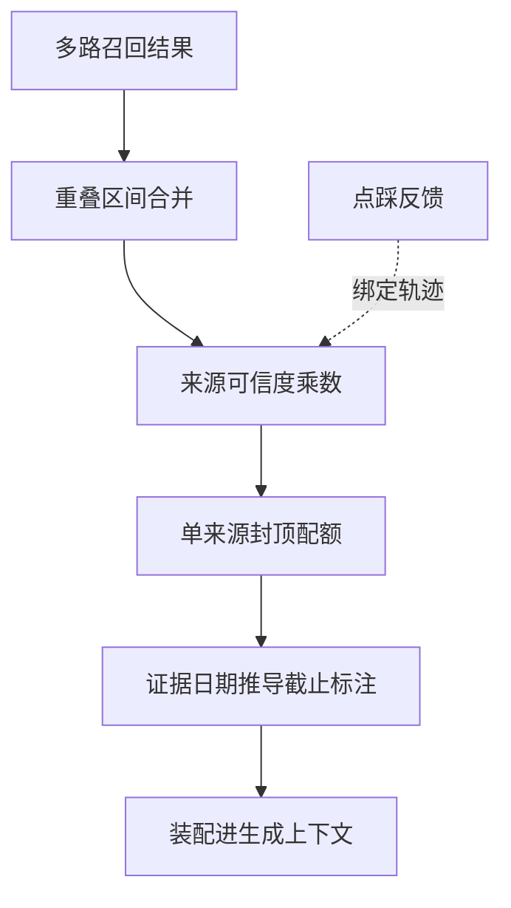

### Q2850 · 检索排序的来源可信度乘数:分级表 未知降权与封顶

> 难度:★★★☆ | 标签:RAG, 排序, 可信度

**问**:相关性分数一样高,官方文档和论坛帖该怎么分先后?来源可信度怎么参与排序?

**答**:embedding 相似度只度量语义接近,不度量可信:论坛帖抄了官方文档的措辞,相似度会比原文还高。重排阶段给每个来源乘一个可信度系数:官方域 1.0、权威百科 0.8、论坛 0.5,没登记过的来源按最低档对待——宁可错杀待登记的新源,不让 SEO 农场冲榜。乘数设计有两个细节:1.0 档只保持原分不加分,可信度不能无中生有相关性;乘完封顶 1.0,防止上游分数本身溢出。分级表要作为配置管理,登记流程轻量但要留审核记录;系数变化前后跑一遍评估集对拍,确认排序变化方向符合预期。这一步和 MMR 这类多样性策略不冲突,一个管可信一个管多样,先后次序按业务定。



```python
# file: code/06_Agent与LLM及系统设计/q2850_trust_multiplier.py
"""Q2850 检索排序的来源可信度乘数:分级表 未知降权与封顶。

相关性分数不能代表可信度:论坛帖也能和官方文档算出一样高的相似度。
在重排阶段给每个来源乘一个可信度系数:官方域 1.0,百科 0.8,论坛
0.5,没登记过的来源按最低档对待,高分低信的来源再也无法霸占榜首。
"""

TRUST = {
    "help.example.com": 1.0,
    "wikipedia.org": 0.8,
    "forum.example.com": 0.5,
}
UNKNOWN_FACTOR = 0.3


def rerank(hits):
    out = []
    for h in hits:
        factor = TRUST.get(h["source"], UNKNOWN_FACTOR)
        final = min(h["score"] * factor, 1.0)   # 封顶防单一来源溢出
        out.append(dict(h, final=round(final, 4)))
    out.sort(key=lambda h: (-h["final"], h["source"]))
    return out


def main():
    hits = [
        {"doc": "x1", "source": "unknown-blog.io", "score": 0.99},
        {"doc": "f1", "source": "forum.example.com", "score": 0.95},
        {"doc": "g1", "source": "help.example.com", "score": 0.82},
        {"doc": "w1", "source": "wikipedia.org", "score": 0.80},
    ]
    out = rerank(hits)
    order = [h["doc"] for h in out]
    assert order == ["g1", "w1", "f1", "x1"], order  # 官方反超论坛
    assert out[0]["final"] == 0.82, out[0]  # 1.0 乘数不加分
    f1 = [h for h in out if h["doc"] == "f1"][0]
    assert abs(f1["final"] - 0.475) < 1e-6, f1  # 0.95 x 0.5,从第2掉到第3
    x1 = [h for h in out if h["doc"] == "x1"][0]
    assert x1["final"] == round(0.99 * 0.3, 4), x1  # 未知来源最低档垫底
    print("重排后:", [(h["doc"], h["final"]) for h in out])
    print("0.95 的论坛帖被压到 0.475,让位给 0.82 的官方文档")


if __name__ == "__main__":
    main()
```

**追问**:
- 追问一:未知来源直接不展示行不行? 答:太狠,新站永远进不来;给最低档加灰度登记通道,人工核验后升档。
- 追问二:可信度该乘在召回阶段还是重排阶段? 答:重排阶段,召回追求查全不设限,重排才做价值判断,混进召回会伤及多样性。
