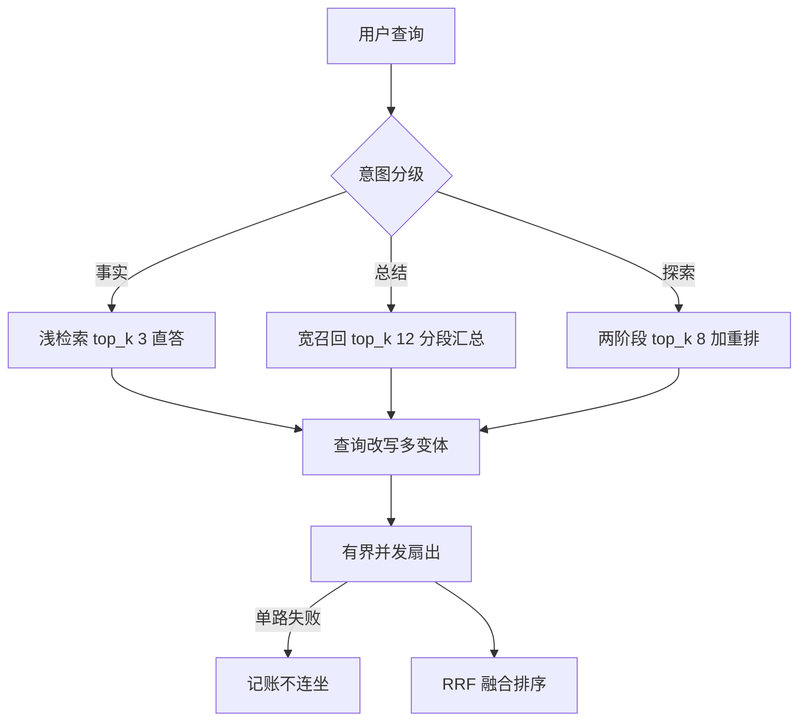

### Q2855 · 查询意图的分级路由:事实 总结与探索各走各的管线

> 难度:★★★☆ | 标签:RAG, 路由, 意图

**问**:所有查询都走同一条检索管线,问题出在哪?意图分级路由怎么设计匹配顺序?

**答**:「退款多久到账」和「总结全部售后政策」需要的检索深度完全不同:前者 k=3 直答最快,后者要宽召回加分段汇总,统一管线不是过深就是过浅。按意图分级路由:规则分类器把查询分到事实、总结、探索几类,每类绑定自己的管线参数——top_k、是否重排、是否分段。规则匹配顺序即优先级,要把更特异的模式放前面,比如「总结」前缀先于数字模式匹配,否则「总结里提到 7 天」会被数字规则抢走。分类错误是这套机制的主要成本,兜底类别给保守管线;规则要拿线上查询日志回归,避免为了一个 case 加的规则打翻一片。分级路由同时是成本杠杆:事实题走浅管线,平均成本立降一档。



```python
# file: code/06_Agent与LLM及系统设计/q2855_intent_routing.py
"""Q2855 查询意图的分级路由:事实题 荟题与探索题各走各的管线。

「发票丢了怎么补」和「总结全部售后政策」不该走同一条检索管线:
事实题浅挖快答,总结题要多路召回加分段汇总,探索题要重排保多样。
规则路由按意图分派管线,匹配顺序即优先级。
"""

import re

PIPELINES = {
    "fact": {"top_k": 3, "rerank": False, "mode": "direct"},
    "summary": {"top_k": 12, "rerank": False, "mode": "map_reduce"},
    "exploratory": {"top_k": 8, "rerank": True, "mode": "two_stage"},
}


def classify(q):
    if re.match(r"^(总结|概述|帮我归纳)", q):
        return "summary"
    if re.search(r"多少钱|几号|多久|\d+\s*(天|元|个)", q):
        return "fact"
    if re.search(r"为什么|如何|怎么|对比", q):
        return "exploratory"
    return "fact"


def route(q):
    return PIPELINES[classify(q)]


def main():
    cases = [
        ("退款多久到账", "fact"),
        ("总结全部售后政策", "summary"),
        ("为什么退款会被驳回", "exploratory"),
        ("发票丢了怎么补", "exploratory"),
        ("退货要 7 天还是 15 天", "fact"),
    ]
    for q, want in cases:
        assert classify(q) == want, (q, classify(q), want)
    p = route("退款多久到账")
    assert p == {"top_k": 3, "rerank": False, "mode": "direct"}, p
    assert route("总结全部售后政策")["mode"] == "map_reduce"
    assert route("为什么退款会被驳回")["rerank"] is True
    print("退款多久到账 ->", route("退款多久到账"))
    print("总结全部售后政策 ->", route("总结全部售后政策"))
    print("为什么退款会被驳回 ->", route("为什么退款会被驳回"))


if __name__ == "__main__":
    main()
```

**追问**:
- 追问一:规则分类器要不要换模型分类? 答:先看规则准确率,日志抽样标注后低于阈值再上小模型,模型分类也有延迟和成本。
- 追问二:多意图查询怎么办? 答:取主意图路由,结果不足时按次意图补一轮,不要试图一次满足两个意图。
