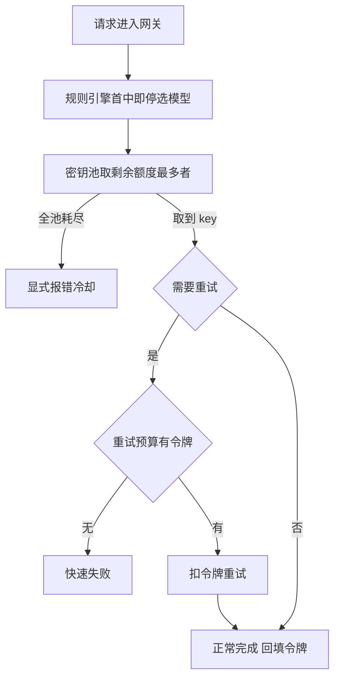

### Q2860 · 模型路由的规则引擎:声明式规则 首中即停与兜底

> 难度:★★★☆ | 标签:LLM 运维, 路由, 规则引擎

**问**:路由逻辑散落在各处 if-else 里,加一条规则要改三个文件,怎么收口?

**答**:把路由决策从命令式 if-else 收口成有序的声明式规则表:每条规则带名字、目标模型和谓词,按序评估、首中即停,谁都不中走兜底。声明的价值在于规则可枚举、可评审、可导出成文档给业务方过目,新规则上线是一行配置加一次回归,而不是在流程深处加分支。顺序即优先级要当成契约写进注释:代码块规则排前,长文含代码也走代码模型,这类交叉场景必须有明确归属。规则谓词只读请求的稳定字段,读响应或者有副作用的谓词会让评估顺序变得不可预测。每条路由都要留痕规则名,否则「这个请求为什么走了 pro」永远在猜。



```python
# file: code/06_Agent与LLM及系统设计/q2860_route_rule_engine.py
"""Q2860 模型路由的规则引擎:声明式规则、首中即停与兜底。

把「长文走长上下文模型、代码块走代码模型、VIP 走旗舰」这类路由决策
从 if-else 堆里搬出来,变成有序的声明式规则表:按序评估、首中即停,
谁都不中走兜底。规则可增删、可测试、可导出成文档给业务方评审。
"""
FENCE = chr(96) * 3  # 反引号栅栏,运行时拼接避免与文档围栏冲突


def has_code_block(prompt: str) -> bool:
    return FENCE in prompt


RULES = [
    {"name": "vip", "model": "flagship-x",
     "test": lambda r: r.get("tier") == "vip"},
    {"name": "code_block", "model": "coder-x",
     "test": lambda r: has_code_block(r["prompt"])},
    {"name": "long_text", "model": "longctx-x",
     "test": lambda r: len(r["prompt"]) > 4000},
]
DEFAULT_MODEL = "standard-x"


def route(request: dict) -> str:
    for rule in RULES:  # 有序评估,首中即停
        if rule["test"](request):
            return rule["model"]
    return DEFAULT_MODEL


if __name__ == "__main__":
    cases = [
        {"prompt": "帮我写代码 " + FENCE + "print(1)" + FENCE, "tier": "free"},
        {"prompt": "短问题", "tier": "free"},
        {"prompt": "短问题", "tier": "vip"},
        {"prompt": "长" * 4001, "tier": "free"},
    ]
    for c in cases:
        print(route(c), "<-", c["tier"], len(c["prompt"]), "字")
    assert route(cases[0]) == "coder-x"
    assert route(cases[1]) == "standard-x"
    assert route(cases[2]) == "flagship-x"
    assert route(cases[3]) == "longctx-x"
    print("断言全部通过:声明式路由,首中即停,兜底可用")
```

**追问**:
- 追问一:规则冲突怎么发现? 答:上线前跑规则交叉矩阵:构造同时命中多条规则的请求,断言结果与声明的优先级一致。
- 追问二:什么该升级成模型分类而不是规则? 答:规则数超过几十条且互相踩踏、谓词开始堆正则,就该考虑前置一个小分类器,规则退化为兜底。
