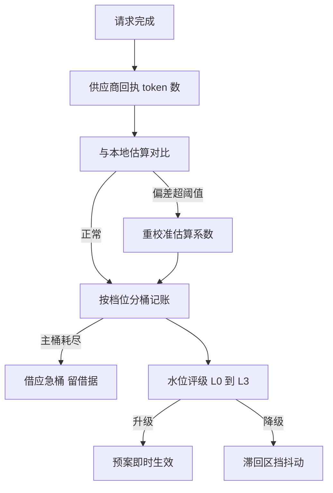

### Q2865 · 密钥池轮换:多 key 分摊限流与窗口冷却调度

> 难度:★★☆☆ | 标签:LLM 运维, 密钥, 限流

**问**:单一 API key 撞限流服务就停摆,多把 key 怎么轮换才公平又高效?

**答**:供应商限流按 key 计,多把 key 组池能把额度线性翻倍,轮换策略决定利用率:每次取剩余额度最多的 key,同分按固定顺序裁决,保证调度确定性;耗尽的 key 冷却到窗口重置,翻篇后满血回池。全池耗尽必须显式报错并附预估恢复时间,让上游能决策降级,而不是拿着 429 硬敲把冷却期拉长。工程上注意三点:窗口重置时间按各 key 实际开始时间记,别一刀切;key 状态要持久化,进程重启不该把刚用掉的额度忘掉;监控按 key 分列,某 key 频繁先进冷却说明它配额被降了,该去和供应商对。密钥池顺带是发布工具:新 key 先灰度小流量,验证配额真实再用满。



```python
# file: code/06_Agent与LLM及系统设计/q2865_key_pool.py
"""Q2865 密钥池轮换:多 key 分摊限流与冷却调度。

单一 API key 撞上限流,服务就停摆;多把 key 轮着用可以把限流额度
翻倍。轮换策略:优先用剩余额度最多的 key,耗尽的进入冷却,整窗
重置后回归池子;全池耗尽要显式报错,而不是拿着 429 硬敲。
"""


class KeyPool:
    def __init__(self, limits):
        self.limits = dict(limits)          # key -> 窗口内额度
        self.used = {k: 0 for k in limits}
        self.window_end = 0
        self.order = list(limits)           # 固定顺序用于同分裁决

    def acquire(self, now):
        if now >= self.window_end and self.window_end > 0:
            self.used = {k: 0 for k in self.limits}
            self.window_end = 0
        best, best_left = None, -1
        for k in self.order:
            left = self.limits[k] - self.used[k]
            if left > best_left:
                best, best_left = k, left
        if best_left <= 0:
            self.window_end = self.window_end or (now + 60)
            return None
        self.used[best] += 1
        return best


def main():
    pool = KeyPool({"k1": 2, "k2": 2, "k3": 2})
    seq = [pool.acquire(now=0) for _ in range(7)]
    # 前三把各用一次,接着各自第二次,第七次全池耗尽
    assert seq[:3] == ["k1", "k2", "k3"], seq
    assert seq[3:6] == ["k1", "k2", "k3"], seq
    assert seq[6] is None, seq
    # 窗口未重置继续取:仍然拿不到
    assert pool.acquire(now=30) is None
    # 窗口翻篇:池子满血复活
    assert pool.acquire(now=61) == "k1", pool.used
    print("轮换序列:", seq[:6], "第7次:", seq[6])
    print("窗口重置后恢复:", pool.used)


if __name__ == "__main__":
    main()
```

**追问**:
- 追问一:key 轮换会被供应商识别为规避限流吗? 答:要遵守服务条款,多 key 通常指企业名下的多配额实体,跨主体蹭额度是另一回事。
- 追问二:池子要几把 key? 答:按峰值流量除以单 key 配额再留一把冗余,轮换本身不产生额度,只是把已有额度用满。
