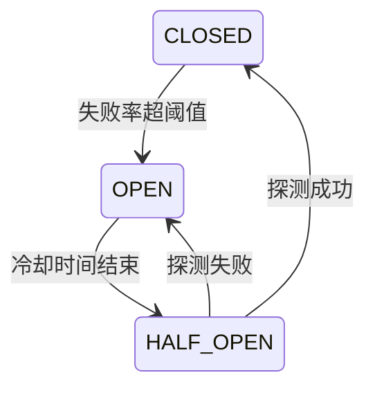

### Q287 · 熔断器:让故障快速失败
> 难度:★★★★ | 标签:可靠性, 状态机

**问**:描述熔断器的三个状态和转换条件,用代码实现一个简易熔断器。

**答**:三态:`CLOSED` 正常放行并统计失败率,失败率超阈值后打开;`OPEN` 直接拒绝请求,经过冷却时间进入 HALF_OPEN;`HALF_OPEN` 放少量探测请求,成功则回到 CLOSED,失败则重回 OPEN。价值是防止调用方线程被下游故障拖死,配合降级返回兜底数据。

```python
# file: code/06_Agent与LLM及系统设计/q287_circuit_breaker.py
import time


class CircuitBreaker:
    def __init__(self, fail_threshold: int = 3, cooldown: float = 1.0):
        self.fail_threshold = fail_threshold
        self.cooldown = cooldown
        self.state = "CLOSED"
        self.failures = 0
        self.opened_at = 0.0

    def allow(self) -> bool:
        if self.state == "OPEN":
            if time.monotonic() - self.opened_at >= self.cooldown:
                self.state = "HALF_OPEN"  # 冷却结束,放探测请求
                return True
            return False
        return True

    def record_success(self) -> None:
        self.failures = 0
        self.state = "CLOSED"

    def record_failure(self) -> None:
        if self.state == "HALF_OPEN":
            self.state = "OPEN"      # 探测失败,再次熔断
            self.opened_at = time.monotonic()
            return
        self.failures += 1
        if self.failures >= self.fail_threshold:
            self.state = "OPEN"
            self.opened_at = time.monotonic()


def call_with_breaker(breaker: CircuitBreaker, fn, *args):
    if not breaker.allow():
        return "degraded"  # 降级响应
    try:
        res = fn(*args)
        breaker.record_success()
        return res
    except Exception:
        breaker.record_failure()
        return "degraded"


def bad_downstream():
    raise ConnectionError("downstream down")


if __name__ == "__main__":
    br = CircuitBreaker(fail_threshold=2, cooldown=0.2)
    for _ in range(3):
        print(call_with_breaker(br, bad_downstream))
    print(br.state)  # OPEN
    time.sleep(0.3)
    print(call_with_breaker(br, lambda: "ok"))  # HALF_OPEN 探测成功
    print(br.state)  # CLOSED
```

**追问**:
- 失败率统计窗口怎么选?——滚动小窗口(如 10s 内 ≥50% 且请求数 ≥20 才触发);样本太小一次失败就熔断是误杀。
- HALF_OPEN 放多少探测?——1-2 个/批,成功才逐步放量;直接全放等于没有熔断。
- 熔断和降级怎么配合?——熔断器 OPEN 时触发降级链(缓存/默认值/裁剪);降级路径要预先演练,OPEN 后才写降级逻辑就晚了。



---
