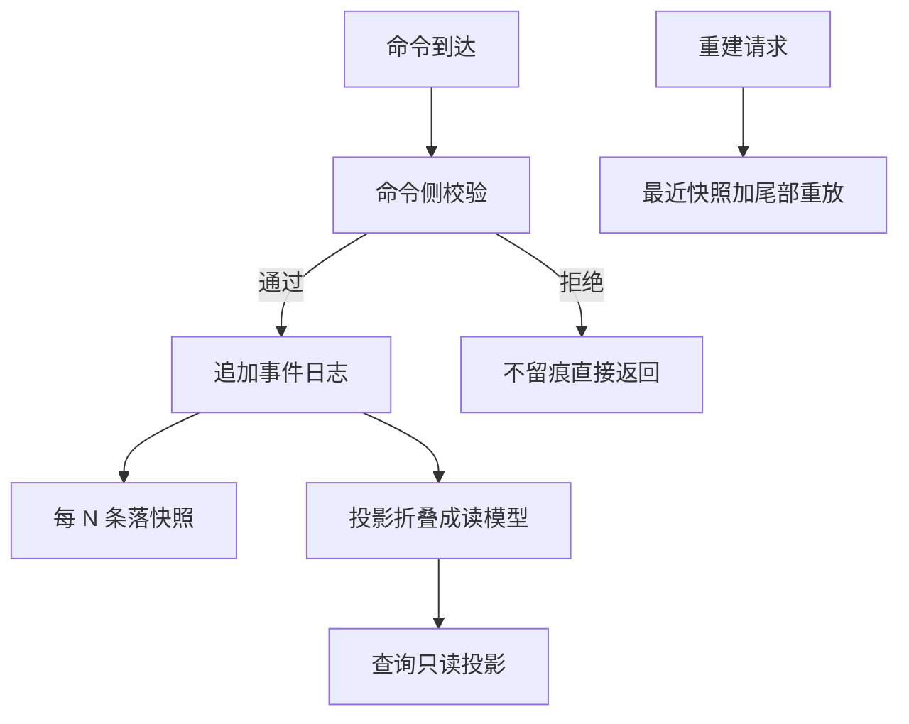

### Q2870 · 位图签名集合:整数位当布尔阵 位运算做集合代数

> 难度:★★☆☆ | 标签:分布式, 位图, 数据结构

**问**:海量「某 id 是否出现过」的标记,set 存内存扛不住,位图为什么省?集合运算怎么做?

**答**:去重、签到、特征签名这类「是否出现」标记,set 存一个元素几十字节,千万级就是几百 MB;位图用整数的二进制位表达集合,一个位一个元素,内存省两个数量级。集合代数全部落到位运算:并是按位或,交是按位与,差是与上非,基数就是置位计数,一条指令的事。适用前提是 id 空间紧凑:位偏移按 id 直接定位,稀疏大 id 要先过一层压缩位图或哈希映射,否则内存被空洞吃掉。位图还能玩组合:按天建的位图,一周活跃就是七天位图按位或,留存分析就是昨天与今天之交,这一手在用户运营里是标配。工程上注意持久化和分片:位图按 id 段分片,单分片过大要能拆。



```python
# file: code/06_Agent与LLM及系统设计/q2870_bitmap_sets.py
"""Q2870 位图签名集合:一个整数当一亿个布尔用 位运算做集合代数。

海量「是否出现」标记(签到 UV 去重 特征签名)用 set 存太贵,位图
用整数二进制位表达集合:add 是按位置或,and/or/except 是三条位运算,
基数就是 popcount——内存省两个量级,交并差一步到位。
"""


class Bitmap:
    def __init__(self, bits=0):
        self.bits = bits

    def add(self, x):
        self.bits |= 1 << x
        return self

    def __contains__(self, x):
        return bool((self.bits >> x) & 1)

    def card(self):
        return bin(self.bits).count("1")

    def to_list(self, limit=64):
        return [i for i in range(limit) if (self.bits >> i) & 1]

    def union(self, other):
        return Bitmap(self.bits | other.bits)

    def intersect(self, other):
        return Bitmap(self.bits & other.bits)

    def except_(self, other):
        return Bitmap(self.bits & ~other.bits)


def main():
    day1 = Bitmap().add(1).add(3).add(5)     # 周一签到用户 1 3 5
    day2 = Bitmap().add(3).add(5).add(7)     # 周二签到用户 3 5 7
    both = day1.intersect(day2)
    either = day1.union(day2)
    only_d1 = day1.except_(day2)
    assert both.to_list() == [3, 5] and both.card() == 2, both.to_list()
    assert either.to_list() == [1, 3, 5, 7], either.to_list()
    assert only_d1.to_list() == [1], only_d1.to_list()
    assert 3 in day1 and 7 not in day1
    assert day1.card() == 3
    # 只补一个位,不用复制整个集合
    day1.add(2)
    assert day1.card() == 4 and day1.to_list() == [1, 2, 3, 5]
    print("两天都来:", both.to_list())
    print("任一天来:", either.to_list())
    print("只周一:", only_d1.to_list())
    print("位运算集合代数:交 并 差基数分别为", both.card(),
          either.card(), only_d1.card())


if __name__ == "__main__":
    main()
```

**追问**:
- 追问一:位图和布隆过滤器怎么选? 答:位图精确无假阳性但要 id 紧凑,布隆省内存可容忍假阳性,数据特征决定选型。
- 追问二:计数场景位图够吗? 答:置位只能记 0 和 1,要计数用计数变体,每位置多个位或分块计数,内存按位宽翻倍。
