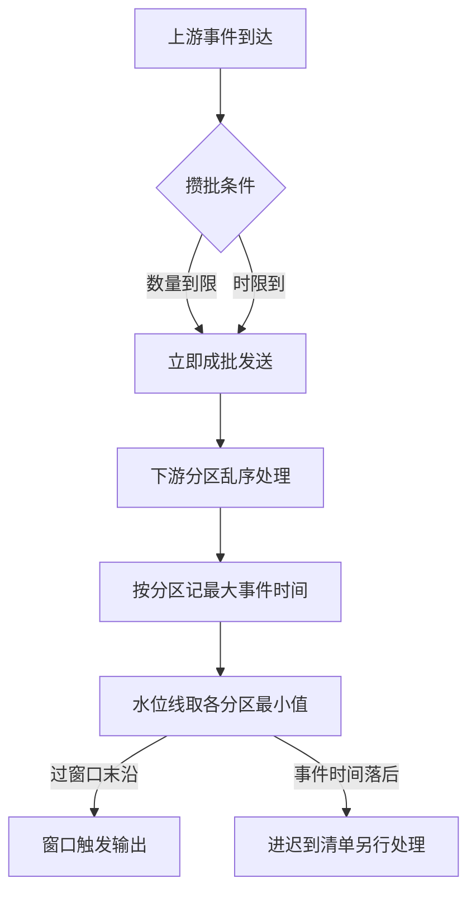

### Q2874 · 乱序事件的水位线:窗口推进 迟到处理与收尾冲刷

> 难度:★★★★ | 标签:分布式, 流式, 水位线

**问**:多分区流式系统事件乱序到达,窗口结果什么时候能出?迟到的窗口结果怎么处理?

**答**:乱序流的核心问题是「什么时候敢说这个窗口不会再有事件了」。水位线机制:每个分区记录已见的最大事件时间,全局水位取各分区最小值——最慢分区决定推进速度,这是正确性换延迟的保守设计;水位没过窗口末沿,窗口结果憋着,水位一过立即触发。水位之后才到的事件判为迟到,进迟到清单另行处理,绝不能悄悄并进已发结果,那等于改了已发布的账。收尾冲刷处理流尾:流结束时把未触发窗口全部强制输出,标注为「不完整」供下游识别。水位是权衡旋钮:允许分区滞后余量可以缓解迟到,代价是结果更晚出。监控三个数:水位滞后、迟到率、触发延迟,任何一个恶化都直接影响下游数据质量承诺。



```python
# file: code/06_Agent与LLM及系统设计/q2874_watermark.py
"""Q2874 乱序事件的水位线:窗口推进 迟到处理与收尾冲刷。

多分区流式系统里,事件到达顺序和事件时间顺序无关。水位线取各分区
最大事件时间的最小值:水位没过窗口末沿,窗口不敢出结果;水位一过,
窗口立即触发;水位之后才姗姗来迟的事件,只能进迟到清单另行处理。
"""

from collections import defaultdict


def run_watermark(events, window, partitions):
    """events: [(partition, ts, payload)],返回 (触发, 迟到, 未触发)。"""
    last = {p: -1 for p in partitions}
    wm_seen = 0
    buffered = defaultdict(list)
    fired = []
    late = []
    for p, ts, payload in events:
        if ts < wm_seen:               # 早于已推进的水位:迟到
            late.append(payload)
            continue
        last[p] = max(last[p], ts)
        start = ts // window
        buffered[start].append(payload)
        wm = min(last[p] for p in partitions)
        for s in sorted(list(buffered)):
            if (s + 1) * window <= wm:
                fired.append((s, buffered.pop(s)))
        wm_seen = max(wm_seen, wm)
    return fired, late, dict(buffered)


def main():
    parts = ("p0", "p1", "p2")
    events = [
        ("p0", 5, "A"),
        ("p1", 12, "B"),
        ("p2", 18, "C"),
        ("p0", 25, "D"),
        ("p1", 3, "E"),    # p1 乱序回退,且水位已过 10:迟到
        ("p2", 40, "F"),
        ("p1", 30, "G"),
    ]
    fired, late, pending = run_watermark(events, window=10, partitions=parts)
    assert fired[0] == (0, ["A"]), fired    # 水位到 12,窗口 0 立即触发
    assert (1, ["B", "C"]) in fired, fired  # 水位到 25 后窗口 1 触发
    assert late == ["E"], late              # 水位已过 10,E 只能记迟到
    assert pending == {2: ["D"], 3: ["G"], 4: ["F"]}, pending  # 等水位
    assert len(fired) == 2, fired
    print("已触发窗口:", fired)
    print("迟到事件:", late)
    print("未触发窗口 2/3/4 在等水位,最慢分区 p0 停在 25 不敢出结果")


if __name__ == "__main__":
    main()
```

**追问**:
- 追问一:迟到事件一定丢弃吗? 答:进侧输出通道,下游按业务决定补发修正或忽略,丢弃是业务决策不是流引擎默认。
- 追问二:某分区长期无事件,水位会卡死吗? 答:会,所以用空闲分区检测,超时把无事件分区的水位按推测推进,这是已知的有损优化。
