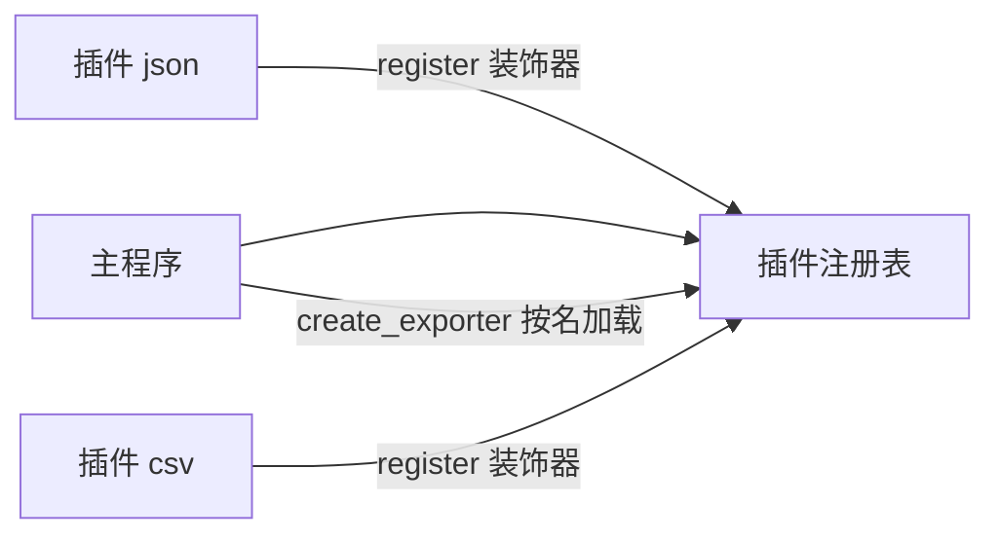

### Q292 · 插件架构:entry_points 与注册表两种思路
> 难度:★★★★ | 标签:架构, 插件

**问**:设计一个支持第三方扩展的插件系统,Python 里有哪些实现路径?

**答**:两条主流路径:一是包管理器级 `entry_points`(importlib.metadata 发现),第三方按声明自动被发现,适合 pip 安装类生态如 pytest 插件;二是进程内注册表(装饰器注册),简单可控,适合业务内部的规则/导出器扩展。共同点是定义稳定的插件接口 + 发现机制 + 失败隔离(单个插件加载失败不影响整体)。

```python
# file: code/06_Agent与LLM及系统设计/q292_plugin_registry.py
from typing import Callable, Protocol


class Exporter(Protocol):
    def export(self, data: dict) -> str: ...


_REGISTRY: dict[str, Callable[[], Exporter]] = {}


def register(name: str):
    """装饰器注册:新插件只需 import 本文件并加装饰器。"""
    def deco(factory: Callable[[], Exporter]):
        _REGISTRY[name] = factory
        return factory
    return deco


def create_exporter(name: str) -> Exporter:
    if name not in _REGISTRY:
        raise KeyError(f"unknown exporter: {name}")
    return _REGISTRY[name]()


@register("json")
class JsonExporter:
    def export(self, data: dict) -> str:
        import json
        return json.dumps(data)


@register("csv")
class CsvExporter:
    def export(self, data: dict) -> str:
        return ",".join(f"{k}={v}" for k, v in data.items())


if __name__ == "__main__":
    print(create_exporter("json").export({"a": 1}))
    print(create_exporter("csv").export({"a": 1}))
```

**追问**:
- entry_points 的发现原理?——importlib.metadata 读已安装包的元数据声明;延迟 import,单个插件加载失败要 try 包住。
- 注册表模式怎么防重复注册?——同名 key 二次注册显式报错(或版本覆盖声明);静默覆盖是排查噩梦。
- 插件接口怎么保持稳定?——接口版本号 + 兼容承诺(只增不改);破坏性变更升大版本并给迁移期。



---
