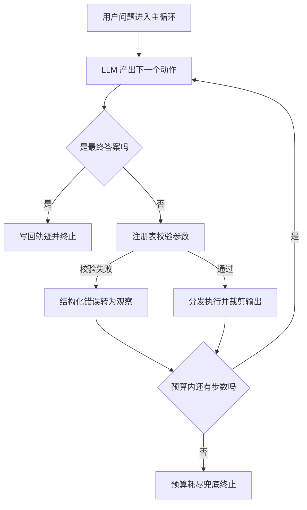

### Q2982 · 工具注册表的完整实现:schema 校验+统一分发

> 难度:★★★ | 标签:Agent, 工具治理, 校验

**问**:Agent 可用的工具越接越多,你怎么保证「参数错了不进执行、执行挂了不炸主循环」?

**答**:答案是把注册表做成 Agent 与工具之间唯一的边界。每个工具注册时声明 schema:必填项、参数类型、取值上下限;分发前统一校验,校验不过返回结构化错误而不是抛异常,LLM 能拿到可读的错误并自行修正。分发结果统一包成 ok/error 两态,连「未知工具」和「工具内部异常」也都是结构化返回,主循环因此永远不需要 try 每个工具。类型校验要小心 bool 是 int 的子类这类 Python 坑,数值参数还要做范围检查,金额上限这种业务约束就放在 schema 里而不是散在工具实现里。注册表同时天然是工具清单,可以按身份过滤后喂给模型做函数选择。

```python
# file: code/06_Agent与LLM及系统设计/q2982_tool_registry.py
"""Q2982 工具注册表的完整实现:schema 声明+参数校验+统一分发。

注册表是 Agent 与工具之间唯一的边界:每个工具注册时声明参数类型、
必填项与取值范围,分发前统一校验,校验不过返回结构化错误而不是抛
异常穿透到 LLM 轨迹里。分发结果统一包成 ok/error 两态,让上层无需
了解每个工具的内部实现。
"""

import math


class ToolRegistry:
    def __init__(self):
        self._tools = {}

    def register(self, name, fn, schema, desc=""):
        self._tools[name] = {"fn": fn, "schema": schema, "desc": desc}

    def list_tools(self):
        return {n: t["desc"] for n, t in sorted(self._tools.items())}

    def _validate(self, schema, args):
        errs = []
        for key in schema.get("required", []):
            if key not in args:
                errs.append("缺少必填参数:" + key)
        for key, val in args.items():
            if key not in schema.get("properties", {}):
                errs.append("未声明参数:" + key)
                continue
            spec = schema["properties"][key]
            want = spec.get("type")
            type_ok = {
                "string": lambda v: isinstance(v, str),
                "number": lambda v: isinstance(v, (int, float))
                                    and not isinstance(v, bool),
                "integer": lambda v: isinstance(v, int)
                                     and not isinstance(v, bool),
                "boolean": lambda v: isinstance(v, bool),
            }.get(want, lambda v: True)(val)
            if not type_ok:
                errs.append("参数 %s 类型应为 %s" % (key, want))
                continue
            if "minimum" in spec and val < spec["minimum"]:
                errs.append("参数 %s 低于最小值 %s" % (key, spec["minimum"]))
            if "maximum" in spec and val > spec["maximum"]:
                errs.append("参数 %s 超过最大值 %s" % (key, spec["maximum"]))
        return errs

    def dispatch(self, name, args):
        """统一入口:校验、执行、包装异常,永远返回 (ok, payload)。"""
        if name not in self._tools:
            return False, {"error": "unknown_tool", "tool": name}
        tool = self._tools[name]
        errs = self._validate(tool["schema"], args)
        if errs:
            return False, {"error": "invalid_args", "detail": errs}
        try:
            return True, {"result": tool["fn"](**args)}
        except Exception as exc:
            return False, {"error": "tool_failure",
                           "detail": type(exc).__name__}


def main():
    reg = ToolRegistry()
    reg.register(
        "pay.refund",
        lambda order_id, amount: "已退 %s 元到原路" % amount,
        schema={
            "required": ["order_id", "amount"],
            "properties": {
                "order_id": {"type": "string"},
                "amount": {"type": "number", "minimum": 0.01, "maximum": 5000},
            },
        },
        desc="按订单退款",
    )
    reg.register(
        "math.sqrt",
        lambda x: round(math.sqrt(x), 4),
        schema={"required": ["x"],
                "properties": {"x": {"type": "number"}}},
        desc="平方根",
    )

    ok, pay = reg.dispatch("pay.refund", {"order_id": "o_1", "amount": 99})
    assert ok and pay["result"] == "已退 99 元到原路", pay

    # 类型错、超上限、缺必填、未声明字段,各自给出可读错误
    ok2, e2 = reg.dispatch("pay.refund", {"order_id": "o_1", "amount": 99999})
    assert not ok2 and e2["error"] == "invalid_args", e2
    assert any("超过最大值" in d for d in e2["detail"]), e2
    ok3, e3 = reg.dispatch("pay.refund", {"amount": 10})
    assert any("缺少必填参数" in d for d in e3["detail"]), e3
    ok7, e7 = reg.dispatch("pay.refund", {"order_id": "o_1", "amount": 0})
    assert any("低于最小值" in d for d in e7["detail"]), e7
    ok4, e4 = reg.dispatch("pay.refund", {"order_id": "o_1", "amount": 1,
                                          "memo": "x"})
    assert any("未声明参数" in d for d in e4["detail"]), e4

    ok5, e5 = reg.dispatch("nope", {})
    assert not ok5 and e5["error"] == "unknown_tool", e5
    ok6, e6 = reg.dispatch("math.sqrt", {"x": -1})
    assert not ok6 and e6["error"] == "tool_failure", e6   # 异常被包装不上抛

    assert set(reg.list_tools()) == {"pay.refund", "math.sqrt"}
    print("分发成功:", pay["result"])
    print("校验失败样例:", e2["detail"])


if __name__ == "__main__":
    main()
```

**追问**:
- 追问一:为什么 bool 要在 number/integer 类型里显式排除? 答:Python 里 True 是 int 的实例,不做排除的话 LLM 填 true 会静默通过金额校验。
- 追问二:校验错误应该喂回给模型吗? 答:应该,把错误文本拼进下一轮提示,模型通常一次就能修正;这正是结构化输出重试层的雏形。


