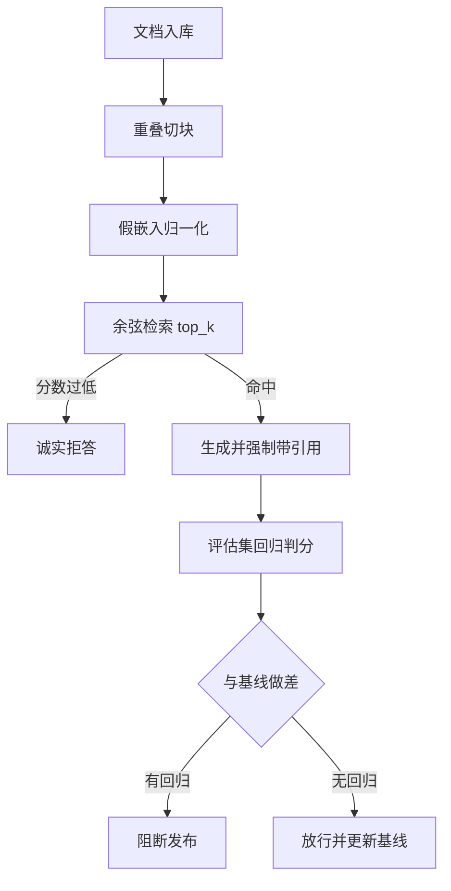

### Q2988 · 评估集的完整回归运行器:跑批-判分-对比基线

> 难度:★★★ | 标签:评估, 回归, 发布门禁

**问**:改了提示词或换了模型,怎么科学判断「新版能不能发布」?

**答**:用评估集当「测试套件」:每条用例带 must_contain 与 must_not 两类断言,运行器逐条跑模型判分。但关键不在跑分而在回归对比:与基线版本的通过集合做差,明确列出 fixed(本轮才过)与 broken(基线过、本轮挂)两个清单——一个 90% 的通过率数字本身没有决策价值,「弄坏了哪三条」才有。有 broken 就阻断发布,回滚或修复后再跑。用例设计上,must_not 专抓退化形态(比如兜底话术出现在不该出现的地方),比只查关键词命中更能发现「答非所问」。这套机制让提示词迭代从玄学变成工程。

```python
# file: code/06_Agent与LLM及系统设计/q2988_eval_regression.py
"""Q2988 评估集的完整回归运行器:跑批-判分-对比基线-出报告。

评估集是 LLM 功能的「测试套件」:每条用例带 must_contain 与
must_not 两类断言,运行器逐条跑桩模型并判分;关键在回归对比——
与基线通过集合做差,明确指出「新版本修好了哪些、又弄坏了哪些」,
没有差集的通过率数字没有决策价值。
"""


class FakeModel:
    """版本化桩:v1 答对余额与退款,v2 顺手弄坏了退款表述。"""

    def __init__(self, version):
        self.version = version

    def answer(self, q):
        table = {
            "v1": {
                "余额": "您的账户余额可在 个人中心-钱包 中查看。",
                "退款": "退款将在 3 个工作日内原路退回。",
                "发货": "发货时间以商品页标注为准,一般为 48 小时内。",
            },
            "v2": {
                "余额": "余额请到 个人中心-钱包 查看。",
                "退款": "钱会退回您的账户。",           # 丢了「原路」与时效
                "发货": "发货时间以商品页标注为准,一般为 48 小时内。",
            },
        }
        for key, ans in table[self.version].items():
            if key in q:
                return ans
        return "抱歉,我不明白。"


CASES = [
    {"id": "c1", "q": "怎么查余额",
     "must_contain": ["个人中心", "钱包"], "must_not": ["抱歉"]},
    {"id": "c2", "q": "退款多久到账",
     "must_contain": ["3 个工作日", "原路"], "must_not": ["人工"]},
    {"id": "c3", "q": "什么时候发货",
     "must_contain": ["48 小时"], "must_not": ["抱歉"]},
]


def judge(case, answer):
    reasons = []
    for token in case["must_contain"]:
        if token not in answer:
            reasons.append("缺少:" + token)
    for token in case["must_not"]:
        if token in answer:
            reasons.append("出现违禁:" + token)
    return reasons


def run_suite(model, cases=CASES):
    results = {}
    for case in cases:
        reasons = judge(case, model.answer(case["q"]))
        results[case["id"]] = {"pass": not reasons, "reasons": reasons}
    return results


def diff(baseline, current):
    """对比两轮结果:fixed=本轮才过,broken=基线过本轮挂。"""
    fixed = [cid for cid, r in current.items()
             if r["pass"] and not baseline[cid]["pass"]]
    broken = [cid for cid, r in current.items()
              if not r["pass"] and baseline[cid]["pass"]]
    rate = sum(1 for r in current.values() if r["pass"]) / len(current)
    return {"fixed": fixed, "broken": broken, "pass_rate": rate}


def main():
    base = run_suite(FakeModel("v1"))
    assert all(r["pass"] for r in base.values()), base   # 基线全绿

    cur = run_suite(FakeModel("v2"))
    d = diff(base, cur)
    assert d["broken"] == ["c2"], d                       # 回归被抓出来
    assert d["fixed"] == [], d
    assert abs(d["pass_rate"] - 2 / 3) < 1e-9
    reasons = cur["c2"]["reasons"]
    assert any("缺少:3 个工作日" in x for x in reasons), reasons

    # 反向:新版本修复了旧问题
    cur2 = dict(cur)
    cur2["c3"] = {"pass": False, "reasons": ["缺少:48 小时"]}
    d2 = diff(base, cur2)
    assert d2["broken"] == ["c2", "c3"], d2
    print("基线通过率: 100%% | 新版通过率: %.0f%%" % (d["pass_rate"] * 100))
    print("回归用例:", d["broken"], "| 失败原因:", reasons)
    print("结论:禁止直接发布,需回滚或修复 c2。")


if __name__ == "__main__":
    main()
```

**追问**:
- 追问一:关键词断言太脆,升级方向是什么? 答:LLM-as-judge 打分加人工抽检校准,但断言型用例仍保留,因为它确定、免费、可回归。
- 追问二:评估集要不要随版本更新? 答:case 集合要稳定才有可比性;新问题进「候选池」,定期评审后扩容,不能边跑边改。


