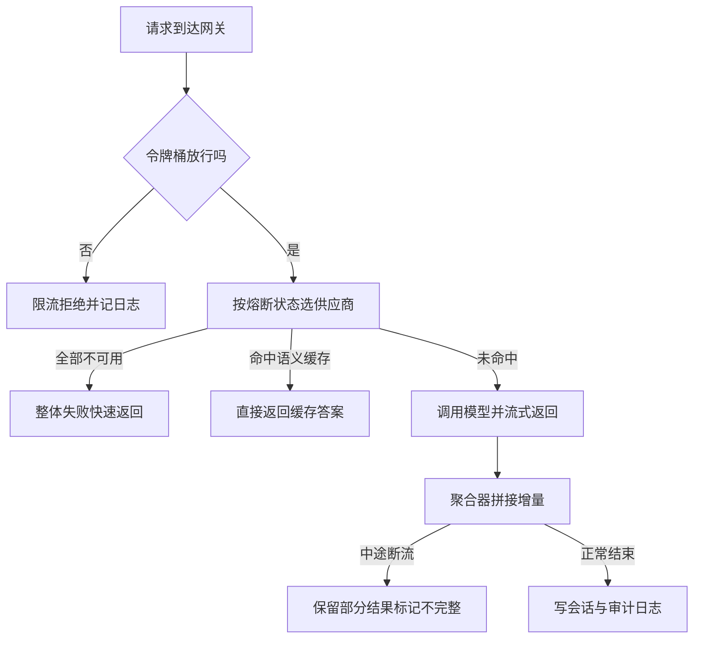

### Q2994 · 流式响应的聚合器:增量拼接-首字延迟-断流恢复

> 难度:★★ | 标签:流式, SSE, 聚合

**问**:流式接口给用户的是打字机体验,但下游审计和计费需要完整文本,中间的聚合器要注意什么?

**答**:聚合器站在流和业务之间,做四件事。逐块拼接正文,空块与 None 增量跳过,不产生幽灵字符。统计首 token 延迟——这是流式体验的核心指标,从请求发出到第一个可见字符,与总耗时分开看。识别结束哨兵:约定 done 标志表示正常结束,没等到哨兵就是异常收尾,不能当成功。最关键的是断流恢复:中途异常时保住已收到的部分结果并标记 incomplete,调用方可以决定展示部分答案、提示重试或降级,不能因为断流把整屏丢掉。首延迟只在第一个非空块时记一次,之后不再更新,保证指标含义稳定。

```python
# file: code/06_Agent与LLM及系统设计/q2994_stream_aggregator.py
"""Q2994 流式响应的聚合器:增量拼接+首字延迟+中断恢复。

流式接口给用户的是「打字机体验」,给下游的是完整文本,聚合器站在
中间:逐块拼接正文,统计首 token 延迟(体验指标)与总块数;约定
哨兵表示正常结束;中途异常时保住已收到的部分结果并标记 incomplete,
调用方可以决定展示部分答案还是降级重试——不能因为断流把整屏丢掉。
"""

import time


class StreamResult:
    def __init__(self):
        self.parts = []
        self.chunk_count = 0
        self.first_latency = None
        self.done = False
        self.error = None

    @property
    def text(self):
        return "".join(self.parts)

    @property
    def incomplete(self):
        return self.error is not None


def aggregate(chunks, clock=None):
    """chunks: 产生 str 或 dict 的迭代器;dict 带 done=True 表示哨兵。"""
    clk = clock or time.time
    res = StreamResult()
    start = clk()
    try:
        for item in chunks:
            if isinstance(item, dict) and item.get("done"):
                res.done = True
                break
            text = item["delta"] if isinstance(item, dict) else item
            if not text:
                continue
            if res.first_latency is None:
                res.first_latency = round(clk() - start, 4)
            res.parts.append(text)
            res.chunk_count += 1
    except Exception as exc:              # 断流:保留部分结果
        res.error = "%s: %s" % (type(exc).__name__, exc)
    return res


def fake_stream(chunks_data, raise_after=None):
    """模拟流:正常发 delta,可在第 n 块后抛异常模拟断流。"""
    for i, data in enumerate(chunks_data):
        if raise_after is not None and i >= raise_after:
            raise ConnectionError("网络中断")
        yield data


def main():
    # 正常流:拼接、首延迟、哨兵结束
    chunks = [{"delta": "退款"}, {"delta": "将在"},
              {"delta": "3 个工作日内到账。"}, {"done": True}]
    res = aggregate(chunks, clock=lambda: 0.0)
    assert res.text == "退款将在3 个工作日内到账。", res.text
    assert res.done and not res.incomplete
    assert res.chunk_count == 3 and res.first_latency == 0.0

    # 带模拟时钟的首字延迟
    ticks = iter([0.0, 0.8, 0.9, 1.0, 1.1])
    res2 = aggregate(fake_stream(["您好", "!", None]), clock=lambda: next(ticks))
    assert res2.first_latency == 0.8, res2.first_latency
    assert res2.text == "您好!" and not res2.done    # 没发哨兵

    # 断流:部分结果保住,incomplete=True
    res3 = aggregate(fake_stream(["订单", "已受理", ",退款中"],
                                 raise_after=2),
                     clock=lambda: 0.0)
    assert res3.text == "订单已受理", res3.text
    assert res3.incomplete and "ConnectionError" in res3.error
    assert res3.done is False
    # 空块与 None 增量被跳过,不产生幽灵块
    res4 = aggregate(["a", "", None, "b", {"done": True}], clock=lambda: 0.0)
    assert res4.text == "ab" and res4.chunk_count == 2
    print("完整流:", res.text)
    print("断流部分结果:", res3.text, "| 错误:", res3.error)
    print("首字延迟:", res2.first_latency, "s | 总块数:", res2.chunk_count)


if __name__ == "__main__":
    main()
```

**追问**:
- 追问一:断流后部分答案展示还是丢弃? 答:看领域:闲聊可展示并提示不完整,交易类必须丢弃,宁可重试也不能让用户看到半截承诺。
- 追问二:首字延迟高但总耗时正常,优化哪里? 答:优化首 token 之前的路径:提示词裁剪、上下文组装、路由决策,通常瓶颈不在生成而在前置处理。


