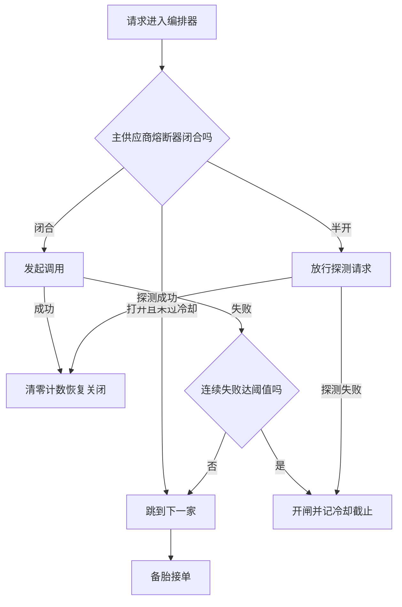

### Q2998 · 故障切换的多供应商编排:熔断-半开探测-优先级恢复

> 难度:★★★ | 标签:高可用, 熔断, 故障切换

**问**:接了两家模型供应商做容灾,简单的「失败就试下一家」差在哪?

**答**:差在三件事。一是熔断:主供应商挂了,每次请求还都要先撞一次失败再降级,白白的超时成本,所以要按连续失败计数开闸,冷却期内直接跳过。二是半开探测:冷却结束不能瞬间恢复全量,要放一个探测请求先试试,成功才真正回正席,失败则继续熔断并重新计时。三是优先级恢复:备胎顶上只是应急,主供应商恢复后要按优先级回到主位,否则备胎的配额和质量约束会被慢慢拖垮。编排器对上层只暴露一个调用入口,把「此刻谁该接单」的决策全部收进去,并用轨迹记录每家被跳过、失败、接单的原因,事后能还原完整的容灾过程。

```python
# file: code/06_Agent与LLM及系统设计/q2998_failover_orchestrator.py
"""Q2998 故障切换的多供应商编排:熔断+半开探测+优先级恢复。

多供应商容错不是简单的 try 下一家:每家要有独立熔断器(连续失败
开闸,冷却后半开放一个探测请求),探测成功才恢复正席;恢复后按
优先级回到主供应商,而不是永远黏在备胎上。编排器对上层只暴露一个
调用入口,把「此刻谁该接单」的决策全部收进去。
"""


class Circuit:
    CLOSED, OPEN, HALF_OPEN = "closed", "open", "half_open"

    def __init__(self, fail_threshold=2, cooldown=8.0):
        self.fail_threshold = fail_threshold
        self.cooldown = cooldown
        self.fail_streak = 0
        self.state = self.CLOSED
        self.opened_at = None

    def can_try(self, now):
        if self.state == self.CLOSED:
            return True
        if self.state == self.OPEN and now - self.opened_at >= self.cooldown:
            self.state = self.HALF_OPEN          # 放一个探测请求
            return True
        return False

    def on_result(self, ok, now):
        if ok:
            self.fail_streak = 0
            self.state = self.CLOSED             # 探测成功恢复正席
        else:
            self.fail_streak += 1
            if self.state == self.HALF_OPEN or \
               self.fail_streak >= self.fail_threshold:
                self.state = self.OPEN
                self.opened_at = now
                self.fail_streak = self.fail_threshold


class Provider:
    def __init__(self, name, priority, breaker=None):
        self.name = name
        self.priority = priority
        self.breaker = breaker or Circuit()

    def call(self, request):
        raise NotImplementedError                # 由测试桩覆写


class FailoverOrchestrator:
    def __init__(self, providers, clock):
        self.providers = sorted(providers, key=lambda p: p.priority)
        self.clock = clock
        self.trace = []

    def execute(self, request):
        now = self.clock()
        for p in self.providers:
            if not p.breaker.can_try(now):
                self.trace.append(p.name + ":skip")
                continue
            try:
                result = p.call(request)
            except Exception as exc:
                p.breaker.on_result(False, now)
                self.trace.append(p.name + ":fail(" + str(exc) + ")")
                continue
            p.breaker.on_result(True, now)
            self.trace.append(p.name + ":ok")
            return result, p.name
        raise RuntimeError("全部供应商不可用")


def main():
    now = [0.0]

    def make(name, fail_times):
        """桩:前 fail_times 次调用抛错,之后成功。"""
        state = {"n": 0}

        def call(request):
            state["n"] += 1
            if state["n"] <= fail_times:
                raise ConnectionError("down")
            return name + " 说:好的"

        p = Provider(name, priority=0)
        p.call = call                      # 覆写实例方法作为桩
        return p

    primary = make("primary", 99)                # 一直挂
    backup = make("backup", 1)                   # 首次失败随后恢复
    orch = FailoverOrchestrator([primary, backup], clock=lambda: now[0])

    # 第 1 次:primary 失败 -> backup 也失败 -> 整体失败
    try:
        orch.execute("q")
        raise AssertionError("应当整体失败")
    except RuntimeError as exc:
        assert "全部供应商" in str(exc)

    # 第 2 次:primary 还没熔断再试一次,失败后熔断;backup 成功
    out, who = orch.execute("q")
    assert who == "backup" and out == "backup 说:好的", (out, who)

    # 冷却期内 primary 被跳过,backup 直接接单
    now[0] = 3.0
    out2, who2 = orch.execute("q")
    assert who2 == "backup", who2

    # 冷却结束:primary 半开放探测,仍然失败,继续熔断
    now[0] = 12.0
    out3, who3 = orch.execute("q")
    assert who3 == "backup", who3                # 探测失败降级

    # 再冷却+探测成功:primary 恢复正席,按优先级回到主位
    now[0] = 25.0
    primary.call = lambda r: "primary 康复了"    # 探测时已恢复
    out4, who4 = orch.execute("q")
    assert who4 == "primary" and out4 == "primary 康复了", (out4, who4)
    assert primary.breaker.state == Circuit.CLOSED

    events = [t.split(":")[1].split("(")[0] for t in orch.trace]
    assert "fail" in events and "skip" in events and "ok" in events
    print("故障切换轨迹:", " | ".join(orch.trace))
    print("恢复后主供应商:", who4)


if __name__ == "__main__":
    main()
```

**追问**:
- 追问一:两家同时挂怎么兜底? 答:快速失败加兜底话术或排队重试,切忌无限重试放大故障;必要时本地缓存答案顶一阵。
- 追问二:熔断阈值和冷却时间怎么定? 答:阈值按失败率目标反推(如 5 次连败即异常),冷却要长于供应商典型故障恢复时间,通常分钟级并用探测渐进放量。


