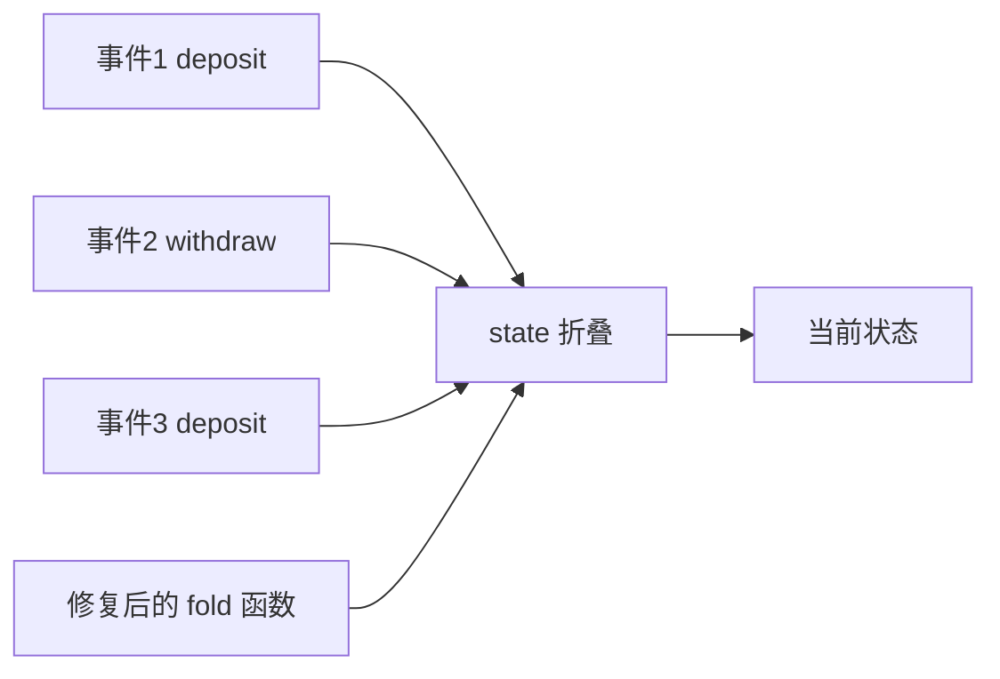

### Q302 · 本地事件重放:用事件溯源修复数据
> 难度:★★★★ | 标签:架构, 事件溯源

**问**:什么是事件重放?线上出 bug 导致数据算错,如何用重放修复?

**答**:把所有状态变更记为不可变事件(append-only),当前状态是事件按序折叠(fold/reduce)的结果。出问题时修复策略:修正有 bug 的处理函数,从事件流重放到最新状态即可得到正确结果;也可在任意历史点分叉重放做对比验证。前提是事件记录完整、处理函数确定性(同输入同输出),这也是事件溯源的核心约束。

```python
# file: code/06_Agent与LLM及系统设计/q302_event_replay.py
from dataclasses import dataclass


@dataclass(frozen=True)
class Event:
    type: str
    payload: dict


def fold(events: list[Event]) -> dict:
    """从事件流折叠出当前状态,处理函数是唯一真相来源。"""
    state = {"balance": 0}
    for e in events:
        if e.type == "deposit":
            state["balance"] += e.payload["amount"]
        elif e.type == "withdraw":
            state["balance"] -= e.payload["amount"]
    return state


# 有 bug 的版本:withdraw 少扣了手续费
def fold_buggy(events: list[Event]) -> dict:
    state = {"balance": 0}
    for e in events:
        if e.type == "deposit":
            state["balance"] += e.payload["amount"]
        elif e.type == "withdraw":
            state["balance"] -= e.payload["amount"] - 5  # bug
    return state


if __name__ == "__main__":
    events = [
        Event("deposit", {"amount": 100}),
        Event("withdraw", {"amount": 30}),
        Event("deposit", {"amount": 20}),
    ]
    print("buggy:", fold_buggy(events))   # 修复前线上错误状态
    print("fixed:", fold(events))         # 修复后重放得到正确状态
```

**追问**:
- 处理函数非确定性会怎样?——重放结果和现状不一致,事件溯源的根基崩塌;时间、随机、外部调用都要在写入时记录为事件数据。
- 事件 schema 演进怎么办?——upcasting(旧事件读时升级到新版本)+ 版本号字段;不能改写历史事件。
- 快照为什么要做?——事件流太长全量重放慢;定期快照折叠状态,重放从最近快照继续。



---
