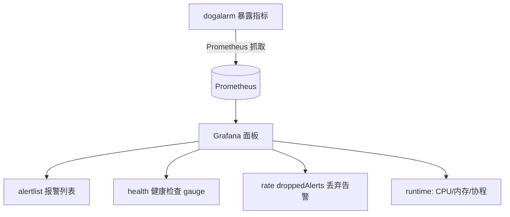

# 103. Go APM 监控系统实战: dogalarm 自监控面板

## 纲要

- 报警列表面板（alertlist）：列出当前 firing / pending 的告警规则，含 app、alertname、持续时长
- 健康检面板：每个 `app + host` 的存活状态 gauge（1 存活 / 0 宕机），配中文映射
- 丢弃告警面板：`droppedAlerts` counter，用 `rate()` 看过去 5 分钟丢弃速率，评估限流排重吞吐
- 通用指标：引入 dogAPM 后自动暴露 CPU / 内存 / 协程等 runtime 指标，复用既有采集
- 丢弃计数器的意义：当因资源保护主动丢弃告警时，可据此评估服务吞吐与告警覆盖盲区

## 素材索引



## 报警列表面板

dogalarm 作为一个告警服务，自己首先要能被一眼看清「现在系统里有哪些服务在告警」。在 Grafana 新建一个面板，类型选 **Alert List**（报警列表）。它能列出当前处于 `firing`（已触发）和 `pending`（挂起）状态的告警规则，并展示：

- 对应的服务名（`app` 等 labels）；
- 告警名称（`alertname`）；
- 该告警已持续的时间。

这个面板就是 dogalarm 的「健康总览」，让值班人员立刻知道哪些服务不在正常状态、告警内容是什么。面板命名为「报警列表」。

## 健康检面板

前面在保活探测里已经为每个 `app + host` 维护了存活状态。把这个状态做成 gauge 面板（命名为「健康检查」）：

- `1` 表示服务存活；
- `0` 表示宕机。

Grafana 的 Value mapping 可以把 `1` 显示成「存活」、`0` 显示成「宕机」，一眼分辨。展示维度只选 `app` 与 `host`，就能逐个服务检测是否存活。

## 丢弃告警面板

dogalarm 内部有「限流排重」逻辑，被丢弃的告警会累加到一个 counter 指标 `droppedAlerts`。建一个面板展示这个指标，用 `rate()` 看过去 5 分钟的丢弃速率：

```promql
rate(dogalarm_dropped_alerts_total[5m])
```

它的价值在于反向评估：如果丢弃速率长期偏高，说明告警过于密集，或程序因保护自身资源（如内存上涨时主动丢弃）而漏掉了部分告警——这正是为什么要把「丢弃告警」单独做成指标来监控：用 `droppedAlerts` 量化这种「主动丢告警」的行为，评估服务吞吐与告警覆盖的盲区。

## 通用 runtime 指标

dogalarm 本身也是个 Go 服务。只要引入了 dogAPM 的 `EnableAPM`，CPU、内存、协程数这类 runtime 指标会自动暴露，Prometheus 直接抓取即可，无需额外编码。这些面板与前面业务服务的一致，直接复用既有采集配置即可。

## Demo 示例

> 以下 Go 代码根据讲稿逻辑补充，演示 dogalarm 用 Prometheus 客户端暴露 `droppedAlerts` 与 `healthState` 两个自监控指标。需 `go get github.com/prometheus/client_golang/prometheus`。

### 运行说明

1. `go get github.com/prometheus/client_golang/prometheus`
2. `go run` 后在 `:8083/metrics` 查看 `dogalarm_dropped_alerts_total` 与 `dogalarm_service_health`。
3. Grafana 加面板：`rate(dogalarm_dropped_alerts_total[5m])` 看丢弃速率，`dogalarm_service_health` 看存活。

### 代码

```go
// selfmon/selfmon.go —— 根据讲稿逻辑补充（需 prometheus client）
package main

import (
	"net/http"

	"github.com/prometheus/client_golang/prometheus"
	"github.com/prometheus/client_golang/prometheus/promhttp"
)

var (
	// droppedAlerts 被限流排重丢弃的告警数，维度含 app/host/通知类型。
	droppedAlerts = prometheus.NewCounterVec(
		prometheus.CounterOpts{
			Name: "dogalarm_dropped_alerts_total",
			Help: "被限流排重丢弃的告警数",
		},
		[]string{"app", "host", "notify_type"},
	)

	// healthState 服务存活状态：1 存活，0 宕机。
	healthState = prometheus.NewGaugeVec(
		prometheus.GaugeOpts{
			Name: "dogalarm_service_health",
			Help: "服务存活状态 1=存活 0=宕机",
		},
		[]string{"app", "host"},
	)
)

func main() {
	prometheus.MustRegister(droppedAlerts, healthState)

	// 演示打点
	droppedAlerts.WithLabelValues("orderservice", "node-1", "phone").Inc()
	healthState.WithLabelValues("orderservice", "node-1").Set(1)

	http.Handle("/metrics", promhttp.Handler())
	_ = http.ListenAndServe(":8083", nil)
}
```

### 代码说明

- `droppedAlerts` 用 CounterVec 带 `app/host/notify_type` 维度，`rate()` 即可观察分维度丢弃速率。
- `healthState` 用 GaugeVec 表达存活状态，1/0 在 Grafana 做 Value mapping 显示中文。
- 引入 dogAPM 的 `EnableAPM` 后，CPU/内存/协程等 runtime 指标会自动出现在 `/metrics`，无需在此重复注册。

### 技术点总结

- Alert List 面板总览 firing/pending 告警及持续时长，是 dogalarm 的健康入口
- 健康检查用 gauge（1 存活 / 0 宕机），配 Value mapping 直观展示
- droppedAlerts 用 rate() 量化限流排重下的丢弃，反向评估告警覆盖盲区
- EnableAPM 自动暴露 runtime 指标，通用面板直接复用

