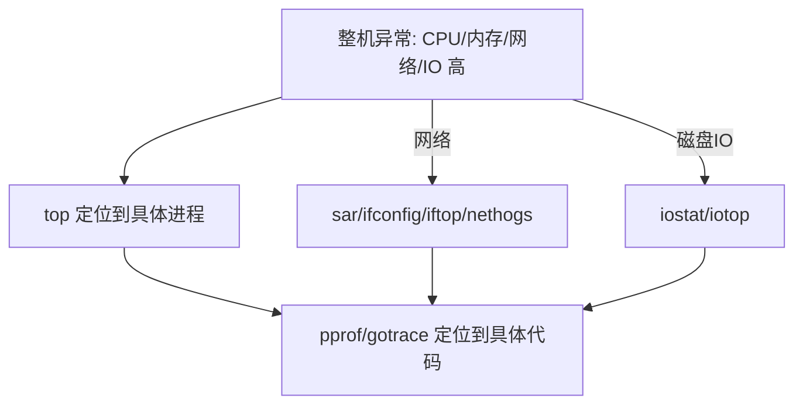

# 106. Go APM 监控系统实战: 通过 Linux 命令通用定位资源瓶颈

## 纲要

- 通用排查思路：从**整机**到**进程**再到**具体代码**，不断缩小问题范围，抽丝剥茧。
- CPU/内存：`top` 看系统级占用与各进程占用，按 `P` 按 CPU 排序、`M` 按内存排序；注意 `buff/cache` 可被系统回收。
- 进程内代码级：用 `pprof`（Go）/ 同类工具（Java）导出火焰图，定位是哪一行代码吃 CPU 或内存。
- 网络：`sar -n DEV` 看流量与 PPS，`ifconfig` 看收发包/错误/丢包，`iftop` 看哪个 IP 流量大，`nethogs` 看哪个进程占带宽，Go 用 `gotrace` 看网络调度延迟。
- 磁盘 IO：`iostat` 看读写与 await 延迟，`iotop` 看哪个进程频繁读写，`gotrace` 看频繁的系统调用。

## 素材索引

## 由大到小的定位思路

当一台服务器上噪声点（异常指标）出现，通常先反映为整机某个资源升高。定位时要逐层缩小范围：

1. **整机**：确认是 CPU、内存、网络还是磁盘 IO 在涨。
2. **进程**：定位到具体哪个进程导致该资源升高。
3. **代码**：对该进程用 profiling 工具（如 Go 的 `pprof`）定位到具体哪一行代码引起异常。

范围缩小到具体代码后，问题基本就迎刃而解。这一思路适用于服务器上任何服务或组件的排查，是本章以及后续各组件扩容分析的基础。

## CPU 与内存：top

`top` 上半部分是系统整体资源，下半部分是每个进程的占用。

| 指标 | 含义 |
| --- | --- |
| `us` | 用户态程序占用 CPU 百分比 |
| `sy` | 内核态代码占用 CPU 百分比 |
| `id` | 空闲 CPU 百分比 |
| `total` | 物理内存总量 |
| `free` | 完全空闲内存 |
| `used` | 已使用内存 |
| `buff/cache` | 文件缓存，内存不足时可由系统自动释放供应用使用 |

关于内存要特别注意：`free` 偏小不代表内存紧张，因为 `buff/cache`（含文件缓存）在内存不足时会被操作系统自动回收。读取文件后，文件数据会被缓存进这块区域，用 `htop` / `lsof` 可以查看进程持有、被缓存的文件。

进入 `top` 后，按大写 `P` 让进程按 CPU 从高到低排序，按大写 `M` 按内存从高到低排序，一眼就能看出哪个进程是资源消耗大户。定位到进程后，再用 `pprof` 之类的工具去定位进程内部具体哪段代码引起 CPU/内存异常；Java 程序有类似的 profiling 工具，也能导出火焰图。

## 网络性能：sar / ifconfig / iftop / nethogs

从系统层面先看是否存在网络问题，关注三个量：网卡进出流量、每秒发包数（PPS）、以及**丢包数**。

| 命令 | 用途 |
| --- | --- |
| `sar -n DEV 1 5` | 每 1 秒输出一次、共 5 次网卡统计：`rxpck/s`（收包）、`txpck/s`（发包）、`rxkB/s`/`txkB/s`（流量） |
| `ifconfig` | 看具体网卡收发包数、`errors`、`dropped`（丢包数） |
| `iftop` | 交互式查看哪个 IP 消耗流量最多 |
| `nethogs` | 按**进程**维度看带宽占用，直接定位是哪个进程把网络搞拥塞 |
| `gotrace` | Go 程序用其性能剖析图观察网络调度延迟 |

排查顺序：先用 `sar`/`ifconfig` 确认整机网络是否到瓶颈、是否丢包；若 PPS 或流量触顶，丢包数会随之上升，再用 `iftop` 找流量最大的 IP，用 `nethogs` 进一步定位到具体进程；最后用 `pprof`/`gotrace` 看该进程为什么产生大流量。

## 磁盘 IO 性能：iostat / iotop

| 命令 | 用途 |
| --- | --- |
| `iostat` | 看整机磁盘读写速率与读写延迟（await） |
| `iotop` | 定位到具体哪个进程在频繁读写磁盘 |
| `gotrace` | 看系统中是否频繁调用读写磁盘类系统调用 |

思路一致：系统层面 `iostat` 发现 IO 问题 → `iotop` 定位进程 → profiling 工具看频繁的系统调用。

## 小结

这套"整机 → 进程 → 代码"的命令组合，是监控环境还不完善时的兜底定位手段，也适用于任何未知组件。下面开始把它落到链路追踪、日志、指标三大 APM 组件上，讲清楚各自的瓶颈怎么衡量、怎么扩容。

