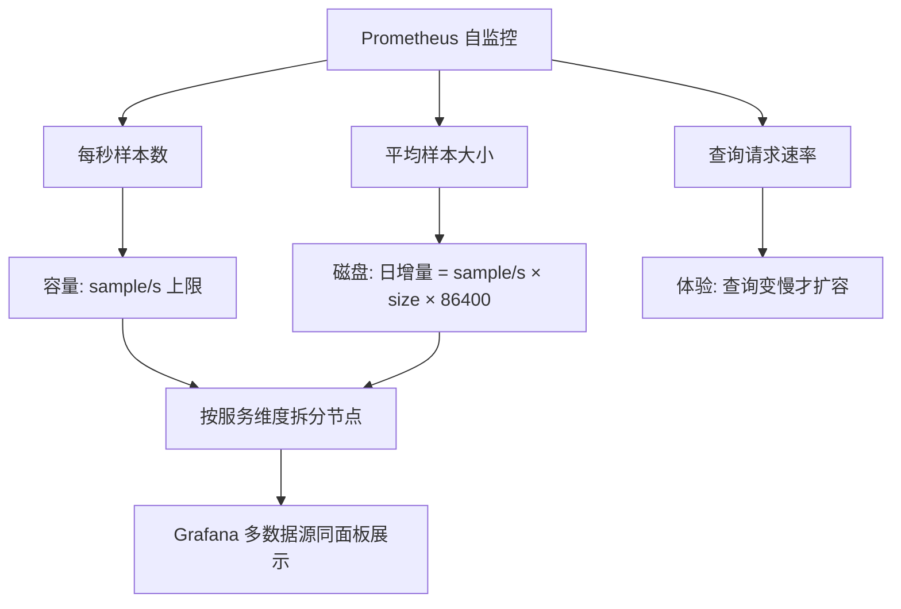

# 109. Go APM 监控系统实战: 指标系统容量分析与扩容思路

## 纲要

- Prometheus 自监控：开启自身 metrics 端口后重启，即可暴露组件运行指标。
- 三类核心指标：① 每秒摄入样本数；② 平均样本大小；③ 查询请求速率。
- 容量估算：每秒样本数 × 平均样本大小 = 每秒数据量，再乘 86400 得每日磁盘增量，据此判断磁盘是否够用、能承载多大 sample/s。
- 查询体验：查询（请求）速率反映看面板的快慢，变慢才考虑扩容。
- 扩容思路"化大为小"：按服务维度划分 Prometheus 节点；某服务样本过多就隔离到独立节点，Grafana 配多数据源、面板可跨源展示，改动最小、成本最低。

## 素材索引



## 开启 Prometheus 自监控

课程前面代码里默认没开 Prometheus 自监控。做法是在 Prometheus 启动配置里加上它**自身**的监听端口（即让 Prometheus 也抓取自己、暴露自己的 `/metrics`），重启后就能收集到组件运行指标。下面三项是日常最常用、也最该关注的。

## 核心指标一：每秒摄入样本数

想知道 Prometheus 当前每秒收集多少个样本：

```promql
rate(prometheus_tsdb_head_samples_appended_total[5m])
```

样本数直接反映采集压力，是容量规划的基础量。

## 核心指标二：平均样本大小

想知道每个样本平均多大（字节）：

```promql
# 平均样本大小 ≈ 每秒写入字节数 / 每秒样本数
rate(prometheus_tsdb_head_bytes_appended_total[5m])
/
rate(prometheus_tsdb_head_samples_appended_total[5m])
```

把"每秒样本数"和"平均样本大小"相乘，就得到**每秒产生的数据量**；再乘一天的秒数（86400），即可估算 Prometheus 一天落盘的数据体积。这对磁盘容量预估非常关键——据此判断当前磁盘能否撑住指标收集，以及系统能承载多大的 sample/s。

```go
// estimate/volume.go —— 根据讲稿逻辑补充：
// 由 每秒样本数 与 平均样本大小 估算每日数据量（字节）。
package estimate

// DailyVolume 返回单日数据增量（字节）。
// samplesPerSec: rate(prometheus_tsdb_head_samples_appended_total[5m]) 的值
// avgSampleBytes: 平均样本大小（字节）
func DailyVolume(samplesPerSec, avgSampleBytes float64) float64 {
	bytesPerSec := samplesPerSec * avgSampleBytes
	return bytesPerSec * 86400
}
```

## 核心指标三：查询请求速率

关系到使用体验——希望看监控面板时结果尽快出来：

```promql
rate(prometheus_http_requests_total{code="200"}[5m])
```

它反映当前 Prometheus 的查询快慢。只有当查询明显变慢、影响开发同学看面板时，才考虑扩容。

## 容量规划的价值

这些自监控指标不只是"看看而已"：

- 知道每天收集多少样本、每个样本多大，就能预估磁盘是否够用；
- 知道当前系统能承载多大的 sample/s，为**接入新系统**提供依据——新系统也会暴露样本指标，结合历史自监控数据，就能判断接入前是否要先扩容指标收集组件。

## 扩容：化大为小

Prometheus 的扩容采用"化大为小"的思路，成本最低：

- 采集指标时本来就带了服务名、主机名等 label，通常**按服务维度划分 Prometheus 节点**。
- 若发现某个服务暴露的样本数过多，把它**隔离**到一台新的 Prometheus 节点单独采集，其余不变。
- Grafana 可配置**多个数据源**，一个面板也能跨多个数据源展示，因此拆分节点后所有数据仍可在同一面板呈现。

这样以最小改动、最小成本完成 Prometheus 节点扩容。

## 小结

指标系统的瓶颈衡量 = 主机资源 + Prometheus 自监控（sample/s、样本大小、查询速率）+ 磁盘容量估算；扩容按服务维度拆分节点、Grafana 配多数据源同屏展示。这与前面链路追踪、日志的"先衡量再扩容"一脉相承。

