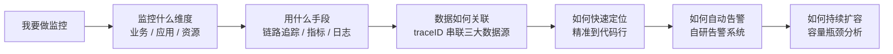

# 1. Go APM 监控系统实战: 课程导学与可观测性学习路径

## 纲要

- 监控知识体系之所以难学，是因为它同时横跨**方法论**与**组件工程**两层，初学者很容易迷失
- 入门必须先回答三个问题
 - 应该从哪些**维度**去监控
 - 每个维度应该采用什么**手段**落地
 - 采集到的多维度数据之间如何建立**关联**，从而在故障时快速定位
- 本课程的定位：以实践为主、理论为辅，从零到一落地一套生产可用的 APM 系统
- 课程主线：基础微服务框架 → 链路追踪 → 性能指标 → 日志采集 → pprof 精准定位问题代码 → 自研告警系统 → 容量分析与扩容
- 课程真正的难点不是"把组件搭起来"，而是"想清楚该监控什么"

## 监控知识体系难在哪里

在生产项目里，"监控"是一个高频词，但大多数开发者的监控认知停留在业务日志和机器资源两个层面。一旦需要真正搭建一套监控体系，就会遇到三个绕不开的问题：

- **监控维度不明确**：CPU、内存、磁盘 IO 这类机器维度的指标，与服务 QPS、接口耗时、下单成功率这类应用维度的指标，究竟该以谁为主？
- **监控手段不匹配**：知道了维度，还要决定用链路追踪、指标还是日志去承载它，三种手段的适用场景和成本差异很大。
- **数据之间没有关联**：指标发现异常后，无法反查是哪条请求、哪段日志、哪行代码导致的，最终又回到"靠猜"。

这三个问题构成了监控体系的主干。本课程的全部内容，本质上就是对这三个问题的逐一解答。

## 课程主线与知识结构

课程采用"先搭骨架、再逐层加监控能力"的推进方式，整体分为六段：

| 阶段 | 内容 | 解决的问题 |
| --- | --- | --- |
| 基础框架 | 用 Go 构建电商下单微服务（订单 / 用户 / 商品），HTTP 对外、gRPC 对内，依赖 MySQL 与 Redis | 为后续所有监控手段提供一个可改造的"被监控对象" |
| 链路追踪 | OpenTelemetry SDK、Collector、Jaeger 展示、后置采样、MySQL / Redis / HTTP / gRPC 埋点 | 一个请求在微服务集群里到底走了哪些服务、慢在哪一步 |
| 指标监控 | Prometheus 四大指标类型、PromQL 函数、Grafana 面板、runtime 指标、业务指标、数据库访问指标 | 用趋势数据发现问题，并为告警提供数据源 |
| 日志采集 | 文件日志、Filebeat / Logstash 收集、Elasticsearch 存储、Kibana 展示与索引生命周期 | 用明细数据解释问题，补全链路追踪看不到的上下文 |
| 精准定位 | pprof（CPU / 内存 / block / mutex / goroutine）、go trace、holmes 自动化 profile | 把问题从"某个接口慢"收敛到"某一行代码" |
| 告警与扩容 | 自研告警服务、Grafana 告警接入、日志告警、电话 / 钉钉通知、限流排重、自监控与容量分析 | 让监控闭环，并保证监控系统自身可持续演进 |

值得注意的是，课程选择的技术栈（OpenTelemetry、Prometheus、Grafana、Jaeger、ELK）都是当前云原生可观测性领域的事实标准，学到的方法论和组件用法可以直接迁移到自己的项目里。

## 三个贯穿全课程的观念

### 监控不是越全越好

很多初学者搭建监控系统时，倾向于把系统的方方面面都监控一遍。结果反而是：面板越多，告警越杂，真正出问题时越容易被噪声干扰。

正确的做法是**站在解决问题的角度设计监控**。业务架构简单、只有一两台服务器时，未必需要完整的链路追踪——打日志就够了；但 QPS、错误数、关键业务指标（如下单成功数）无论公司大小都值得监控，因为它们直接反映应用的健康度，并且是告警的直接依据。

### 优化必须有数据支撑

性能优化最容易陷入"我觉得快了"的争论。只有把优化前后的指标（例如订阅页渲染耗时从 2s 降到 1s、订阅转化人数上升）量化记录下来，结论才具备说服力，后续的容量规划才有依据。这也是为什么要先建设指标系统，再谈性能优化。

### 落地难点在埋点设计而非组件搭建

组件的安装配置是有标准答案的，真正考验工程能力的是：

- 如何设计指标，让它既能发现问题又能定位问题
- 如何打印日志，让它携带足够上下文而不是只记一句错误
- 如何在代码框架里做链路追踪埋点，让 trace 数据覆盖到 MySQL 慢查询、长事务、Redis 报错、慢 HTTP 接口、慢 gRPC 接口

Go 语言没有 Java 那种字节码增强的自动探针，链路追踪基本依赖**手动埋点**，因此埋点设计是 Go APM 落地中最核心的工程环节。

## 适合人群与学习建议

- **有一定开发基础的后端工程师**：结合自己做过的项目，反问"当时的监控有哪些缺位"，把方法论直接映射回自己的系统。
- **初级架构师**：重点看监控层次的划分（业务层 / 应用服务层 / 中间件层）以及最后一章的容量分析与扩容思路。
- **对技术有追求的工程师**：把视野从业务代码扩展到系统可观测性与稳定性建设。

学习时建议一边看一边动手：跟着章节逐步给自己手上的项目加上监控能力，并持续思考"如果我早这样做，之前的某个线上故障会不会提前被发现"。

