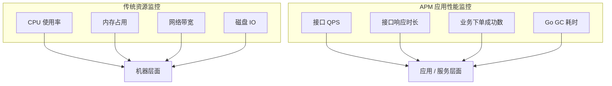
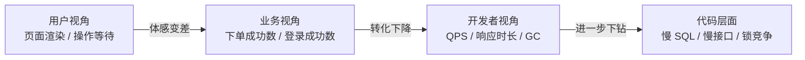

# Go APM 监控系统实战: APM 核心概念与监控维度划分

## 纲要

- APM 是 Application Performance Monitor 的缩写，即**应用服务性能监控**
- 与传统资源监控的本质区别：监控对象从**机器层面**上移到**应用服务层面**
- 监控内容是分维度的，可以从三个视角切分
    - 开发者视角：接口 QPS、响应时长、GC 耗时
    - 产品 / 业务视角：登录成功人数、下单成功数
    - 用户视角：页面渲染时间、真实体验指标
- 学习任何一门技术都遵循"是什么、为什么、怎么用"的顺序，APM 也不例外

## 什么是 APM

APM（Application Performance Monitor，应用性能监控）是一类监控工具的统称。它和传统资源监控的根本差异在于**监控对象**：

- **传统资源监控**关注的是机器层面的指标：CPU 使用率、内存占用、网络带宽、磁盘 IO。它回答的问题是"这台机器忙不忙"。
- **APM** 关注的是应用服务层面的指标：服务接口的 QPS、服务接口的响应时长、业务下单数、Go 程序的 GC 时长。它回答的问题是"这个服务对外提供服务的效率好不好"。

## 监控是分维度的

建设 APM 之前必须建立的一个认知是：**监控不是一张大表，而是分层次、分视角的**。同样一个系统，不同角色关心的数据完全不同。

### 开发者视角

开发者最关心服务自身的吞吐与延迟，典型指标包括：

- 服务接口的 QPS（每秒请求数）
- 服务接口的响应时长（常用 P99、P95 而非平均值）
- 运行时指标：Go 程序的 GC 暂停时长、goroutine 数量、堆内存占用

这类指标反映了服务的处理能力，是容量规划和性能调优的直接依据。

### 产品 / 业务视角

从业务角度出发，关心的是系统有没有把该做的事情做成：

- 当天的登录成功人数
- 电商系统中的当天下单成功数、支付成功数

业务指标的特点是与公司营收直接挂钩，一旦异常通常需要立即介入，因此往往是告警规则里的高优先级项。

### 用户视角

用户视角关注的是**真实体验**，例如：

- 页面首屏渲染时间
- 某个关键操作（如进入订阅页）的等待时长

这类指标的价值在于把技术问题和商业结果直接关联起来。假设订阅页渲染要 5 秒，那么一部分本来想订阅的用户会在等待过程中流失——这部分损失是可以被量化的。通过监控真实体验指标，就能清晰地知道应用对外提供服务的状态和效率。

## 三个视角的关系

三个视角不是割裂的，而是一条**自上而下的问题定位链**：用户体感变差会被业务指标捕捉，业务指标异常会被应用指标解释，应用指标异常最终要靠链路追踪与 pprof 落到具体代码上。

这也解释了为什么后面要建设那么多监控面板——不是为了堆砌图表，而是为了让问题在每一层都有对应的数据可以查询。

相关度：95%。是否需要继续：[是]。代码是否可运行：[否]。
