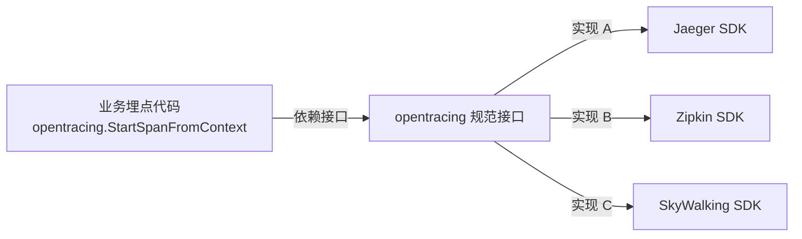
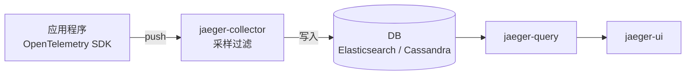
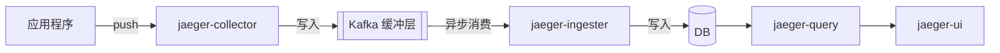
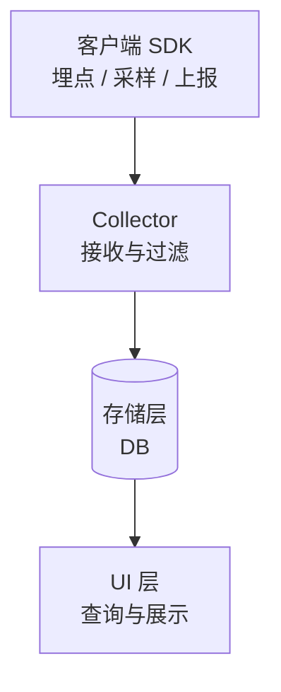

# Go APM 监控系统实战: 常见链路监控工具对比与选型

## 纲要

- 四款主流链路监控工具：Zipkin、Jaeger、SkyWalking、Pinpoint
- 六个对比维度：开发语言、代码侵入性、监控界面丰富度、非链路监控维度支持、告警支持、OpenTracing 规范支持
- OpenTracing 是一套**客户端 SDK 的接口规范**，实现由各厂商提供，因此替换工具时业务埋点代码无需改动
- 选型要结合团队技术栈：Go 团队优先 Jaeger，Java 团队按"界面丰富度 / 告警 / 轻量化"取舍
- Jaeger 的数据流：SDK → Collector（采样）→ DB（存储）→ Query + UI（展示），可用 Kafka 或 OpenTelemetry Collector 做缓冲与中转

## 四款工具横向对比

| 维度 | Zipkin | Jaeger | SkyWalking | Pinpoint |
| --- | --- | --- | --- | --- |
| 开发语言 | Java | **Go** | Java | Java |
| 代码侵入性 | 埋点，有侵入 | 埋点，有侵入 | 探针（javaagent）自动埋点 | 探针自动埋点 |
| 界面丰富度 | 较简单 | 中等 | 丰富 | 丰富 |
| 非链路监控维度 | 不支持 QPS / 响应时长 | 支持 QPS、响应时长 | 支持 | 支持 |
| 告警支持 | 无 | 无（需外挂） | 框架内自带告警规则配置 | 框架内自带告警规则配置 |
| OpenTracing 支持 | 支持 | 支持 | 支持 | 私有协议 |

几个需要展开解释的点：

- **代码侵入性**：Zipkin 和 Jaeger 采用埋点方式，对代码有侵入；SkyWalking 和 Pinpoint 在 Java 上可以通过 javaagent 探针做到自动埋点，接入成本低，但这是 Java 生态特有的能力。
- **监控维度**：Zipkin 只支持链路追踪，没有 QPS、接口响应时长这类 APM 维度，因此界面丰富度也受限。
- **告警**：只有 SkyWalking 和 Pinpoint 在框架内部自带告警规则配置；Zipkin 和 Jaeger 需要配合 Prometheus / Grafana 或自研告警系统来完成。

## OpenTracing 解决了什么问题

OpenTracing 的定位是"提供平台无关、厂商无关的 API，使开发人员能够方便地添加或更换追踪系统的实现"。换句话说，它只规定了**客户端 SDK 调用分布式链路追踪功能时的接口规范**，具体实现由各厂商完成。

在 Go 程序里使用 Jaeger 时，代码结构是这样的：

```go
import (
	"github.com/opentracing/opentracing-go"
	"github.com/uber/jaeger-client-go"
	"github.com/uber/jaeger-client-go/config"
)

func initTracer() (opentracing.Tracer, io.Closer) {
	cfg, _ := config.FromEnv()
	tracer, closer, _ := cfg.NewTracer()
	// 设置为全局 Tracer，业务埋点统一从 opentracing 包取
	opentracing.SetGlobalTracer(tracer)
	return tracer, closer
}
```

关键在于：**初始化用的是 Jaeger 的配置对象，而业务埋点调用的全都是 `opentracing` 包上的方法**。

```go
func createOrder(ctx context.Context) error {
	span, ctx := opentracing.StartSpanFromContext(ctx, "createOrder")
	defer span.Finish()

	span.SetTag("uid", 10086)
	// 业务逻辑...
	return nil
}
```

这样带来的收益非常直接：将来想换掉链路追踪工具时，业务埋点代码一行都不用改，**只需改初始化 GlobalTracer 的那一处逻辑**，换成对应厂商的 SDK 方法即可。例如 Zipkin 同样提供了 `zipkin.NewTracer(...)`，替换后仍然 `opentracing.SetGlobalTracer` 即可。



> 说明：Jaeger 新版本已不再推荐 `opentracing-go` + `jaeger-client-go` 这套组合，而是转向 OpenTelemetry SDK。原因在下一节展开。

## 如何选型

技术选型与团队技术栈强相关，不能脱离团队空谈优劣：

| 场景 | 推荐 | 理由 |
| --- | --- | --- |
| 团队熟悉 Go | Jaeger | 语言一致，源码可读，框架内部问题排查成本低 |
| Java 团队，想要丰富界面 + 告警 | SkyWalking | 功能全面，且支持 OpenTracing 规范，后续替换成本可控 |
| Java 团队，只想要轻量链路追踪 | Zipkin | 功能简洁，专注链路监控这一件事 |
| Java 团队，想要自动埋点 | SkyWalking / Pinpoint | javaagent 探针，几乎零代码改造 |

本课程选择 **Jaeger**：一方面团队语言是 Go，另一方面 Jaeger 支持 OpenTracing 规范，后续要换成其他链路追踪框架成本也不大。

## Jaeger 的数据采集与展示架构

Jaeger 提供三种部署模式，区别在于数据从客户端到存储之间经过了什么。

### 直接写存储



- 应用程序通过 SDK 把 trace 数据 **push** 到 `jaeger-collector`
- Collector 按采样规则决定收集还是丢弃这条 trace
- 通过采样后写入 DB 组件（可以是 Elasticsearch，也可以是其他支持的数据存储）
- 最终由 `jaeger-query` 提供查询能力，`jaeger-ui` 做展示

### 引入 Kafka 作为缓冲层



区别在于 Collector 不再直接写库，而是把数据推到 Kafka，再由 `jaeger-ingester` 异步消费并落库。收益是**通过 Kafka 缓冲减缓 trace 数据对 DB 层的写入压力**——可以按 DB 的写入能力控制消费速率，削峰填谷。

### 引入 OpenTelemetry Collector

在客户端与 Jaeger 之间再加一层 OpenTelemetry Collector，把"上报"与"展示"彻底解耦。这一层的作用在后续链路追踪章节详细展开。

## 通用抽象：一套 trace 系统的最小组成

无论用哪款工具，链路追踪系统都由四部分组成：



- **客户端 SDK**：埋点并推送 trace 数据
- **Collector**：接收数据，执行采样策略
- **存储层**：每种工具支持的具体组件不同
- **UI 层**：展示 trace 数据

理解这个抽象，再看任何一款链路追踪工具都能快速上手。

## API 速览

| API | 说明 |
| --- | --- |
| `config.FromEnv()` | 从环境变量构建 Jaeger 客户端配置 |
| `cfg.NewTracer()` | 创建 Jaeger Tracer 实例与 closer |
| `opentracing.SetGlobalTracer(tracer)` | 设置全局 Tracer，是唯一与厂商耦合的地方 |
| `opentracing.StartSpanFromContext(ctx, name)` | 从 ctx 派生一个 span，自动建立父子关系 |
| `span.SetTag(key, value)` | 为 span 打标签 |
| `span.Finish()` | 结束 span 并上报 |

## Demo 示例

**运行说明**：以下代码根据讲稿逻辑补充，演示"初始化耦合厂商、埋点只依赖规范"这一关键设计。

```bash
go mod init jaeger-demo
go get github.com/opentracing/opentracing-go github.com/uber/jaeger-client-go
go run main.go
```

**完整代码**：

```go
package main

import (
	"context"
	"io"
	"log"

	"github.com/opentracing/opentracing-go"
	"github.com/uber/jaeger-client-go/config"
)

// 唯一与 Jaeger 厂商耦合的地方：更换链路追踪工具时只改这一个函数
func initTracer(service string) io.Closer {
	cfg := config.Configuration{
		ServiceName: service,
		Sampler:     &config.SamplerConfig{Type: "const", Param: 1},
		Reporter:    &config.ReporterConfig{LocalAgentHostPort: "127.0.0.1:6831"},
	}
	tracer, closer, err := cfg.NewTracer()
	if err != nil {
		log.Fatalf("init jaeger tracer failed: %v", err)
	}
	opentracing.SetGlobalTracer(tracer)
	return closer
}

func main() {
	closer := initTracer("order-service")
	defer closer.Close()

	if err := createOrder(context.Background(), 10086); err != nil {
		log.Println("create order failed:", err)
	}
}

// 业务埋点只依赖 opentracing 规范，不依赖任何厂商 SDK
func createOrder(ctx context.Context, uid int) error {
	span, ctx := opentracing.StartSpanFromContext(ctx, "createOrder")
	defer span.Finish()

	span.SetTag("uid", uid)
	return deductStock(ctx)
}

func deductStock(ctx context.Context) error {
	span, _ := opentracing.StartSpanFromContext(ctx, "deductStock")
	defer span.Finish()
	return nil
}
```

**代码说明**：

- `initTracer` 是初始化全局 Tracer 的逻辑，是唯一与 Jaeger 耦合的代码块。
- `createOrder` 与 `deductStock` 的埋点全部调用 `opentracing` 包的方法，与厂商无关。
- 若要换成 Zipkin，只需把 `initTracer` 换成 Zipkin 的构造方式，业务埋点代码零改动。
- 真实环境中需要启动 jaeger-agent 或直接使用 OpenTelemetry Collector 接收上报数据。

**技术点总结**：

- 选型看团队技术栈与功能诉求，不是越全越好
- OpenTracing 的价值在于把"埋点"与"实现"解耦
- Jaeger 支持 Kafka 缓冲与 OpenTelemetry Collector 中转两种扩展架构
- 所有链路追踪系统都遵循 SDK → Collector → 存储 → UI 的四段式结构

相关度：94%。是否需要继续：[是]。代码是否可运行：[是]。
