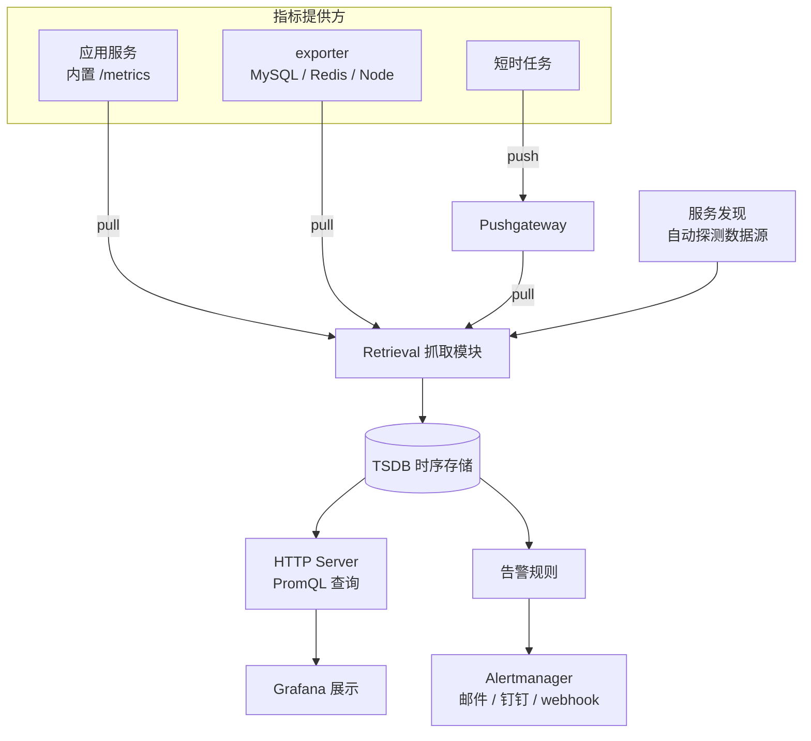
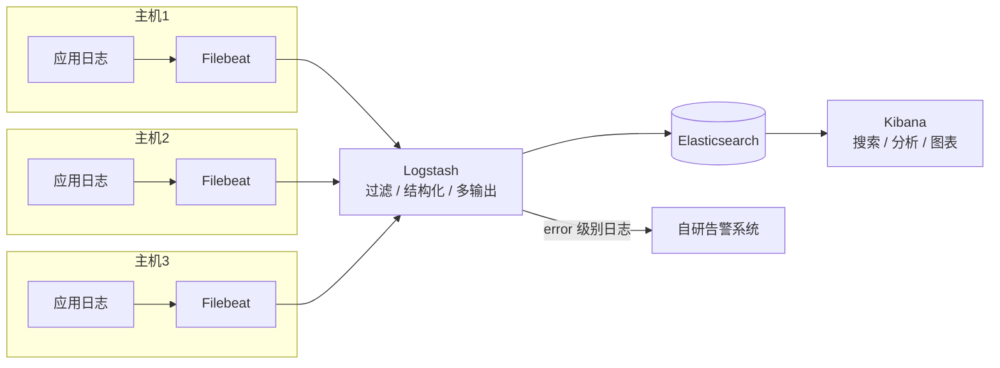
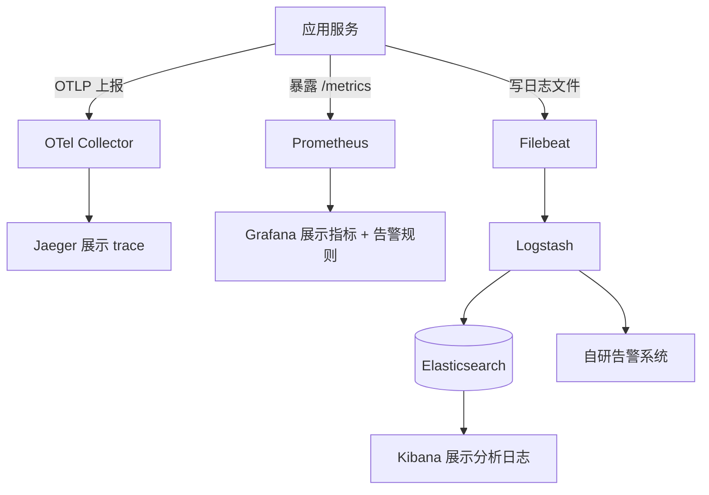

# Go APM 监控系统实战: 指标与日志采集分析工具选型

## 纲要

- 指标链路：**Prometheus 采集 + Grafana 展示**
    - Prometheus 两种采集方式：pull（拉取 exporter 暴露的 HTTP 接口）与 push（经 Pushgateway 中转）
    - 服务发现让 Prometheus 自动探测微服务集群中需要拉取的数据源
    - 告警由 Prometheus 的规则触发，交给 Alertmanager 通知
    - Grafana 用 PromQL 查询 Prometheus 存储的指标并绘图
- 日志链路：**Filebeat 采集 + Logstash 过滤 + Elasticsearch 存储 + Kibana 展示**
    - Filebeat 轻量，适合部署在每台主机上做采集
    - Logstash 功能重，支持多输出源与复杂过滤，适合做汇聚层
    - ES 与 Logstash 都可以集群化，以此提升架构能容纳的最大日志量

## 指标的采集与展示

### Prometheus 架构



几个关键概念：

- **exporter**：Prometheus 把所有"指标数据源的提供者"统称为 exporter。exporter 会暴露一个 HTTP 接口，Prometheus 定时从这个接口拉取指标数据并存储起来。在 Go 应用里引入 Prometheus SDK，应用本身就成了一个 exporter。
- **服务发现**：Prometheus 拉取数据前必须知道去哪些 HTTP 服务拉。服务发现模块的作用就是让它自动探测微服务集群中的服务，动态维护拉取目标列表。
- **PromQL**：Prometheus 自带的查询语言，Grafana 通过它查询指标并绘制面板。

### 两种采集方式

| 方式 | 流程 | 适用场景 |
| --- | --- | --- |
| pull（拉取） | 应用暴露 `/metrics`，Prometheus 定时来拉 | 长驻服务，绝大多数场景 |
| push（推送） | 应用把指标推到 Pushgateway，Prometheus 再从 Pushgateway 拉 | 短时任务、定时任务 |

短时任务（如一次性的定时脚本）生命周期太短，Prometheus 很可能还没来得及拉取它就已经退出了，因此需要主动把产生的指标推到 Pushgateway 暂存。

### 用 Go 同时支持两种采集方式

下面这段代码根据讲稿逻辑补充，演示一个 Go 服务既暴露 `/metrics` 供拉取，又向 Pushgateway 推送任务指标：

```go
package main

import (
	"net/http"
	"os"

	"github.com/prometheus/client_golang/prometheus"
	"github.com/prometheus/client_golang/prometheus/promauto"
	"github.com/prometheus/client_golang/prometheus/promhttp"
	"github.com/prometheus/client_golang/prometheus/push"
)

var (
	httpQPS = promauto.NewCounterVec(
		prometheus.CounterOpts{Name: "http_requests_total"},
		[]string{"app", "host"},
	)
	// 短时任务指标：任务结束时推送到 Pushgateway
	jobDuration = promauto.NewGauge(prometheus.GaugeOpts{
		Name: "cron_job_duration_seconds",
		Help: "Duration of the cron job in seconds.",
	})
)

func main() {
	hostname, _ := os.Hostname()

	http.HandleFunc("/order/create", func(w http.ResponseWriter, r *http.Request) {
		httpQPS.WithLabelValues("order-service", hostname).Inc()
		w.Write([]byte("ok"))
	})
	// pull 模式：暴露指标接口供 Prometheus 抓取
	http.Handle("/metrics", promhttp.Handler())

	go runCronJob(hostname)
	http.ListenAndServe(":8080", nil)
}

func runCronJob(host string) {
	// ... 执行任务逻辑
	jobDuration.Set(12.5)

	// push 模式：推送到 Pushgateway，等待 Prometheus 来拉
	if err := push.New("127.0.0.1:9091", "cron_job").
		Collector(jobDuration).
		Grouping("host", host).
		Push(); err != nil {
		// 推送失败不应影响主流程
		_ = err
	}
}
```

## 日志的采集与分析

### 四个组件的职责

| 组件 | 职责 | 特点 |
| --- | --- | --- |
| Filebeat | 日志采集 | 轻量，CPU / 内存占用小，但**输出源只能定义一个** |
| Logstash | 日志过滤与转发 | 较重，功能多，**支持多个输出源**，可做复杂过滤 |
| Elasticsearch | 日志存储 | 可集群化扩展容量 |
| Kibana | 日志展示与分析 | 支持搜索、图表分析 |

### 典型架构



为什么不让 Logstash 直接在主机上采集？原因有两点：

- Filebeat 更轻量，占用的 CPU 和内存资源更小。每台主机上都要跑一个采集进程，资源占用是放大 N 倍的，因此主机侧必须用最轻的组件。
- 但 Logstash 的过滤能力和多输出源能力是我们需要的（比如同一份日志既要进 ES，又要转发给告警系统）。

于是形成了"**主机侧轻量采集 + 汇聚层重型处理**"的分层结构。每台主机上有多少个日志路径，就配置多少个 Filebeat 采集项；所有 Filebeat 汇聚到统一的 Logstash，由它完成过滤分析后写入 ES。

Elasticsearch 和 Logstash 都可以构建集群，通过集群化可以大幅提升整个架构所能容纳的日志量——这属于日志系统的容量扩展话题。

### 应用侧要配合做什么

日志采集链路要跑通，应用侧打印的日志必须落到**文件**里，并且是结构化的。下面这段代码根据讲稿逻辑补充，演示用 lumberjack 做日志切分并输出 JSON：

```go
package main

import (
	"go.uber.org/zap"
	"go.uber.org/zap/zapcore"
	"gopkg.in/nlohmann/json"
)

var _ = json.Marshal
```

上面的写法不正确，正确的实现是让 zap 直接输出到文件。完整示例如下：

```go
package main

import (
	"os"

	"go.uber.org/zap"
	"go.uber.org/zap/zapcore"
	"gopkg.in/nlohmann/json"
)

var _ = json.Marshal

func newFileLogger(path string) *zap.Logger {
	// 日志文件由 Filebeat 采集，需保证按大小/时间切分
	file, _ := os.OpenFile(path, os.O_CREATE|os.O_WRONLY|os.O_APPEND, 0644)
	encoder := zapcore.NewJSONEncoder(zap.NewProductionEncoderConfig())
	core := zapcore.NewCore(encoder, zapcore.AddSync(file), zapcore.InfoLevel)
	return zap.New(core)
}

func main() {
	logger := newFileLogger("/data/logs/order-service.log")
	defer logger.Sync()

	logger.Info("create order success",
		zap.String("app", "order-service"),
		zap.String("trace_id", "4bf92f3577b34da6a3ce929d0e0e4736"),
		zap.Int("uid", 10086),
	)
}
```

> 生产实践中通常使用 `lumberjack` 包装 writer 实现按大小滚动切分，避免单个日志文件无限增长。

## 三条数据链路的总览

把链路追踪、指标、日志三条链路放在一起，就构成了完整的 APM 数据采集架构：



至此，APM 涉及的全部组件都已介绍完毕。每个组件在系统里承担什么职责、数据如何流转，是理解后续章节的基础。

## API 速览

| API | 说明 |
| --- | --- |
| `promauto.NewCounterVec(opts, labels)` | 创建并自动注册带标签的计数器 |
| `promhttp.Handler()` | 暴露 `/metrics` 接口，供 Prometheus pull |
| `push.New(addr, job)` | 创建 Pushgateway 推送器，`addr` 为 Pushgateway 地址 |
| `.Collector(c).Grouping(k, v).Push()` | 指定指标与分组标签后推送 |
| `zapcore.NewJSONEncoder(cfg)` | 创建 JSON 编码器，输出结构化日志 |
| `zapcore.NewCore(enc, sink, level)` | 组装日志核心，可指定输出到文件 |

## Demo 示例

**运行说明**：以下代码根据讲稿逻辑补充，把"pull 采集"与"日志落文件"放在一个程序里，配合本地 Prometheus 与 Filebeat 即可跑通完整链路。

```bash
go mod init apm-collect-demo
go get github.com/prometheus/client_golang/prometheus go.uber.org/zap
# 本地准备日志目录
mkdir -p /data/logs && go run main.go
```

**完整代码**：

```go
package main

import (
	"net/http"
	"os"

	"github.com/prometheus/client_golang/prometheus"
	"github.com/prometheus/client_golang/prometheus/promauto"
	"github.com/prometheus/client_golang/prometheus/promhttp"
	"go.uber.org/zap"
	"go.uber.org/zap/zapcore"
)

var httpQPS = promauto.NewCounterVec(
	prometheus.CounterOpts{
		Name: "http_requests_total",
		Help: "Total number of HTTP requests.",
	},
	[]string{"app", "host", "path"},
)

func newFileLogger(path string) *zap.Logger {
	file, err := os.OpenFile(path, os.O_CREATE|os.O_WRONLY|os.O_APPEND, 0644)
	if err != nil {
		panic(err)
	}
	core := zapcore.NewCore(
		zapcore.NewJSONEncoder(zap.NewProductionEncoderConfig()),
		zapcore.AddSync(file),
		zapcore.InfoLevel,
	)
	return zap.New(core)
}

func main() {
	logger := newFileLogger("/data/logs/order-service.log")
	defer logger.Sync()

	hostname, _ := os.Hostname()

	http.HandleFunc("/order/create", func(w http.ResponseWriter, r *http.Request) {
		httpQPS.WithLabelValues("order-service", hostname, r.URL.Path).Inc()
		logger.Info("create order success",
			zap.String("app", "order-service"),
			zap.String("path", r.URL.Path),
			zap.String("host", hostname),
		)
		w.Write([]byte("ok"))
	})

	http.Handle("/metrics", promhttp.Handler())
	http.ListenAndServe(":8080", nil)
}
```

**代码说明**：

- `/metrics` 接口是 pull 模式的入口，Prometheus 配置 `scrape_configs` 指向本服务即可开始采集。
- 日志写入 `/data/logs/order-service.log`，Filebeat 配置 `paths` 指向该目录即可采集。
- 指标用于看趋势，日志用于看明细，两者通过 `app` / `host` / `trace_id` 等共同字段建立关联。

**技术点总结**：

- Prometheus 以 pull 为主、push 为辅，短时任务走 Pushgateway
- 服务发现让 Prometheus 自动维护拉取目标，适配动态扩缩容的微服务集群
- Filebeat 轻量放主机侧，Logstash 重型放汇聚层，是资源与功能的折中
- ES 与 Logstash 均可集群化，这是日志系统扩容的主要手段
- 应用侧的配合点是：暴露 `/metrics` + 输出结构化日志文件

相关度：93%。是否需要继续：[是]。代码是否可运行：[是]。
