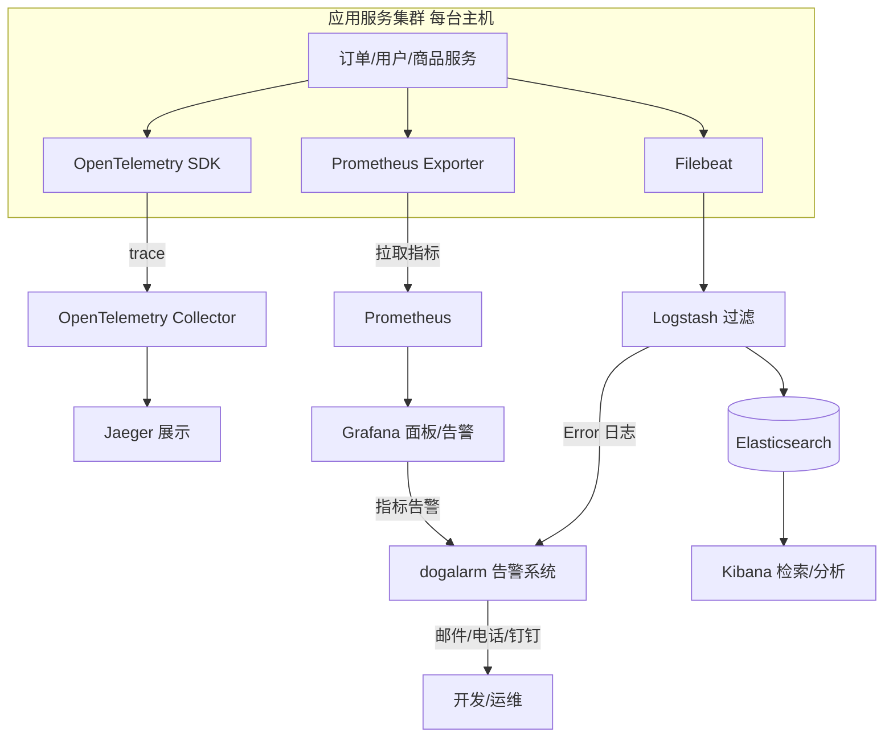

# Go APM 监控系统实战: APM 产品的最终成果与整体架构

## 纲要

- 被监控的微服务集群形态：订单 / 用户 / 商品（SQ）三大服务，gRPC 内部通信、HTTP 对外通信
- 完整落地后的 APM 系统由三大部分组成：链路追踪、指标、日志
- 链路追踪链路：应用内 OpenTelemetry SDK → OpenTelemetry Collector → Jaeger 展示
- 指标链路：应用暴露指标 → Prometheus 拉取 → Grafana 面板与告警
- 日志链路：Filebeat 采集 → Logstash 过滤 → Elasticsearch 存储 → Kibana 检索，Error 日志回灌告警
- 自研告警系统 dogalarm：资源存活探测、指标告警、日志告警（邮件 / 电话 / 钉钉）
- 分层监控方法论：业务层、应用服务层、中间件（数据库）层
- 排查闭环：指标发现问题 → 日志 / 链路定位原因 → 通过 traceID 串起整条调用链

## 被监控的微服务集群

在落地 APM 之前，先要明确我们要监控的对象。整个后端服务由三个微服务组成：

- 订单服务（Order Service）
- 用户服务（User Service）
- 商品服务（SQ，即商品服务）

服务间通信走 gRPC 协议；对外（用户发请求）走 HTTP 协议。每个服务都有自己独立的 Redis 与 MySQL，这是一个典型的微服务架构。

我们模拟的是"用户下订单"这一核心流程：

1. 用户向订单服务发起一个 HTTP 请求；
2. 订单服务先去用户中心校验用户信息；
3. 校验通过后，订单服务去商品服务查询库存；
4. 库存充足则创建一条购买记录，整个流程结束。

后续所有章节，就是把前面提到的 APM 手段——指标、日志、链路追踪——逐一应用到这套微服务架构上，让系统具备完整的可观测性。

## 完整落地后的 APM 系统架构

左侧只画了一台主机，实际生产中是多台。每台主机上都部署了 Filebeat 进程，同时应用内通过引入 Prometheus SDK 使自己成为一个 Prometheus Exporter；应用还会引入 OpenTelemetry SDK 推送链路追踪数据。

三部分数据最终都被 APM 系统统一收集：

- trace 数据由 OpenTelemetry Collector 收集，并通过 Jaeger 做可视化展示；
- 指标由 Prometheus 主动拉取应用暴露的端点，在 Grafana 上建立面板、配置告警；
- 日志由 Filebeat 在每台主机上采集，汇总到 Logstash 做过滤分析，Error 级别日志发往告警系统，过滤后的全量日志写入 Elasticsearch，由 Kibana 检索。

告警分日志告警与指标告警两个维度，二者都通过调用 dogalarm 的不同接口完成。dogalarm 是一个用 Go 编写的、麻雀虽小五脏俱全的自研告警服务，后面会有专门章节讲解。

## 指标监控的分层面板

落地后，我们通过 Grafana 将收集到的指标建成**分层监控面板**，分为业务层、应用服务层、中间件（数据库）层。把监控抽象到不同层级，能够使整个监控体系更清晰，也更易于把问题定位到具体的某一层。

### 自研告警系统 dogalarm 的面板

- **资源告警 / 存活探测**：探测服务集群中哪些服务处于存活、哪些已经宕机，并对宕机服务告警；
- **告警消息丢弃监控**：短时间内发往告警系统的消息过多时存在丢弃策略，被丢弃的消息会在该面板体现。

### 应用服务层监控

应用服务层又被进一步拆为三个维度：

1. **内部流量分析**：随着业务复杂化，一个内部服务可能被多个服务调用，依赖关系变复杂。通过流量分析可以看出某段时间内调用本服务 gRPC 接口最多的是哪些应用、哪台主机；
2. **Runtime 指标**：监控 Go 运行时指标（goroutine、GC 等）以及应用的 CPU、内存；
3. **黄金指标**：按四大黄金指标原则监控 QPS、接口延迟等。后文讲指标监控时会系统介绍四大黄金指标，所有监控维度都不是拍脑袋定的，而是有方法论支撑。

### 数据库（中间件）层监控

传统数据库监控只关注数据库自身的 CPU、内存、IOPS 等指标。APM 视角下还要站在**应用服务**角度去看数据库的使用情况：应用与数据库打交道，本质就是对表做增删查改。因此该层额外增加了三个应用服务维度的面板：

- 按主机维度的数据库访问 QPS 占比——一眼看出哪台主机在某段时间疯狂请求数据库；
- 按应用服务维度的 QPS 占比——看出究竟是哪些应用服务在疯狂请求数据库；
- 具体 QPS 数值面板，并提供 `table` 选项按表维度细分：哪台主机 / 哪些应用服务在疯狂请求某张表，其 QPS 是多少。

应用维度的数据库监控，能站在开发者视角分析数据库性能问题——很多时候数据库性能劣化是代码层面的业务逻辑不当导致的（比如一个方法里成千上万次查询），通过应用维度的 QPS 占比能很方便地甄别这类问题。

## 日志检索与链路追踪

### 日志检索（Kibana）

用 Kibana 对 Elasticsearch 中存储的日志做展示与搜索，支持 KQL（Kibana Query Language）或 Lucene 查询语法，可按日志等级（如 error、info）过滤。

需要注意：只有在为索引建立相应 `field`（字段）之后，才能对该字段搜索。因此如果想按日志中的 `traceID`、`orderID`、`uid` 等字段检索，必须把它们提取为独立字段。

### 链路追踪（Jaeger）

在 Jaeger 的 trace 查询界面，可以通过 tag 过滤 trace 数据。例如打 tag 时把报错链路的 `error` 设为 `true`，那么搜索 `error=true` 即可把所有错误链路捞出来，进而针对某条 trace 排查出错原因。

## 排查闭环

整套 APM 系统搭建完毕后，排查问题的流程变得非常顺滑：

1. **指标发现问题**：通过 Grafana 面板看到异常指标；
2. **日志 / 链路定位原因**：进入日志或链路追踪查看具体出错点；
3. **traceID 串联全链路**：日志中会记录打印该日志的 `traceID`，即使单条日志内容多、关联弱，也能通过 `traceID` 直接抽出整条请求的调用链，看清是哪个环节出的问题。

这样就形成了"发现问题 → 定位问题 → 解决问题"的闭环，不再像传统监控那样线上出问题只能靠猜。

值得强调的是：真正把监控手段落地，难点不在搭建几个组件，而在于**如何设计监控维度、如何创建监控数据**——如何去创建 trace、创建指标、创建日志。而链路监控尤其需要考虑如何做代码框架的**埋点**，改造基础应用框架（比如 Go 程序接入链路追踪必须手动埋点）。这一点是后续章节的重点。

## API 速览

本节为概念总览，涉及的组件均以架构图与名词说明呈现，不展开具体的 SDK 调用 API。各组件后续章节会分别给出可运行示例：

| 组件 | 职责 |
| --- | --- |
| OpenTelemetry SDK / Collector | 生成、收集、转发 trace 数据 |
| Jaeger | trace 数据可视化与检索 |
| Prometheus | 拉取并存储指标 |
| Grafana | 指标面板与告警规则 |
| Filebeat / Logstash / Elasticsearch / Kibana | 日志采集、过滤、存储、检索（ELK 栈） |
| dogalarm | 自研告警系统，统一收纳指标告警与日志告警 |

相关度：96%。是否需要继续：[是]。代码是否可运行：[否]。
