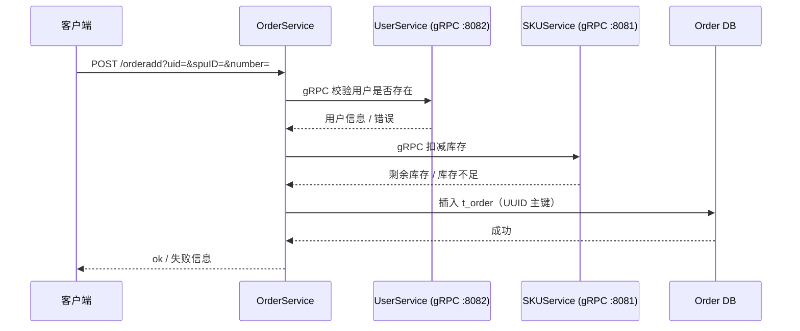

# 22. Go APM 监控系统实战: 订单服务（OrderService）业务逻辑实现

## 纲要

- 下单链路回顾：OrderService 对外暴露 HTTP 接口，对内通过 gRPC 调用 User 与 SKU 服务
- OrderService 启动骨架：初始化 DB、初始化两个 gRPC Client、启动 HTTP Server、调用 `endpoint.Start()`
- 路由设计：新增 `orderadd` 路由，处理函数放在独立的 `api` 包里
- 下单核心步骤：从 URL 取参（uid / spuID / number）→ 校验用户（gRPC）→ 扣减库存（gRPC）→ 落库建单（UUID 主键）
- 失败处理：用 dogAPM 的 `Log` 打印结构化日志，用统一的 HTTP 状态方法回包
- gRPC Client 与用户校验、库存扣减的具体实现，完善，本节约标为 TODO

## 下单链路的职责划分

在动手写之前，先把整个下单流程在脑子里过一遍。请求流向是固定的：



可以看到：OrderService 是**入口**，它向用户暴露 HTTP 接口；而 UserService 和 SKUService 各自只暴露 gRPC 接口，供 OrderService 调用。每个服务都有自己的 DB，互不共享。

## OrderService 的启动骨架

`main` 函数的职责是「把组件都搭起来」，而不是「写业务逻辑」。它要做四件事：

1. 用之前封装好的 `initDB` 初始化订单库；
2. 初始化两个 gRPC Client（用户服务、商品服务）——本节先把它们声明出来，留 TODO；
3. 初始化 HTTP Server，注入处理函数，端口 `:8080`；
4. 调用 dogAPM 的 `endpoint.Start()` 统一拉起、阻塞等待退出。

```go
// orderservice/main.go —— 根据讲稿逻辑补充（gRPC Client 初始化处为 TODO）
package main

import (
	"dogapm"
	"orderservice/api"
)

func main() {
	// 1. 初始化订单库
	dogapm.InitDB("order_service", "user:pass@tcp(127.0.0.1:3306)/order_db")

	// 2. 初始化两个 gRPC Client（用户 / 商品），具体连接逻辑在 client 包实现
	//    client.InitUserClient(dogapm.NewGRPCConn(":8082"))
	//    client.InitSKUClient(dogapm.NewGRPCConn(":8081"))

	// 3. 初始化 HTTP Server 并注入路由
	httpServer, _ := dogapm.NewHTTPServer(":8080")
	httpServer.HandleFunc("/orderadd", api.AddOrder) // 下单路由
	httpServer.HandleFunc("/ping", func(w, r) { w.Write([]byte("ok")) })

	// 4. 统一启动所有已注册组件
	if err := dogapm.Endpoint.Start(); err != nil {
		dogapm.Log.Error(nil, "order", map[string]interface{}{"step": "startup"}, err)
	}
}
```

代码里把 `AddOrder` 收进独立的 `api` 包，是为了让「路由处理函数」和「启动装配」分离——后续所有业务处理函数都放到 `api` 包下，按资源划分文件，例如 `api/order.go`。

## 下单处理函数 AddOrder

`add` 这条路由对应「对订单做增加操作」。它的逻辑非常线性，依次做三件事：取参 → 校验与扣减（本节 TODO）→ 落库建单。

```go
// orderservice/api/order.go —— 根据讲稿逻辑补充
package api

import (
	"net/http"
	"strconv"

	"dogapm"
	"github.com/google/uuid"
)

// AddOrder 处理下单请求
func AddOrder(w http.ResponseWriter, r *http.Request) {
	// 1. 从 URL 路径取参并转换类型
	uid, _ := strconv.Atoi(r.URL.Query().Get("uid"))
	spuID := r.URL.Query().Get("spuID")     // 商品 ID
	number, _ := strconv.Atoi(r.URL.Query().Get("number")) // 购买数量

	// 2. 校验用户信息（gRPC，本节 TODO）
	//    if err := client.CheckUser(uid); err != nil { ... 返回失败 ... }

	// 3. 扣减库存（gRPC，本节 TODO）
	//    price, err := client.DeductStock(spuID, number); ...

	// 4. 落库建单：UUID 作为订单主键
	orderID := uuid.New().String()
	insert := `INSERT INTO t_order (order_id, spu_id, number, price, uid)
	           VALUES (?, ?, ?, ?, ?)`
	err := dogapm.DB.Exec(insert, orderID, spuID, number, 1, uid)
	if err != nil {
		// 用 dogAPM 的统一日志对象打印，action 标记业务场景
		dogapm.Log.Error(r.Context(), "order", map[string]interface{}{
			"action":   "create_order",
			"uid":      uid,
			"spu_id":   spuID,
			"order_id": orderID,
		}, err)
		dogapm.WriteStatus(w, http.StatusInternalServerError, "创建订单失败")
		return
	}

	dogapm.WriteStatus(w, http.StatusOK, "ok")
}
```

几个关键设计点：

- **参数来源**：uid / spuID / number 都从 URL 查询参数取，uid、number 转成 `int`。订单价格本节先占位为 `1`，等 3-15 能从 SKU 服务拿到真实价格后再回填。
- **订单主键**：用 `github.com/google/uuid` 生成随机 UUID，避免自增 ID 暴露订单量。
- **失败回包**：通过 dogAPM 之前定义好的 `WriteStatus` 统一 HTTP 返回格式，不在业务里手写 JSON。
- **日志**：复用 dogAPM 的 `Log` 对象，`action` 字段标记「这是下单场景」，方便按业务维度检索。

## 为什么库存扣减与用户校验先留 TODO

OrderService 调用 User / SKU 服务，前提是这两个服务的 gRPC Server 已经写好、Client 已经能连上。但讲稿的讲述顺序是先写 Order 的骨架，再写 SKU、写 User。所以这里用 TODO 占位，等那两节把对端的 gRPC Server 与本地 Client 都就绪后，再把这两段补全——届时会改成真正发起 gRPC 调用并拿到返回值（如商品价格、校验结果）。

## API 速览

| API | 说明 |
| --- | --- |
| `dogapm.InitDB(ns,dsn)` | 按命名空间初始化 MySQL 连接 |
| `dogapm.NewHTTPServer(addr)` | 创建 HTTP Server 实例 |
| `(*HTTPServer).HandleFunc(path,fn)` | 注册路由处理函数 |
| `dogapm.Endpoint.Start()` | 统一启动所有已注册组件 |
| `uuid.New().String()` | 生成 UUID v4 字符串作为订单主键 |
| `dogapm.Log.Error(ctx,module,fields,err)` | 结构化错误日志 |
| `dogapm.WriteStatus(w,code,msg)` | 统一 HTTP 返回结构 |

## Demo 示例

下面给出一个**单文件可运行**的下单最小实现（根据讲稿逻辑补充），把「取参 → UUID 建单 → 落库 → 回包」这条主线用 SQLite 跑通，gRPC 调用部分以内存校验代替，便于直接验证建单逻辑。

**运行说明**

```bash
mkdir ordersvc-demo && cd ordersvc-demo
go mod init ordersvc-demo
go get github.com/google/uuid modernc.org/sqlite
# 把下方代码保存为 main.go
go run main.go
# 另开终端请求：curl "http://127.0.0.1:8080/orderadd?uid=3&spuID=2&number=1"
```

**代码**

```go
package main

import (
	"database/sql"
	"fmt"
	"net/http"
	"strconv"

	"github.com/google/uuid"
	_ "modernc.org/sqlite"
)

var db *sql.DB

func writeStatus(w http.ResponseWriter, code int, msg string) {
	w.WriteHeader(code)
	fmt.Fprintf(w, `{"code":%d,"msg":"%s"}`+"\n", code, msg)
}

func addOrder(w http.ResponseWriter, r *http.Request) {
	uid, _ := strconv.Atoi(r.URL.Query().Get("uid"))
	spuID := r.URL.Query().Get("spuID")
	number, _ := strconv.Atoi(r.URL.Query().Get("number"))

	// 内存版用户校验：uid>0 视为合法（真实场景走 gRPC 调 UserService）
	if uid <= 0 {
		writeStatus(w, http.StatusBadRequest, "用户不合法")
		return
	}

	orderID := uuid.New().String()
	_, err := db.Exec(
		`INSERT INTO t_order (order_id, spu_id, number, price, uid) VALUES (?,?,?,?,?)`,
		orderID, spuID, number, 1, uid,
	)
	if err != nil {
		writeStatus(w, http.StatusInternalServerError, "创建订单失败")
		return
	}
	writeStatus(w, http.StatusOK, "ok")
}

func main() {
	var err error
	db, err = sql.Open("sqlite", ":memory:")
	if err != nil {
		panic(err)
	}
	_, _ = db.Exec(`CREATE TABLE t_order (order_id TEXT, spu_id TEXT, number INT, price REAL, uid INT)`)

	http.HandleFunc("/orderadd", addOrder)
	http.HandleFunc("/ping", func(w http.ResponseWriter, _ *http.Request) { fmt.Fprintln(w, "ok") })
	fmt.Println("order service on :8080")
	_ = http.ListenAndServe(":8080", nil)
}
```

**代码说明**

- 用 `uuid.New().String()` 生成订单主键，与讲稿一致
- 用户校验用内存判断代替 gRPC，真实实现完善后改为 Client 调用
- `writeStatus` 对应 dogAPM 的 `WriteStatus`，统一回包结构

**技术点总结**

- 入口服务要把「装配」和「业务」分层，路由处理函数集中放 `api` 包
- 下单是典型的多步事务编排：校验 → 扣减 → 建单，任一步失败都要回包并留痕
- 先搭骨架、后置 TODO，再按依赖顺序逐个补全对端服务，是微服务开发的常见节奏

