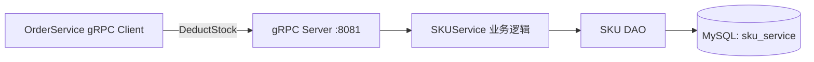

# 23. Go APM 监控系统实战: 商品服务（SKUService）业务逻辑实现

## 纲要

- SKUService 与 OrderService 结构类似：初始化 DB、启动 gRPC Server（`:8081`）、注册处理逻辑
- 用 protobuf 定义 `SKU` 消息与 `DeductStock` 方法，由工具生成 gRPC 骨架
- 单独抽一层 **DAO** 承载所有 SQL：业务层只调 DAO，不直接碰 DB
- DAO 方法第一个参数固定传 `context.Context`，为后续链路追踪埋点透传信息预留
- `getSKU`：用 3-13 的 `QueryOne` 按 ID 查 `t_sku`，返回单行 map
- `deductStock`：执行 `UPDATE ... SET stock = stock - ? WHERE id = ? AND stock - ? >= 0`
- 库存不足时更新影响行数为 0，业务层据此返回「库存不足」
- 用 `cast` 库把 map 里的 `interface{}` 安全转回具体类型

## SKUService 的整体形态

SKUService 是 OrderService 的下游：它只暴露 gRPC 接口，不对外提供 HTTP。核心职责就一个——**管理商品库存**。它的启动骨架与 OrderService 高度对称：



## protobuf 契约

先定义 `SKU` 消息和扣减方法。`SKU` 同时作为「请求参数」和「返回结构」在 Order 与 SKU 两个服务之间传递：

```protobuf
// sku.proto —— 根据讲稿逻辑补充
syntax = "proto3";

package sku;

option go_package = "./skupb";

message SKU {
  string name  = 1; // 商品名称
  int64  id    = 2; // 商品 ID
  double price = 3; // 商品价格
  int64  stock = 4; // 库存数量
}

service SKUService {
  // 扣减库存，返回扣减后的商品信息
  rpc DeductStock(DeductReq) returns (SKU);
}

message DeductReq {
  int64 id     = 1; // 商品 ID
  int64 number = 2; // 扣减数量
}
```

用 `protoc` 生成 `skupb` 包后，在 `main` 里把我们自己实现的 Server 注册进去：

```go
// skuservice/main.go —— 根据讲稿逻辑补充
package main

import (
	"dogapm"
	"skuservice/grpcimpl"
	"skuservice/skupb"
)

func main() {
	dogapm.InitDB("sku_service", "user:pass@tcp(127.0.0.1:3306)/sku_db")

	// 启动 gRPC Server，监听 8081
	grpcServer := dogapm.NewGRPCServer(":8081")

	// 注册我们实现的 SKUService
	skupb.RegisterSKUServiceServer(grpcServer.Server(), &grpcimpl.SKUServer{})

	// 统一启动
	if err := dogapm.Endpoint.Start(); err != nil {
		dogapm.Log.Error(nil, "sku", map[string]interface{}{"step": "startup"}, err)
	}
}
```

## DAO 层：把 SQL 隔离在业务之外

讲稿里特意强调：因为 SKU 服务涉及较多 SQL，所以把 DB 操作单独拆成一层 **DAO（Data Access Object）**。业务层通过 DAO 实例调用 `getSKU` / `deductStock`，完全不感知 SQL 长什么样。

两个 DAO 方法都**把 `context.Context` 作为第一个参数**。原因下面讲链路追踪埋点时再说：监控 DB 这一层时需要拿到从业务层一路透传下来的链路信息（比如 traceID），而 context 正是 Go 里承载这类「随请求流动」数据的标准容器。

```go
// skuservice/dao/sku.go —— 根据讲稿逻辑补充
package dao

import (
	"context"
	"dogapm"
)

// GetSKU 按 ID 查询商品，返回单行 map（无记录时返回 nil）
func GetSKU(ctx context.Context, id int64) (map[string]interface{}, error) {
	rows, err := dogapm.DB.QueryContext(ctx, "SELECT id, name, price, stock FROM t_sku WHERE id = ?", id)
	if err != nil {
		return nil, err
	}
	return dogapm.QueryOne(rows) // 封装的单行查询
}

// DeductStock 扣减库存，条件保证扣减后库存 >= 0
func DeductStock(ctx context.Context, id int64, number int64) error {
	_, err := dogapm.DB.ExecContext(ctx,
		`UPDATE t_sku SET stock = stock - ? WHERE id = ? AND stock - ? >= 0`,
		number, id, number,
	)
	return err
}
```

`DeductStock` 的 SQL 是这一节的精髓：`WHERE id = ? AND stock - ? >= 0` 把「库存是否充足」的判断下推到数据库。如果库存不足，这条 `UPDATE` 匹配不到行，**影响行数为 0**，业务层就能以此判定扣减失败。

## 业务层：调用 DAO 并完成判定

```go
// skuservice/grpcimpl/sku.go —— 根据讲稿逻辑补充
package grpcimpl

import (
	"context"
	"fmt"

	"skuservice/dao"
	"skuservice/skupb"

	"github.com/spf13/cast"
)

type SKUServer struct{}

// DeductStock 实现 gRPC 方法
func (s *SKUServer) DeductStock(ctx context.Context, req *skupb.DeductReq) (*skupb.SKU, error) {
	// 1. 先查商品是否存在
	row, err := dao.GetSKU(ctx, req.Id)
	if err != nil {
		return nil, err
	}
	if row == nil {
		return nil, fmt.Errorf("商品不存在")
	}

	// 2. 扣减库存
	err = dao.DeductStock(ctx, req.Id, req.Number)
	if err != nil {
		return nil, err
	}

	// 3. 用影响行数判断是否库存不足（实际可在 DAO 返回 RowsAffected，这里以再查一次演示）
	after, err := dao.GetSKU(ctx, req.Id)
	if err != nil {
		return nil, err
	}
	left := cast.ToInt64(after["stock"])
	if left < 0 { // 演示用：真实实现应在 DeductStock 返回 RowsAffected==0 时直接报库存不足
		return nil, fmt.Errorf("库存不足")
	}

	// 4. 返回扣减后的商品信息（用 cast 把 map 里的字段转回具体类型）
	return &skupb.SKU{
		Id:    cast.ToInt64(row["id"]),
		Name:  cast.ToString(row["name"]),
		Price: cast.ToFloat64(row["price"]),
		Stock: left,
	}, nil
}
```

讲稿提到的 `cast` 库（GitHub 的 `spf13/cast`）正是用来解决 3-13 里「返回 map 但业务要具体类型」的衔接问题：把 `interface{}` 安全转成 `int64` / `string` / `float64` 等，避免到处写类型断言。

> 更严谨的写法：让 `DeductStock` 返回 `sql.Result`，用 `RowsAffected()` 直接判断——若等于 0 即代表库存不足。上面示例为清晰演示「再查一次」的等价逻辑，生产代码建议直接用 `RowsAffected`。

## 完善 OrderService 的库存扣减调用

SKU 服务就绪后，回过头在 OrderService 里把前述留下的 TODO 补上：声明一个全局 `SKUClient`，用 dogAPM 的 gRPC Client 连到 `:8081`，下单时调用 `DeductStock` 并拿到真实价格回填。

```go
// orderservice/client/sku.go —— 根据讲稿逻辑补充
package client

import (
	"skuservice/skupb"

	"dogapm"
)

var SKUClient skupb.SKUServiceClient

// InitSKUClient 用 gRPC 连接初始化商品服务客户端（端口 8081）
func InitSKUClient(conn *dogapm.GRPCConn) {
	SKUClient = skupb.NewSKUServiceClient(conn.Channel())
}
```

至此，「下单 → 扣库存」这条链路在代码层面闭合，价格字段也能从 SKU 服务的返回值回填，而不再是占位 `1`。

## API 速览

| API | 说明 |
| --- | --- |
| `dao.GetSKU(ctx,id)` | 按 ID 查商品，返回单行 map |
| `dao.DeductStock(ctx,id,n)` | 扣减库存，SQL 内保证扣减后非负 |
| `skupb.RegisterSKUServiceServer` | 注册自实现的 SKU gRPC Server |
| `(*sql.DB).ExecContext` | 带 context 执行写操作，便于透传链路信息 |
| `cast.ToInt64 / ToString / ToFloat64` | 把 `interface{}` 安全转具体类型 |

## Demo 示例

下面给出一个**单文件可运行**的库存扣减演示（根据讲稿逻辑补充），用 SQLite 验证「库存充足则成功、不足则影响行数为 0」的核心判定。

**运行说明**

```bash
mkdir skudao-demo && cd skudao-demo
go mod init skudao-demo
go get modernc.org/sqlite github.com/spf13/cast
# 把下方代码保存为 main.go
go run main.go
```

**代码**

```go
package main

import (
	"database/sql"
	"errors"
	"fmt"

	"github.com/spf13/cast"
	_ "modernc.org/sqlite"
)

var db *sql.DB

// deductStock 扣减库存，返回影响行数；行数为 0 代表库存不足
func deductStock(id, number int64) (int64, error) {
	res, err := db.Exec(
		`UPDATE t_sku SET stock = stock - ? WHERE id = ? AND stock - ? >= 0`,
		number, id, number,
	)
	if err != nil {
		return 0, err
	}
	n, _ := res.RowsAffected()
	return n, nil
}

// getSKU 按 ID 查商品
func getSKU(id int64) (map[string]interface{}, error) {
	row := db.QueryRow(`SELECT id, name, price, stock FROM t_sku WHERE id = ?`, id)
	var idv int64
	var name string
	var price float64
	var stock int64
	if err := row.Scan(&idv, &name, &price, &stock); err != nil {
		if errors.Is(err, sql.ErrNoRows) {
			return nil, nil
		}
		return nil, err
	}
	return map[string]interface{}{"id": idv, "name": name, "price": price, "stock": stock}, nil
}

func main() {
	var err error
	db, err = sql.Open("sqlite", ":memory:")
	if err != nil {
		panic(err)
	}
	_, _ = db.Exec(`CREATE TABLE t_sku (id INT, name TEXT, price REAL, stock INT)`)
	_, _ = db.Exec(`INSERT INTO t_sku VALUES (2, 'SKUtest', 9.9, 90)`)

	// 扣 10 件：成功
	n, _ := deductStock(2, 10)
	fmt.Println("扣减10件 影响行数:", n) // 1

	// 再扣 100 件：库存只剩 80，不足，影响行数 0
	n, _ = deductStock(2, 100)
	fmt.Println("扣减100件 影响行数:", n, "-> 库存不足") // 0

	after, _ := getSKU(2)
	fmt.Println("剩余库存:", cast.ToInt64(after["stock"])) // 80
}
```

**代码说明**

- `WHERE stock - ? >= 0` 是库存安全的兜底，避免超卖
- 用 `RowsAffected()` 直接判断扣减是否生效，比再查一次更省一次 IO
- `cast.ToInt64` 演示了从查询字段转回具体类型的用法

**技术点总结**

- DAO 层隔离 SQL，业务层只关心「做什么」不关心「怎么查」
- Context 作为 DAO 首参，是后续链路追踪透传埋点的标准姿势
- 「库存充足」的下推判定 + 影响行数判断，是防超卖的可靠组合

