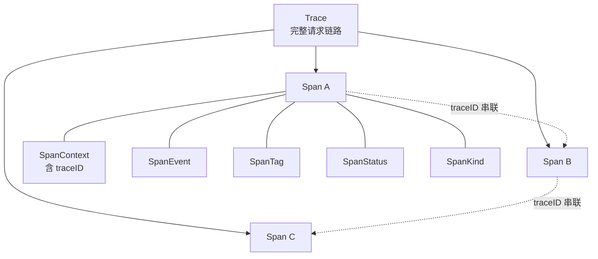
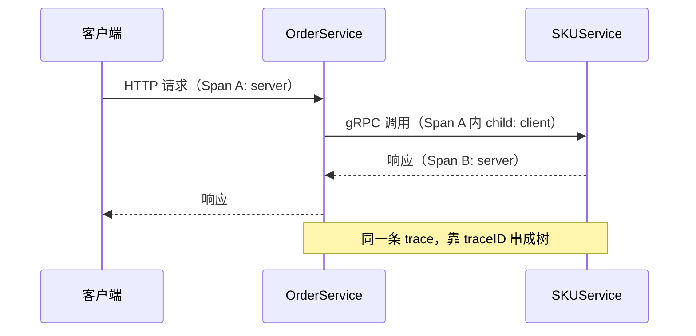
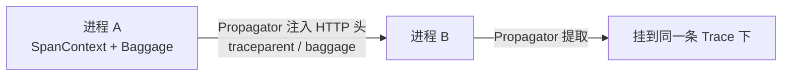

# 26. Go APM 监控系统实战: 链路追踪基本概念（Trace / Span / Baggage / Propagator）

## 纲要

- `Trace`：一次完整请求链路，也可指组件内的一条完整链路
- `Span`：链路中的一个小阶段，是链路追踪的基本单位
- `SpanContext`：跨进程串联所需的上下文，核心是全局唯一的 `traceID`
- `SpanEvent`：Span 内某个时间点的事件，可记录堆栈与时间戳
- `SpanTag`：给 Span 打的键值对属性，用于标记维度
- `SpanStatus`：OpenTelemetry 规范里的状态（如 error），含 `status.code` 与 `description`
- `SpanKind`：Span 的类型（client / server / producer / consumer / internal）
- `Baggage`：随上下文跨进程传递的自定义业务键值对，W3C 规定了其封装与解析格式
- `Propagator`：负责跨进程注入 / 提取 `SpanContext` 与 `Baggage` 的传播器，遵循 W3C 规范
- 并非所有 SDK 都遵循 W3C：Zipkin 自成一套，OpenTelemetry SDK 完全遵循

## 为什么先统一术语

无论你用的是 OpenTracing、OpenTelemetry，还是其他链路追踪框架，它们对核心概念的定义高度相似。OpenTelemetry 官网的 *Traces* 部分、OpenTracing 的 *Concepts* 部分，都把下面这些概念讲清楚了。先把这套语言对齐，后面读任何框架文档都不会再模糊。



## Trace 与 Span

- **Trace**：一条完整的请求链路。对 OpenTelemetry SDK 客户端而言，它通过 `TracerProvider` 实例化出一个 `Tracer`，再创建 `trace` 对象——此时这个 trace 对象指的就是「某个组件内的一条完整链路」。
- **Span**：链路追踪里的一个小阶段。它是链路追踪最基本、几乎所有框架都会提到的单位。一个 Trace 由一棵 Span 树组成，每个 Span 有自己的起止时间和属性。下面的图（Jaeger 展示）里整条链路包含 2 个 Span，每个 Span 都有自己的属性、开始时间和持续时间。



## SpanContext：跨进程串联的关键

要把不同进程之间的 Span 串成一条统一链路，就必须传递上下文信息，这就是 `SpanContext`。它最核心的字段是 **`traceID`**——一个能唯一标记整条请求链路的 ID。

只要下游服务收到的请求里带着同一个 `traceID`，它新创建的 Span 就会被挂到同一条 Trace 下，最终在界面上拼出完整调用链。

## SpanEvent：时间点事件

`SpanEvent`（在部分规范里也叫「给 Span 打 log」）记录的是 Span 内某个**特定时间点的事件**。因为是时间点，它可以记录当时的堆栈、时间戳等。在 OpenTelemetry SDK 里，你可以这样为 Span 记录一个事件：

```go
// 根据讲稿逻辑补充（OpenTelemetry SDK 用法示意）
import "go.opentelemetry.io/otel/trace"

// 在某个 Span 内记录一个时间点事件
span.AddEvent("cache.miss", trace.WithAttributes(
	attribute.String("key", "user:3"),
))
```

## SpanTag：键值属性

Span 是一个小阶段，你可以为它设置一组**键值对**来标记属性，这就是 `SpanTag`。例如给 Span 打上 `http.method=GET`、`db.statement=SELECT ...`，后续就能按这些维度筛选和聚合。

## SpanStatus 与 SpanKind

这两个都出自 **OpenTelemetry** 规范（OpenTracing 规范里没有），本质上也都是给 Span 打标签：

- **SpanStatus**：为 Span 设置状态。最典型的是把某个 Span 标记为 `error` 时，要求同时携带错误描述。OpenTelemetry 会为它设置几个属性：
 - `error = true`
 - `status.code = ERROR`
 - `status.description = <失败描述>`（如 `fail`）

 Jaeger 在展示时识别到 `error=true` 这个键，就会给该 Span 打上一个醒目的感叹号标记。

  ```go
  // 根据讲稿逻辑补充
  import "go.opentelemetry.io/otel/codes"

  span.SetStatus(codes.Error, "fail") // 标记 Span 出错并附带描述
  ```

- **SpanKind**：为 Span 设置类型，说明它是客户端、服务端、生产者还是消费者。如果不设置，默认是 `internal`。它和 `SpanStatus` 一样不是必须的，但能让 Span 之间的关系和界面展示更清晰。

## Baggage 与 Propagator

- **Baggage（行李）**：当「前一个进程想顺带传一些自定义信息给后一个进程」时，希望这些信息**随着 `SpanContext` 一起跨进程传递**。Baggage 就是装这些自定义键值对的「包裹」，内容由程序自己定义。早期链路追踪技术并没有规定 Baggage 怎么封装和解析，于是各家框架各搞一套。后来 **W3C** 统一了 Baggage 的传输格式——只要客户端和服务端都遵循 W3C，即便用了不同的链路追踪组件，也能解析出彼此的 Baggage。
- **Propagator（传播器）**：负责把 `SpanContext`（含 `traceID`）和 `Baggage` **注入**到向下游发出的请求里，也负责从上游发来的请求里**提取**这些数据。W3C 不仅规定了 Baggage 的格式，也规定了 `SpanContext` 应该通过哪些 **HTTP 头部**传递（比如 `traceparent`、`baggage`），对端再从对应头部解析。OpenTelemetry SDK 里的 Propagator，就是对 W3C 这套 `SpanContext` + `Baggage` 协议的具体封装与解析实现。



## 注意：并非所有 SDK 都遵循 W3C

- **Zipkin** 出现较早，当时 W3C 规范还没成型，它的客户端 SDK 用的是自己的一套 trace 数据封装体系。
- **OpenTelemetry SDK** 则完全遵循 W3C 协议。

两者都有「传播器」这个概念，只是各自遵循的协议不同。这也是为什么在跨语言、跨框架的链路追踪落地中，统一到 OpenTelemetry + W3C 能省掉大量适配成本。

